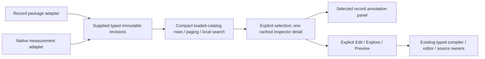

# Compact definition libraries

The first B1 slice adopts one supplied-data presenter in the record telemetry-package
and native measurement catalogs on Definitions. Each compact row retains its exact
revision; selecting it opens one detail with explicit Edit/Explore or Preview actions.
Selection itself does not validate, execute telemetry, publish annotations or replace
the package editor draft. Native Preview retains its existing source-free compiler
step; record Explore retains its existing explicit execution contract.

The application adapters own list requests, refresh generations, authoring and
execution. `GooDefinitionLibrary` owns only loaded-row paging/search and the shared
inspector. There are 25 displayed rows per page; search covers the loaded catalog,
not a global index or all evidence. Its pure page model preserves order, exact IDs,
missing matches and typed record/measurement identity without merging titles/names.
Native and record refreshes reject older responses. A failed refresh retains old
rows and the selected detail, with an unavailable notice.

Only the selected record revision has an attached annotation panel. The existing
inspector caches up to 32 visited details in this tab, so switching revisions can
restore an unsaved annotation draft. Filtering/paging does not silently change the
selected target; a notice identifies an out-of-page/filter selection. Close returns
focus to its row when that row is available. This cache is not durable draft recovery;
eviction/reload loses local drafts. Annotation history, explicit parallel heads,
pinned old revisions and native retry/await-token semantics remain in their existing
owners. No new retention or review semantics are introduced.

Journey 110 creates unrelated same-title record/native definitions through the real
Go APIs. It checks exact selection, one attached annotation panel, editor and
annotation-draft preservation, no source/publication reads on selection, mobile
containment and a delayed real catalog response overtaken by a newer refresh.
Journeys 40 and 98 protect native continuation and existing annotation branches/
history. The library Bombadil campaign inspects, filters and pages without execution.
Hegel generates loaded catalogs/pages to protect exact identity, complete paging,
literal search and non-mutation. Existing annotation Quint ledgers protect unchanged
publication semantics; the DOM composition is not exhaustively modeled.

B1 remains open: the fixed-editor reusable-question list is a named remaining
consumer of the older card composition. Compatible document/retained catalogs,
selected contextual editors and touched retention-owner separation remain subsequent
B1 cuts. Backend catalogs still return their existing revision arrays; this slice
adds no server cursor, family/lineage API, inferred head, global search or store migration.
