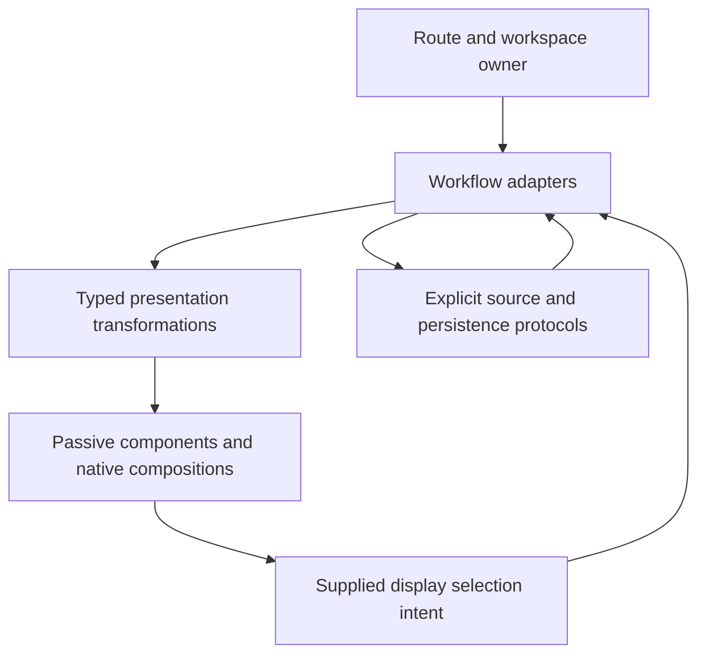

# Design and UI refactoring review

Prepared 2026-10-22 after the [implementation proposal](PRODUCT_IMPLEMENTATION_PROPOSAL.md).
**Recommendations for review, not approved implementation.** This is a source and
documentation review of the whole product, including the in-flight retained
evidence catalog/citation/retry work. It adds no runtime changes and does not
claim a fresh browser usability campaign. The latest live observations and their
limits remain in [the usability review](WHOLE_PRODUCT_USABILITY_REVIEW.md).
The companion [architecture review](ARCHITECTURE_REFACTORING_REVIEW.md) covers
backend and protocol layering; the two reviews recommend incremental adoption,
not a combined rewrite.

The highest-value refactor is to separate **workflow ownership from display
composition**. Goo already has the essential visual primitives. Its remaining
inconsistency comes mainly from mounting whole workflows inside other workflows,
then hiding their extra chrome, and from presenting every stored revision as a
complete card. Another chart framework or universal card would not resolve that.

## Reconcile earlier recommendations first

The [component sweep](WHOLE_PRODUCT_COMPONENT_SWEEP.md) correctly identified scope,
selection and continuation as common concerns. Its proposed evidence summary and
selected-item helper now exist: `goo-evidence-summary`, `GooEvidenceScope` and
`GooUI.inspector` are implemented. Tables, attributes, facets, waterfalls,
heatmaps and chart frames also exist. Reuse them; do not reopen their initial
extraction as new projects. Shared-scale grouped charts exist locally in
`grouped-time-series.js`; the remaining opportunity is a reusable composition and
adoption, not the invention of small multiples.

The current retention round already adds exact pinned-review citations, a native
catalog, and explicit native retry recovery. These should join existing evidence
and narrative workflows. Do not create another permanent navigation destination
or generalize the native-only journal into a promise that all drafts survive.

## Concrete opportunities

| Priority | Code-backed finding | Proposed change and boundary | User-visible result |
| --- | --- | --- | --- |
| P1 | `workspace.js:mount/navigate` reparents the live `#operations` element into `savedEvidenceHost` for investigations. | Give live Operations and stored operation receipts distinct compositions. Keep a read-only receipt presenter reusable in Saved; retain existing routes and explicit continuation to live work. | Saved investigations consistently means preserved work; switching to it no longer exposes an unrelated live editor. |
| P1 | `population-workspace.js` composes `GooDistributions`, while `product.css` selectors under `.population-breakdown` hide its count, chart, latency and Records controls. Recent activity adds another layer of `.recent-mode` and `.recent-canvas` overrides. | Extract the existing facet/breakdown/comparison body from its enclosing result workspace. Let the owner explicitly compose records, facets and charts once. Start with a named, small adapter option or separate renderer; avoid a large matrix of flags. | One count/scope/primary action region; mobile facets can disclose beside results instead of forcing the entire nested workflow ahead of them. |
| P1 | `documents.js:questionEvidence/evidenceSummary` still manually assembles record population, UTC window, read/custody and caveat paragraphs. Measurement entries already use `GooEvidenceScope.measurement`. `evidence-scope.js` exports measurement/service-widget/comparison-side transformations. | Add a bounded record/capture presentation transformation beside existing scope adapters, then adopt it in documents and captures. Keep receipt parsing and clock selection in adapters; the element receives display facts. | Compact consistent evidence headers with exact details available once, while decisive changed-read/coverage warnings stay visible. |
| P1 | `telemetry-packages.js:refresh`, `exploration.js:renderQuestions`, `measurements.js:renderCatalog`, and `documents.js:renderLibrary` each construct their own searchable catalog cards. Package refresh eagerly mounts a meaning panel for every revision. | Share native catalog-row structure, search-count wording, compact metadata and action placement. Each catalog supplies identity, revision/family policy and callbacks. Group history only where a real definition family is established; retain parallel heads rather than inventing latest. Mount richer review detail for the selected entry. | A definition can be recognized and opened without scrolling past repeated full revision cards. History remains explicit and accessible. |
| P2 | `evidence-comparison.js`, `fresh-comparison.js`, `live-comparison.js` and `distributions.js` own different two-sided controls and scope/result presentation. `GooEvidenceScope.comparisonSide` and shared metric geometry already cover part of this. | Share a presentation composition: two named evidence sides, compatibility/result state, paired plots/table and caller-owned actions. Keep stored comparisons, rereads, rolling subscriptions, baseline pinning and publication in their existing typed adapters. | Baseline/current can be visually scanned across surfaces without implying equal windows, shared snapshots or compatible units. |
| P2 | `GooUI.inspector` in `components.js` already preserves caller content, opener and scroll, and is adopted by `exploration.js` and `measurements.js`. Other continuations retain their own close/context behavior. | Complete adoption where the identity and lifecycle contract fits. Standardize compact identity → value/state → continuation → attributes. Keep fresh trace/log context reads named and separate from local inspection. | One predictable detail location and keyboard return pattern, without turning Inspect into a hidden source read. |
| P2 | `grouped-time-series.js:draw` builds local `.time-bars`, native buttons, axes and selection text while other count plots use passive elements. | Extract only compatible count-series display first; supply the shared domain and opaque selection keys. Keep duration, signed numeric magnitudes and rates behind their typed geometry contracts until explicitly supported. | Common chart scale, readable ticks and consistent selection presentation without silently changing measure semantics. |
| P2 | Qualified field names and presence labels are assembled in `population-workspace.js`, `grouped-time-series.js`, `distributions.js`, package handoff and document population text. | Introduce a small application presentation helper for qualified field labels and missing/present-empty values. Keep predicates, selector budgets and source mappings outside it. Adopt in applied chips and definition summaries first. | The same field keeps its name and namespace across selection, authoring and saved evidence. |
| P2 | `product.css` repeats `.dashboard-grid`, `.dashboard-widget`, `.population-workspace` and mobile overrides, including broad `!important` reductions and selectors that reach into nested adapters. | Consolidate rules by owning composition after its layout changes. Keep reusable visual styles with elements, page layout with the application, and explicit density variants rather than repeated specificity fixes. | Compactness becomes a stable default rather than a series of local shrinking patches. Nested and standalone components remain usable. |

These are adoption and ownership findings, not assertions that the current
implementations are incorrect. The current native catalog's expanded mobile
containment fix and its release checks are being completed separately; this review
does not claim their validation. Consult [VALIDATION.md](../VALIDATION.md) for the
final delivered status.

## A small ownership model

- **Route/workspace owner:** which workflow is active, retained parent/child
  navigation, focus and continuation. It should not relocate a live editor into a
  saved library simply because both once shared markup.
- **Workflow adapters:** applied versus staged question, source generations,
  subscriptions, selection identity, draft context and publication. Existing
  `population-workspace`, `documents`, `tail` and measurement adapters stay here.
- **Typed presentation transformations:** qualified labels, supplied scope facts,
  human-readable UTC timestamps, exact-value disclosures and compatible display
  shapes. Extend existing `evidence-scope`, service identity and attribute adapters
  instead of teaching components to infer telemetry semantics.
- **Passive display:** the current web components plus small native composition
  helpers. They accept supplied attributes/properties and retain the documented
  no-fetch/no-navigation/no-publication boundary.
- **Protocols:** request identity, read basis, cursor semantics and durable state
  remain application/service contracts. A shared button or status strip does not
  decide whether Capture rereads or Retain copies held observations.

Do not create a global mutable UI store as the prerequisite. Similar-looking
`generation`, `busy` and `contextToken` variables protect different read/draft
boundaries. Extract a cancellation/owner utility only after two actual workflows
demonstrate identical transitions; preserve domain-specific guards and tests.
Likewise, duplicated short `node()` helpers are lower priority than duplicated
workflow chrome. Normalize them opportunistically when touching an owner, not in
a large churn-only change.

## Composition contracts worth standardizing

1. **Applied scope and result actions:** a compact native strip with caller-supplied
   scope, explicit staged changes, decisive result state and primary/secondary
   actions. General provenance can disclose, but incompatible/partial/gap state
   must not disappear into details. Start as an application helper, not a new
   query-aware element.
2. **Revision-aware library row:** title, kind/scope, revision identity/status,
   primary open/use action and secondary history/review action. Local page search
   must identify its bounds. Native retained search and file metadata keep their
   different query clocks and authoritative stores even if the row layout matches.
3. **Selected evidence region:** identity and scope above one caller-owned body,
   with close/return and explicit continuation. A frozen citation pins its exact
   review/read basis; a live tail keeps its independent follow/gap state.
4. **Two-sided comparison:** consistent labels, one compatibility explanation,
   supplied common geometry where valid, exact table fallback otherwise. Common
   appearance is not proof of semantic comparability.

Avoid a public `goo-investigation-app`, `goo-live-dashboard` or universal datagrid
that owns storage and fetching. A native helper is enough until two adopted
surfaces prove a stable passive contract. The existing framework-neutral
server-HTML and pre-definition SPA property interfaces remain acceptance criteria.

## Incremental delivery and checks

**Round A — compact Explore composition.** Align with proposal milestone 1.
Separate the reused distribution body from its surrounding workspace, then reduce
duplicate scope/actions and disclose mobile facets. Preserve current behavior
before removing hidden old markup. Check representative desktop/mobile first
visual/record positions, keyboard traversal, touch scroll versus selection,
staged/applied distinction, unknown states and actual source-request counts.

**Round B — saved/live boundary and evidence presentation.** Align with milestone
2. Extract the read-only operation receipt composition and adopt record evidence
summaries in linked questions/captures. Keep old hashes and deep links; test dirty
draft return, expired held pages, source-free reopen and pinned old review after a
later correction. The retained journal stays native-only in wording and behavior.

**Round C — library composition.** Align with milestone 3. Share rows first across
record and native measurement definitions, then selectively apply to documents
and retained evidence. Test duplicate titles, real revision families, branching,
missing/present-empty identity, local search versus server catalog filters,
pagination and delayed responses. Selecting an entry must not run a query.

**Round D — comparison and detail adoption.** Align with milestone 4. Share the
two-sided shell and finish inspector adoption; introduce the count small-multiple
composition only if it reduces real duplication. Test known-to-unknown selection,
changed layouts, focus after local update, large exact values, explicit common
domains and fallback tables. Keep live comparison windows independently named.

For each round, regenerate affected real-OTLP storyboard frames and update
Bombadil actions/invariants alongside new controls. Standalone SSR/SPA component
journeys should continue asserting zero app/API reads, safe text, detached data,
pre-definition upgrade, reconnect and nested mobile containment. Hegel should
cover meaningful owner transitions; Quint observed traces should retain rejecting
controls for unexpected reads/publications and identity drift. Layout-only changes
need browser evidence, not semantic tests mirroring CSS. Browser keyboard checks
are not a substitute for assistive-technology validation of mobile table layouts.

The acceptance criterion is fewer places to make the same decision and less
travel to useful evidence, while preserving explicit scope, identity, clocks and
uncertainty. No broad framework migration or new persistence model is necessary.
