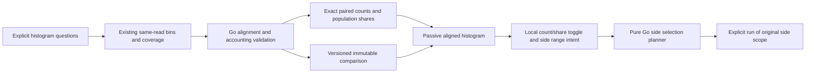

# Aligned numeric distribution comparisons

Implementation in progress. This extends the existing numeric baseline flow with
exact aligned integer histograms. No new binning policy, numeric type inference,
query language or automatic source subscription is introduced.

## Exact meaning

Both source questions opt into the existing powers-of-two histogram and declare
the same numeric field namespace/key, int64/uint64 type, unit and canonical parsing
policy. Go validates the full 65/128-bin schema and each histogram's count sum
against numeric coverage before comparing it. Bins are aligned by exact derived
half-open boundaries; data is not rebinned or reconstructed from inspection rows.

Counts are exact integer strings. Population shares are exact rational percentages
with **all matching records** as the denominator, rather than only valid values.
Bin shares therefore need not sum to 100%. Valid/missing/empty/invalid coverage
stays visible. Counts and population share use a common scale across both sides;
these unequal numeric ranges are categorical buckets, not a linear density axis.
Only the common outer zero extent may be cropped, using the union of both sides;
internal gaps and original global bin keys remain aligned.

Present empty histograms with record count zero have known zero bin counts but
undefined shares. Present all-invalid populations with positive record count have
known zero bin shares and explicit excluded coverage. Missing histogram evidence
is an error/unavailable capability, not a zero-filled distribution. Changed source
reads withhold share/difference claims and disable range execution. No percentile
averaging, completeness or causal/statistical significance is inferred.

## Explicit intent and immutable evidence

`POST /compare` adds `distribution: true`, requiring `numeric: true` and both full
histogram payloads. Legacy count/numeric requests omit the new flag and payload;
older saved comparison requests continue to recompute identically. New captured
comparison questions persist the explicit distribution flag. Refresh preserves
that intent rather than inferring it from a histogram-shaped numeric question.

Stored capture comparison uses a separate explicit distribution request and v5
receipt algorithm. Existing frozen v1–v4 decisions are not reinterpreted. Reusable
exploration views may retain distribution comparison intent with their numeric
binding, histogram requests and baseline questions. The local count/share toggle
is display state and does not trigger a source read.

## Interaction

The existing comparison actions offer **Compare distributions** when both supplied
histograms are available. Baseline/selection panels have identical bin positions
and count/share scales, with familiar side colors and independent scope/read
context. Coverage and exact bins remain inspectable. Mobile keeps both sides
accessible and avoids clipping data inside a fixed-height comparison panel.

Mouse or keyboard range selection stages a side and global bin indices without
reading sources or planning queries. The pure Go comparison-selection planner
validates the full comparison, chooses the requested side's original question and
derives exact typed predicates. Explicit Run opens that side's records; the other
side's selector/window is never silently substituted. Empty ranges and unknown
reads cannot be executed. Pending plans are canceled on mode change, new selection,
draft change, navigation and replacement; retained return permits new gestures.

Live comparisons and range execution support zero or one categorical breakdown.
Existing two-field stored captures can display paired distributions, with range
execution explicitly unavailable until grouping is edited. No grouping is silently
added or discarded. Native histogram layout alignment/rebinning is separate.

## Review gates

DC1: exact validation/comparison, side selection, legacy preservation and stored
intent/versioning; Go tests plus independent properties and architecture review.

DC2: reusable passive aligned display and existing live/stored/view owners, exact
count/share toggles, readable mobile pairs and cancellation; component/protocol
checks and independent UI review.

DC3: ordinary OTel shape-change storyboards, actual side drilldowns and capture/
view reopen, model trace/rejection controls and Bombadil; final review, commit/push.
