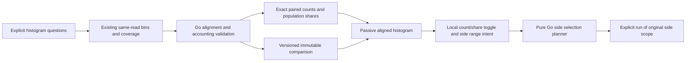
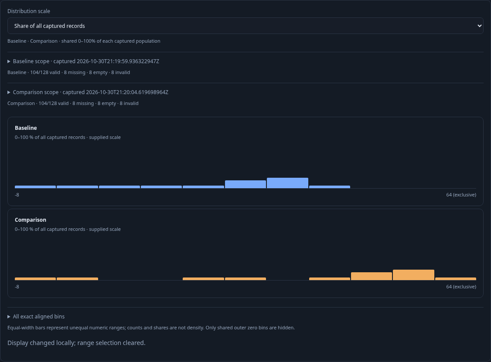
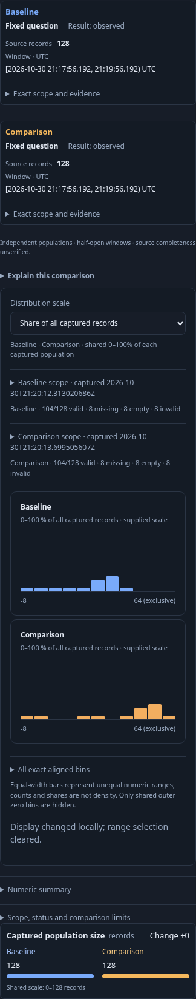
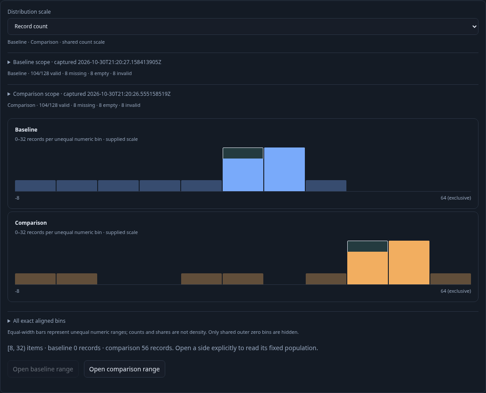

# Aligned numeric distribution comparisons

270 adopts [canonical independent histogram operands](SCOPED_HISTOGRAM_COMPARISONS.md)
for the shared display and side planners. Captured-record shares retain the
denominator described below; valid-value share is a separate explicit scale.
The component now accepts `.comparison` and `.display`, with immutable scope,
support and clock facts. Deferred side loads must match the displayed content.

Implemented and independently reviewed. This extends the existing numeric baseline flow with
exact aligned numeric histograms. No new binning policy, numeric type inference,
query language or automatic source subscription is introduced.

## Exact meaning

Both source questions opt into the existing powers-of-two histogram and declare
the same numeric field namespace/key, int64/uint64/decimal64 type, explicit decimal
scale, unit and canonical parsing policy. Go validates the full 65/128-bin schema and each histogram's count sum
against numeric coverage before comparing it. Bins are aligned by exact derived
half-open boundaries; data is not rebinned or reconstructed from inspection rows.

Counts are exact integer strings. Population shares are exact rational percentages
with **all matching records** as the denominator, rather than only valid values.
Bin shares therefore need not sum to 100%. Valid/missing/empty/invalid coverage
stays visible. Counts and population share use a common scale across both sides;
these unequal numeric ranges are categorical buckets, not a linear density axis.
Only the common outer zero extent may be cropped, using the union of both sides;
internal gaps and original global bin keys remain aligned.

Present empty histograms with record count zero have known zero bin counts but
undefined shares. Present all-invalid populations with positive record count have
known zero bin shares and explicit excluded coverage. Missing histogram evidence
is an error/unavailable capability, not a zero-filled distribution. Changed source
reads withhold share/difference claims and disable range execution. No percentile
averaging, completeness or causal/statistical significance is inferred.

## Explicit intent and immutable evidence

`POST /compare` adds `distribution: true`, requiring `numeric: true` and both full
histogram payloads. Legacy count/numeric requests omit the new flag and payload;
older saved comparison requests continue to recompute identically. New captured
comparison questions persist the explicit distribution flag. Refresh preserves
that intent rather than inferring it from a histogram-shaped numeric question.

Stored capture comparison uses a separate explicit distribution request and v5
receipt algorithm. Existing frozen v1–v4 decisions are not reinterpreted. Reusable
exploration views may retain distribution comparison intent with their numeric
binding, histogram requests and baseline questions. The local count/share toggle
is display state and does not trigger a source read.

## Interaction

The existing comparison actions offer **Compare distributions** when both supplied
histograms are available. Baseline/selection panels have identical bin positions
and count/share scales, with familiar side colors and independent scope/read
context. Coverage and exact bins remain inspectable. Mobile keeps both sides
accessible and avoids clipping data inside a fixed-height comparison panel.

Mouse or keyboard range selection stages a side and global bin indices without
reading sources or planning queries. The pure Go comparison-selection planner
validates the full comparison, chooses the requested side's original question and
derives exact typed predicates. In the population workspace, Open range stages a child without a source read;
its explicit Run opens that side's records. Fixed/captured question continuations
use their existing explicit-open behavior. The other
side's selector/window is never silently substituted. Empty ranges and unknown
reads cannot be executed. Pending plans are canceled on mode change, new selection,
draft change, navigation and replacement; retained return permits new gestures.

Live comparisons and range execution support zero or one categorical breakdown.
Existing two-field stored captures can display paired distributions, with range
execution explicitly unavailable until grouping is edited. No grouping is silently
added or discarded. Native histogram layout alignment/rebinning is separate.

## Delivered review gates

DC1: exact validation/comparison, side selection, legacy preservation and stored
intent/versioning; Go tests plus independent properties and architecture review.

DC2: reusable passive aligned display and existing live/stored/view owners, exact
count/share toggles, readable mobile pairs and cancellation; component/protocol
checks and independent UI review.

DC3: ordinary OTel shape-change storyboards, actual side drilldowns and capture/
view reopen, model trace/rejection controls and Bombadil; final review, commit/push.

## Storyboard 176 — isolate a changed shape

Executable [live journey](../journeys/distribution-comparisons.spec.js) uses ordinary
OTel spans/logs with compact numeric ranges so the two shapes are visibly distinct.
A separate resource attribute exercises integer extremes and parsing boundaries.

1. Enable the existing numeric histogram, Run baseline and pin its distribution.
   Change the population and Run; Compare distributions opts into aligned counts
   and all-record shares. Toggling the scale is local, with explicit excluded
   coverage and an inspectable exact-bin table.
2. Capture and reload the explicit distribution comparison without source reads.
   A reusable view retains both independently fixed questions and distribution
   intent; reopening stages configuration and Run reads both sides explicitly.
3. Keyboard selection on the baseline chart stages global bounds. Open baseline
   range asks Go for a checked plan and stages the existing child workspace.
   Run reads the baseline's original selector/window narrowed to that range.
   Back restores the parent without reading it again.
4. Pointer selection on the comparison chart follows the same flow using the
   comparison side's distinct selector/window. Neither side's question is swapped
   or rounded. Empty/unknown populations and invalid comparison payloads refuse
   execution; all-invalid positive populations retain known zero shares.
5. New v5 stored-evidence receipts freeze explicit distribution meaning; v4 numeric
   decisions and older general captures retain their original output. Aggregate-only
   comparisons work without fabricated categorical groups.
6. A separate journey delays a real planner response, leaves the owner and returns.
   The old plan cannot create a child or read telemetry; a new range can stage and
   Run explicitly. A separate synthetic passive-component journey verifies SSR,
   detached SPA properties, retained gestures and mobile layout without telemetry.

DC1 `07a6fa9` and DC2 `aa96720` are committed. Actual source, model, actor and
final display evidence is recorded in [VALIDATION.md](../VALIDATION.md).

[Fixed-scale decimals](FIXED_SCALE_DECIMALS.md) retain integer coefficient bounds
and exact bin counts. Human labels apply declared scale; the same coefficient
geometry at a different scale is a different measurement, so comparison never
implicitly rescales or rebins it.
