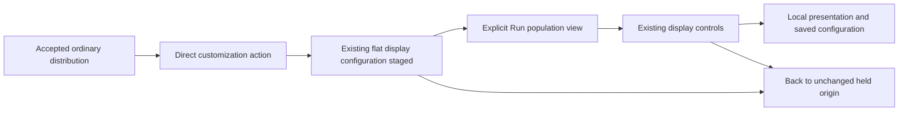

# Customize an accepted distribution

Milestone 394 count customization and milestone 397 quantitative customization are delivered;
[validation](../VALIDATION.md) records executed checks. The
[active roadmap](ROADMAP_2026_11_10_CHECKPOINT_396.md) defines this finite cut.

An accepted ordinary log/span count, numeric or span-duration breakdown leads directly to the existing
[population workspace](POPULATION_WORKSPACE.md) and its
[display controls and Preserve](SAVED_DISPLAY_DECLARATIONS.md). Use **Customize distribution** after the visual instead of inspecting a
record merely to reach the same scoped display editor. This continuation adds no
query engine, renderer, view store or second population owner.

## Finite admission

The profile accepts one ordinary qualified grouping, logs or spans, observed
nonempty evidence and the full canonical ranked source groups. Bar and Table
support captured count; numeric mean, sum, minimum and maximum; and span-duration
mean, minimum, maximum, p50, p95 and p99 when supplied by the query. Offset must be
zero; a nondefault limit is retained exactly. The current selected measure and
presentation are preserved, never silently converted to count. Numeric field,
type, scale, literal unit and parse policy remain part of the complete question.
Only count has population-share scale. Quantitative bars use the full-population
maximum magnitude; local Find does not redefine it. Invalid, empty and missing
numeric support remain separate; no valid values means unavailable arithmetic,
not zero. Duration percentiles remain group summaries, never fleet percentiles.
The originating result and its complete question must remain current and accepted.

Status summaries, reported-edge scopes,
grouped-time queries, numeric histograms and derived pattern profiles do not
acquire this continuation merely because they draw bars. Existing specialized
workflows remain available. Changed-between-read evidence cannot attest a complete
partition or acquire unsupported population shares or drill authority.

## Stage the question, then Run

The continuation preserves the exact source question: signal, complete typed
predicate tree, environment policy, fixed half-open bounds, qualified grouping,
measures and paging. Missing keys and present-empty values remain distinct. It
must not silently compose a broader companion or normalize away source scope.

Opening stages the existing flat saved-view configuration, with the authored
Bar/Table declaration in `displays[signal]`, without reading telemetry. It does
not create a composition or another population editor. The existing Run action is explicit. The distribution's accepted dataset is not
relabeled as newly read workspace evidence; the population workspace owns its own
accepted results and display controls. Existing saved display
reuse keeps the destination's complete question, not the origin's source authority.

Back restores the held origin without a source read. Returning does not revive
retired source acquisition or publication capabilities. Hidden, inert, superseded
or pending owners cannot stage through a stale callback. Failed replacement keeps
its own status distinct from any prior accepted evidence still retained.

## Acceptance boundary

Actual ordinary OTel log and span journeys must demonstrate the direct action,
exact staged questions, explicit execution and source-free held Back. Local
presentation, Inspect/Apply and configuration operations do not read telemetry;
configuration publication is counted separately. Genuine desktop/narrow frames,
finite admitted/refused contract cases, real application-wrapper ownership tests,
relevant Bombadil actions and observed model checks are required before delivery.
Empty, changed, failed and unsupported cases need explicit outcomes rather than
an enabled no-op. The log/span journey, Bombadil campaign and required observed-model admission
pass; all six semantic mutants and the unintended staging-read model control
are rejected. See the [executable storyboard](../journeys/394-distribution-customize-storyboard.md)
and the [quantitative storyboard](../journeys/397-quantitative-customize-storyboard.md)
for 397. [Validation](../VALIDATION.md) records the measured outcomes.
