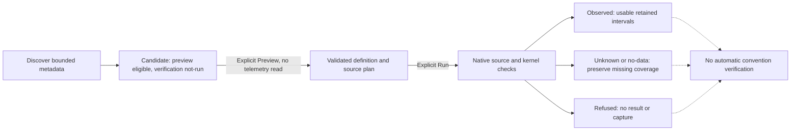
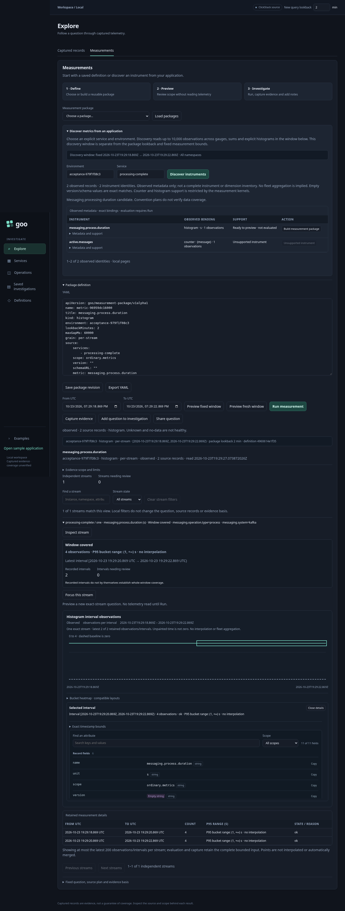
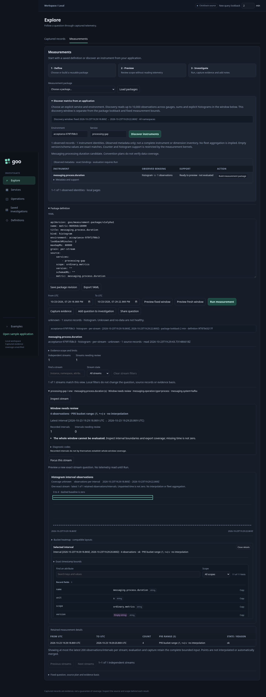
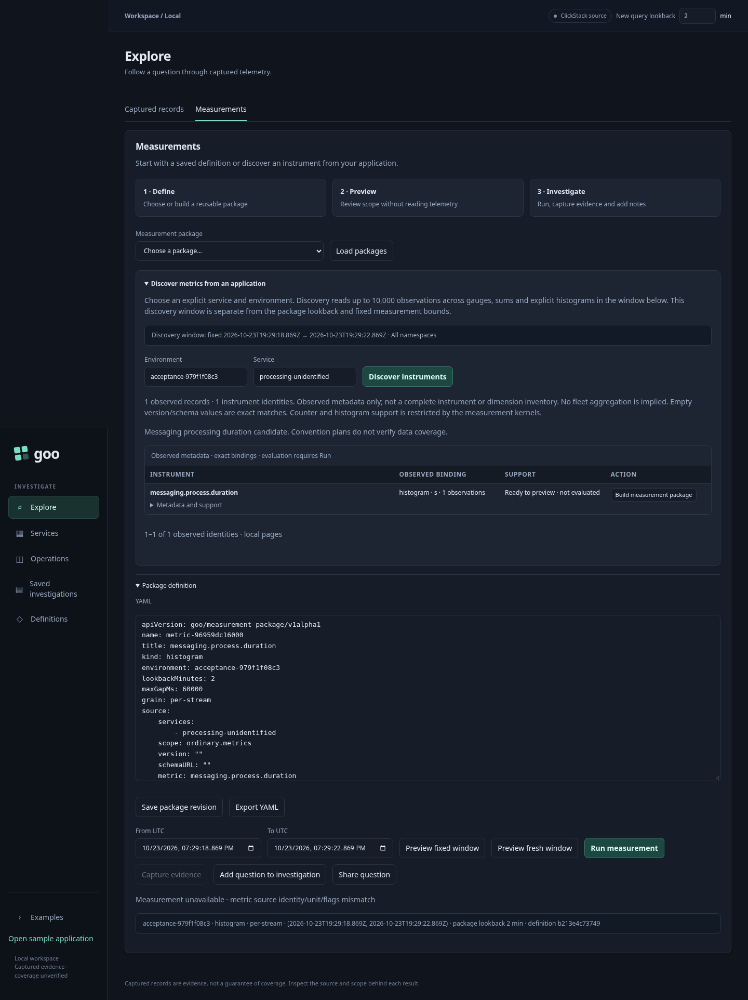
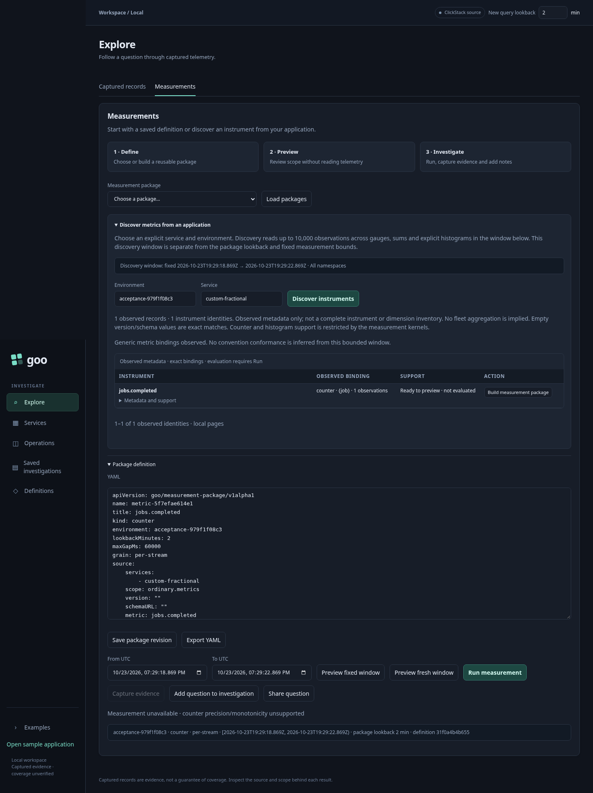

# E1 native instrument discovery acceptance — 2026-10-23

Scope reviewed: `e4f42d5`, covering native discovery, versioned Go metadata plans,
HTTP server duration and experimental messaging processing duration candidates.
This audit evaluates the E1 row in the [active plan](IMPLEMENTATION_PLAN.md).
Bounded E1 is accepted. It supplies convention candidates and exact-stream
presence, followed by explicit native evaluation; it does not certify OTel
conformance or introduce new metric kernels.

## Acceptance map

| Requirement | Implementation and evidence |
| --- | --- |
| Manifest-free, non-Go and custom OTel data | Existing service handoff and explicit Measurements discovery feed `Source.Discover`; no annotation or manifest is required. Journeys 130/132 ingest ordinary OTLP HTTP/messaging histograms and custom sums. Journey 39 exercises independent Python OTel instrumentation, package save and capture. New journey 133 completes the messaging path through explicit Preview and Run. |
| Pinned HTTP convention, generic fallback and one messaging case | `PlanInstrument` owns HTTP v1.30.0 and experimental messaging processing profiles. Histograms in seconds match the pinned shapes; milliseconds retain an eligible generic binding without conversion. Wrong kinds/units do not acquire convention support. Unknown names retain generic semantics. `instrument_capabilities_test.go` and Hegel cover both profiles; browser presentation does not repeat the rules. |
| Observed identities and declarations remain distinct | Discovery returns observed metadata in a bounded question, independent of static manifests. Scope/version/schema/name/unit, complete resource/attribute maps and resource schema identify streams. Empty optional scope version/schema are exact matches, not wildcards. Instance missing/empty/present remain distinct diagnostics. Existing namespace and exact-stream tests preserve selectors; journeys 130/131/132 exercise missing schema and identity. |
| Presence totals independent of display | The source fails above 10,000 rows or 8 MiB instead of publishing a partial catalog. Instrument paging and the 25-stream detail cap are local. The complete bounded read determines record/stream totals and watched-key presence; duplicates count as records, not extra streams. Go tests and Hegel permutations/cap properties cover this. Journey 131 compares the plan with independent ClickHouse identities and rejects seven forged traces. |
| Units, temporality and unsupported cases remain honest | Only gauges, sums and explicit histograms are inventoried. Non-monotonic sums are visible but have no generated binding. Duration histograms require s/ms; other shapes/units/temporalities retain explicit unsupported state. Inventory groups temporality separately, but bindings intentionally do not filter it out: Run must see mixed-temporality evidence and refuse it. Cumulative epochs, resets, gaps and histogram layouts remain the existing kernels' responsibility. No fleet percentile is inferred. |
| Preview eligibility is distinct from actual evaluation | `TestDiscoveryCandidatesDoNotVerifyEvaluation` runs generated bindings through the real evaluator for both profiles and generic durations in s/ms. Complete coverage is observed; partial/boundary-crossing/no-recorded-value coverage is unknown; malformed buckets, missing/empty instance identity and mixed temporality are refused; no rows is no-data. The candidate is unchanged throughout. Journey 133 verifies actual API/UI observed, unknown and refused outcomes. |
| Batch observations do not become business-event guarantees | OTLP metric requests can contain multiple resources and points; journey 133 uses both and includes an observation exactly at the evaluation end. Histogram count is the reported observation population, not distinct deliveries, messages per operation or trace completeness. Messaging hints withhold queue lag, success, throughput and end-to-end relationships. |
| Explicit reads and publication ownership | Preview validates a definition/source plan without telemetry execution. Run performs a separate read. Capture/package/document publication is explicit. Journey 133 observes four explicit Runs and zero writes; refusals clear results and disable capture. Catalog metadata stays `not-run` after every outcome. The configured Bombadil actor also inspects an unidentified consumer without implicit evaluation. |

## What Run establishes

Observed describes retained numeric observations, not application health, source
completeness or semantic-convention conformance. A convention's presence matrix
does not check allowed values: a processing duration tagged with a different
operation type is not certified by a successful duration evaluation. A successful
Run never promotes the catalog to verified. Source read time and the fixed question
remain separate; capturing the result later adds its own custody time.

Discovery's event-end inventory window is half-open. Counter/histogram evaluation
also reads the point at the right boundary and the bounded preceding context needed
for intervals. Therefore discovery record count is not expected to equal Run's
source count. Journey 133 deliberately observes one histogram export in discovery
and two in a fully covered evaluation; both retain the original fixed question.

## Deliberate limits

- A nonempty `service.instance.id` is required by current native kernels. Missing
  and empty instances can be discovered and previewed but make a matching Run
  fail closed. A valid stream is not silently returned as a partial result when
  another matching stream is invalid. This is a kernel limitation, not an OTel
  requirement or evidence of bad application health.
- The current ClickStack sum adapter accepts only nonnegative integer values below
  2^53 for monotonic counters. Fractional or larger values may be preview-eligible
  from metadata and then refused by Run. It must not round them into a rate.
- Summary and exponential-histogram tables are not inventoried. Unsupported
  non-monotonic sums remain visible; absence of a row is not proof of absent
  instrumentation. Discovery does not enumerate every possible OTel instrument.
- Gauge freshness, counter/histogram intervals and per-stream coverage keep their
  existing meanings. A 25-stream display is not a selected fleet or a denominator.
- Verified HTTP error policy, valid messaging operation values, destination
  cardinality, message deduplication, queue lag and cross-signal relations need
  supporting data/policies. None is implemented by this metadata cut.
- No automatic native dashboard, persistent convention declaration, backend
  migration or generalized broker/pool support is implied. Existing service
  dashboards and metric authoring retain their own contracts.

These limits remain in the [discovery contract](NATIVE_INSTRUMENT_DISCOVERY.md)
and [known issues](KNOWN_ISSUES.md); accepting bounded E1 does not hide them.

## Verification executed for this audit

- Go native kernels, measurements and Go HTTP tests passed, including the new
  generated-binding-to-evaluation acceptance matrix.
- Hegel passed both metadata/candidate properties, optional identity, and counter/
  histogram state/swarm tests. The new evidence property varies convention name,
  s/ms units, population, coverage, flags and invalid identity/counts without
  allowing planning to promote the result.
- Observed Quint counter-epoch and histogram-semantics traces passed. Journey 133
  replayed both its observed and unknown results through the existing discovery
  model and result validator, with three rejecting controls per replay. No new
  execution protocol or model was required.
- Journey 133 passed against the deployed lab, including four explicit evaluations,
  fixed windows, exact definitions, refusals clearing the UI and zero writes.
  The 25-second configured Bombadil inspection campaign passed on the consumer
  whose observations lack instance identity.
- Existing journey 130/131/132 and passive-catalog evidence from the immediately
  preceding cuts remains current: this audit changes tests/docs, not the runtime.
  Their outcomes and the corrected stale text assertion are in [VALIDATION.md](../VALIDATION.md).

New compact logs are in `artifacts/e1-acceptance`; actual browser outcomes and
ledgers are in `artifacts/instrument-acceptance/979f1f08c3`. Screens below come from
the real OTLP journey, not supplied UI mocks.

## Next bounded cut

Return to D2's existing population workflow: extend selection-versus-rest beyond
categorical facets, starting with the existing raw-span time/latency rectangle.
Preserve the parent's window and predicates, define the complement including
missing/invalid duration values, stage without reading, then use existing explicit
child execution and comparison/capture owners. This is not a general Boolean
editor or native-metric population algebra. F1 remains prerequisite-gated.
