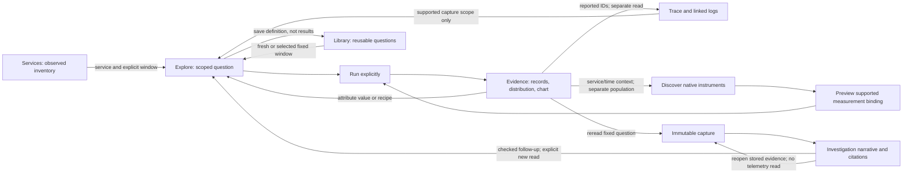

# Entry points and investigation flow

Design spike, 2026-10-19. The first bounded [question-workbench slice](QUESTION_WORKBENCH.md)
is now implemented, followed by [scoped service browsing](SERVICE_BROWSING.md)
and [one Services catalog](UNIFIED_SERVICE_CATALOG.md).
Broader navigation, Library and standalone native discovery proposals below remain
future work. Findings describe the audited baseline at `bf54b36`.
This is an expert review of the current UI and code, not a usability study with
customers. The aim is to let an engineer follow a question without first learning
goo's package taxonomy.

## Evidence and scope

Read the running UI at `http://127.0.0.1:8088` in a separate desktop Chromium
session: fresh Explore, Services, Saved investigations, Definitions and the
Measurements tab. Navigation and catalog loading only; no telemetry queries,
saves, fixture ingestion or runtime changes were performed. Audit screenshots and
visible text are local evidence under `artifacts/entrypoints-spike/` (generated
artifacts, not the executable feature-storyboard gallery). Existing storyboards
33, 37–44 supplement the review of populated workflows; they were not rerun here.

Grounding: [workspace routing](../ui/workspace.js), [Explore](../ui/exploration.js),
[Services](../ui/inventory.js), [measurements](../ui/measurements.js),
[documents](../ui/documents.js), [recipes](../ui/recipes.js),
[follow-ups](../ui/followups.js), [question scope](QUESTION_SCOPE.md),
[core workbench](CORE_WORKBENCH.md) and [current journeys](journeys/README.md).
The numeric-measure release was in progress during the browser audit and completed
as `bf54b36`; this spike does not alter its code or validation record.

## Findings at the audited baseline

| Observed entry or transition | What an engineer must work out | Consequence |
| --- | --- | --- |
| First arrival opens Explore with **Explore telemetry**, **Search spans** and **Apply question**; service/duration shortcuts sit above a second attribute editor | Which button applies which draft controls? | The page asks for editor knowledge before showing evidence. This is semantic ambiguity, not merely too many buttons. |
| The blank Explore page shows filters, breakdowns, several measures/chart controls, comparisons, result tabs and disabled save/package/page actions | Which controls are prerequisites, optional views or later steps? | The primary task and expected first result compete with unready tools. |
| **Captured records / Measurements** are peer tabs | Whether measurements means span-derived durations, native instruments or declared lifecycle evaluation | A user seeking latency can reasonably choose either. The distinction is technically real but not explained through the task. |
| Measurements starts **Define → Preview → Investigate**, package selection and date bounds; instrument discovery is a collapsed disclosure | Whether an existing instrument can simply be inspected | Live discovery exists, but package authoring appears to be required knowledge first. |
| Services first presents span/name inventory; log activity and reported dependencies are under another explicit discovery section | Why a log-only service does not appear in the main table | The first service list can be mistaken for a complete fleet. |
| Services → **Explore spans** carries inventory bounds; its adjacent **Discover metrics** passes service/environment but currently no bounds | Whether both transitions retain the same incident window | One visually similar handoff silently starts a fresh metric-discovery window. The metric workbench does describe that fresh window. |
| **Saved investigations** begins with collapsed investigation notes, an expanded general-capture catalog, an operation-capture ID form, and the moved Operations surface | Whether an investigation is a narrative, a capture or an operation query | Reopening work mixes three object types and can expose unrelated live-query controls below stored evidence. |
| **Capture investigation**, operation **Save investigation**, **New investigation**, **Create package** and **Add to notes** coexist | Which action saves evidence, a question or a conclusion | Object semantics are sound in parts of the code, but the language makes them look interchangeable. |
| Definitions lists telemetry revisions, native measurement packages, application contracts, bound HTTP evaluation and proposed OTel capabilities | Which items are runnable for this source versus proposed or authoring-only | A useful library reads like an implementation catalog. Repeated test-generated revisions make this especially visible in the current lab. |
| Recipes say **Start with a question** but require an already applied Explore question; capture follow-ups are inside stored-evidence disclosures | Where to start and what to try next | Helpful guidance arrives after the user already knows how to get started. |

Keep the useful foundations: attribute actions, bounded trace inspector, exact
linked logs, source-free recipe/follow-up plans, immutable captures and the active
investigation banner. The design should connect these affordances, rather than
introduce another dashboard or a second query language.

## Recommended model

**Explore asks a question. An investigation explains what the evidence supports.
A reusable question records how to ask again.**

Use three objects consistently:

| Object | User-facing action | Persisted meaning |
| --- | --- | --- |
| Question | **Run question**; **Save reusable question** | Query/typed definition, selector, measures and presentation; reuse resolves a fresh window unless fixed bounds are explicitly chosen. Existing package APIs remain the implementation. |
| Evidence | **Capture evidence**; **Open frozen evidence** | Immutable bounded read, fixed question, receipt and basis. Current capture creation rereads the fixed question: say so before confirmation; never imply it saves the already displayed result byte-for-byte. |
| Investigation | **Start investigation**; **Add evidence**; **Save investigation revision** | Authored question, findings, open questions and ordered references. A question draft is not evidence, and an unsaved draft is not durable. |

Keep Explore as the default landing page. Do not add a separate Home dashboard.
Target navigation: **Explore · Services · Investigations · Library**, with Examples
in a secondary help position. Library is the user-facing browse/reuse view over
existing definitions; YAML/contracts/capability proposals remain its advanced
authoring area. Rename Definitions only when that browse view exists. Operations
should ultimately be a contract-backed lens reachable from a service or Library;
retain its route during migration until all current workflows have equivalent
entry points. Do not hide a working feature behind an unimplemented service page.

The trace arrow back to Explore is deliberate: current general captures archive
the main question's evidence, not every independently fetched trace/log context.
To cite context, run and capture the supported exact-ID record question; do not
label a population capture as a complete saved trace.

## Interaction design

### One question bar, then evidence

At first arrival show **Spans · Logs · Native metrics** choices with brief scope
text, environment, a window selector and one primary **Run question** action.
Native metrics opens instrument discovery; it does not route spans through metric
kernels. Lifecycle/operation questions are supplied by explicit Library contracts.
Common span shortcuts (service, duration, recorded status) and the advanced filter
composer edit the **same draft**. One primary Run applies freely composed edits.
An explicit result action such as **Filter and run** or **Break down and run**
commits a checked question through that same execution path in one gesture; do not
require an extra Run click after every deliberate drilldown. Make actions that
read fresh evidence distinct from local view changes. A keyboard Run shortcut is optional, not required to discover
the main action. No natural-language parser or invented search syntax is needed.

After execution, keep a compact applied-scope strip above results: signal/grain,
environment, fixed UTC interval, key selectors and state. Relative “last 15 min”
is an authoring choice; the published result always has resolved fixed bounds.
Unapplied changes have a visible **Draft changes — Run to apply** state. Keep the
old result visibly tied to its old scope, or clear it; never relabel it with draft
controls. Editing the global lookback must not retime frozen evidence or existing
applied questions. Put time controls near the active question rather than giving
one global input an appearance of universal scope.

Put records/chart/distribution below this compact bar. Reveal breakdown and measure
options via **Break down** and **Measure**, close to the result they affect.
Keep unsupported options discoverable with a reason; no silent substitution of
record count for native rate, no automatic unit conversion. Display declared numeric
unit and valid/missing/empty/invalid coverage next to numeric results. Counts remain
full-population aggregates, independent of pages and local search.

### Contextual actions should name what changes

Clicking a record opens one inspector with attributes, reported trace links and
supported next actions. Attribute values offer **Filter and run** and **Break
down and run**, with **Add to question** available when staging an edit is useful.
Selecting a chart interval can expose its evidence locally before offering a
labelled **Use this interval and run** action. Switching a recorded chart measure,
searching captured series and reopening frozen evidence remain local operations.
Back restores the previous applied scope and view without silently querying it.
With OR predicates, keep the existing restriction on narrowing
until a valid explicit conjunction transformation exists. Avoid implying every
chip adds an AND clause safely.

Keep an origin breadcrumb: **Service inventory → Spans for gateway → Trace …**.
Returning restores the previous applied question, table selection and local view;
it does not run telemetry implicitly. An exact trace/span action states that it
replaces the population selector with reported IDs inside fixed environment/bounds.
Surrounding logs and service/time metric discovery state **Context search**, with
the changed selectors/window visible. Reuse checked `QuestionTransform` metadata
where available; do not hand-author a claim that populations are equivalent.

Service inventory's metric handoff should pass the incident's explicit bounds,
then show the discovery window. A fresh-window alternative is a separate action.
This needs the small handoff correction identified above; it is not merely a label
change. Likewise, preserve native instrument identity, unit, scope/version/schema
and temporality through discovery → preview → run. Recognition of an OTel-looking
name does not establish a convention binding or instrument compatibility.

### Entry and empty states

| State | Useful next action and truthful copy |
| --- | --- |
| No question run | **Run spans**, switch to Logs, **Discover metrics**, or open a reusable question. “Choose a scope to read telemetry.” No placeholder health score. |
| Successful empty result | Retain exact fixed bounds/filter chips. Offer **Edit window** or remove a specific filter. “No matching records; coverage unknown.” Do not silently widen and run. |
| Unsupported instrument/binding | Explain the unsupported kind, temporality or unit and retain identity. Let the user inspect metadata or record an evidence gap; do not render a zero measure. |
| Cancelled / failed / changed between reads | Show that state separately from no data; offer a deliberate rerun. Preserve source-change warnings beside displayed evidence. |
| Empty investigation | **Start with a question** or **Add existing capture**. No requirement to paste IDs to discover saved work. |
| Reopen stored evidence | Lead with **Frozen evidence**, recorded-at and original event window. **Run same fixed question again** creates a new capture revision; **Use question in a fresh window** is distinct. Current “Open as live question” retains original bounds and must not be relabelled as fresh without changing the handoff. |

### Reuse, authoring and investigation continuity

Library defaults to runnable saved/built-in questions, searchable by title, service,
signal/kind and environment, with revision identity retained. Show versioned siblings
together only as a presentation grouping; immutable revisions stay selectable and
no mutable “latest” store is implied. Current catalog pagination/limits must remain
visible; local search must not claim it searched unloaded revisions. An importer or
YAML editor is an advanced action, not the first step in looking at telemetry.

Investigations leads with authored question/findings and cited evidence, not capture
receipt forms. Provide tabs **Investigations / Evidence captures**, with manual
ID entry in a disclosure. Existing operation captures keep their type-specific
viewer until an adapter can expose them safely in the common evidence browser.
Do not claim a unified operation catalog exists today. Exclude the unrelated live
Operations editor from a reopened general capture's main content.

Use the active-investigation banner as a compact continuity tool: title, unsaved
state, **Add evidence to this investigation** and **Return**. Saving a capture and
attaching it must keep the existing explicit document-save rules. Navigation and
Back must not discard an unsaved note or substitute another document revision.
Draft recovery across reloads is a separate persistence feature, not an existing
guarantee. Mobile places the scope summary before results and moves optional actions
into a labelled menu; the inspector should return focus to its originating record.

## Proposed real user storyboards

These are acceptance scenarios for a future slice, not new executed journeys.
Use ordinary OTLP fixtures with general service names and fixed incident windows.

1. **“Why did gateway get slow?”** Arrive in Explore; choose service `gateway`,
   incident interval, duration summary and route breakdown; Run once. Select a
   route with **Filter and run** in one gesture and inspect a span's attributes,
   then reported trace and exact linked logs.
   Breadcrumbs explain each selector replacement and separate context read. Return
   to the same route result without rerunning. Capture the supported exact-ID log
   question as separate evidence; cite both population and log captures in an
   investigation. Record a finding limited to observed spans, not complete requests.
   Reopen the investigation later; frozen citations and windows remain unchanged.

2. **“Is worker pressure related to slow processing?”** Discover emitting services
   in a fixed window, choose `worker` → Discover metrics. Verify fixed-window
   handoff; observe a gauge and cumulative counter with exact identities. Preview
   the supported gauge definition without a telemetry read, run explicitly, inspect
   per-stream state and capture. Open service/time span context as a separate
   population and compare evidence in notes; do not imply a metric point identifies
   a causal trace. An unsupported instrument stays unsupported. Save the reusable
   definition; tomorrow use it in a fresh window while yesterday's citation stays
   fixed. Capture reference and package revision remain separate identities.

3. **“Pick up yesterday's investigation.”** Open Investigations; select a stored
   narrative by title; read finding/open questions and open a cited capture without
   a source query. Choose a checked follow-up, preview preserved/replaced scope,
   then explicitly Run. Capture new evidence and save a child document revision.
   Back returns to the same historical evidence; editing an old document creates
   a preserved branch. Separately choose Library → reusable question → fresh window,
   which must not rewrite either historical document or capture.

## Prioritized implementation and acceptance

**First slice: simplify the existing Explore entry, without replacing its query
model.** This is smaller and more useful than a new homepage or wholesale redesign.

1. Inventory the current three action paths and make one shared draft→validated
   question→explicit execution pipeline. One primary Run handles the editor;
   labelled one-gesture drilldowns use the same executor. Keep advanced controls and current scope checks.
   Show draft/applied state and fixed scope beside results; hide unready pagination
   and optional capture/reuse actions behind the result toolbar. Collapse advanced
   composition initially, while preserving an obvious **Add filter** action.
2. Rename evidence versus definition actions consistently and show capture's reread
   semantics. Put **Capture evidence** and **Save reusable question** together after
   a successful result; preserve old URLs and stored objects.
3. Correct Services → metric discovery fixed-window handoff. Add compact origin/
   scope messaging to the existing transitions; no new service detail backend.
4. Refresh first-arrival, populated question, inspector/return and mobile storyboards.
   Ship this slice before restructuring Library or moving Operations.

Next slice: a browse-first native-metric entry and a clear Investigations/Evidence
split; then Library's runnable-question catalog and service-backed Operations lens.
Do not add new top-level destinations for each visualization or measurement kernel.

| Acceptance test | Why / appropriate tool |
| --- | --- |
| Fresh arrival has one primary Run; shortcut and advanced edits contribute to one question; one run starts one main query request | Playwright over live OTLP data; inspect outgoing question and assert fixed bounds, conjunction and measures. Several bounded backend aggregate reads are expected, so do not assert one SQL read. |
| Select a route, interval or attribute, then return | Playwright checks that an explicit Filter/Break down and run action needs no second Run click, uses the shared executor, and retains an origin/applied-scope snapshot. Local inspection/measure/search and Back issue no telemetry query. |
| Edit draft while a request is pending, switch mode, cancel, then receive delayed completion | Playwright plus bounded Bombadil actions; stale result cannot publish under new scope, capture remains unavailable for an unapplied draft. |
| Preview a recipe/package or return from inspector | Playwright request ledger; no new telemetry execution from preview/local return. Exact context navigation is separately counted as an explicit read. |
| Inventory → metric discovery → preview → run | Playwright verifies environment and exact incident bounds; native binding identity/unit/temporality are retained; preview does not execute measurement. |
| Capture, cite, reopen, rerun fixed, reuse fresh | Playwright checks immutable original IDs/bases, distinct windows and explicit document child/branch revision; reopen performs no telemetry query. Verify captured totals against source/reference independently of the visible page. |
| Any navigation leaves UI coherent | Bombadil navigates routes/modes/inspectors, edits draft, cancels and reopens existing frozen evidence. Invariants: one active view, correct scope label, no stale publication, draft not silently lost, no horizontal overflow at mobile width, focus restored after inspector closes. Actor must not create unbounded captures/definitions or treat query limits as failures of invariants. |
| Question-to-evidence state contract | Extend the existing Quint observed-trace approach if the new shared execution state changes: draft→preview/applied→running→published→captured, with cancel/supersede. Validate actual request/response generations, fixed scopes and evidence IDs, not only DOM booleans. Reject mutated ledgers with stale completion, changed scope, reopened source read or overwritten capture. Pure label/layout changes do not need a new model. |

Preserve existing semantic Hegel properties and capture validation rather than
retesting CSS as formal semantics. All new screenshots should come from the live
journeys, with docs updated to distinguish proposed steps from delivered behavior.

## Recommended next milestone

Adopt the single question workbench and evidence/question/investigation vocabulary;
implement the first slice above before catalog or navigation migrations. Backend
authorization, ingestion completeness, correlation across arbitrary instruments,
general selection algebra and multiplayer remain separate capabilities. This
cleanup should expose current truthful behavior more naturally, not imply those
capabilities exist.
