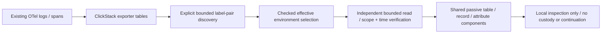

# Environment adoption — first slice, 247

Existing OTel logs and spans can be inspected without adding a manifest or
inventing an environment label. Activity → **Find environments** offers an explicit
bounded discovery read and a separate read-only record preview. Opening the tool
alone reads nothing. Discovery and preview cover all services in the chosen
signal/window; Activity predicates are not applied. Reads pause live Activity but do not replace its named
selector. Named, empty and unreported labels remain distinct.

This tool is A0's scope/adoption foundation, not full environment support throughout
the product. 250 adds separate [main record API support](RECORD_SELECTOR_API.md), including
Query/Tail and filesystem captures. Browser handoffs and inventory/native/reusable
intent adoption remain open. Adoption results offer
local inspection and copying of reported IDs/attributes; live tail, trace/context
expansion, service/native dashboards, comparisons, package generation, fixed
question conversion and capture publication are visibly unavailable. No result
snapshot token or evidence receipt is issued.

## Checked scope semantics

`identity.EnvironmentScope` is an explicit value type. Zero/nil/omission is not an
all-environment selector. Modes are:

| Mode | Meaning |
|---|---|
| `unreported` | Neither `deployment.environment.name` nor legacy `deployment.environment` exists. |
| `empty` | The winning key exists and its value is the empty string. |
| `named` + nonempty value | The winning value equals the literal, bounded UTF-8 value. No wildcard or normalization. |

The **current key wins by presence**, including a present-empty value. Legacy is
used only if the current key is absent. Both raw labels and winning-key provenance
are retained in observations; different reported values set the conflict flag.
A named value literally equal to `unreported` is still a name, not missing data.
Names are at most 128 UTF-8 bytes without NUL. Out-of-bound observed labels remain
diagnostic data but cannot become a checked selector.

Old named queries retain their original current-key-only semantics and bytes/IDs.
The new effective-named selector deliberately includes legacy-only records; it is
not retroactively applied to stored questions. In the real five-value presence
matrix, the old named population has five records and the effective named scope
has six. Current conflicting values never fall back to legacy.

## Reads and interpretation

`POST /api/environment-scopes` accepts signal (`logs` or `spans`) and a half-open
fixed `fromMs`/`toMs` window. It groups both raw values and both presence flags,
reads at most 65 combinations and retains at most 64. `hasMore` means other label
combinations may exist. Counts are exact UInt64 strings **per label combination**;
they are not service/request totals or the size of an effective-scope preview.
Several combinations can share the same effective scope. Preview explicitly
covers all matching combinations and performs an independent read.

`POST /api/environment-scopes/records` accepts that window, an explicit `scope`
and a limit of 1–100. It reads at most limit+1 records and retains a prefix bounded
to 1 MiB. Every returned/overflow record is checked against the selected scope and
event-time window; missing/null resource maps/values or wrong signal content are
refused. The `limited` flag covers row and byte truncation. Raw decoded resource
attributes remain visible in the shared attribute viewer; no browser record is
converted into evidence. Display timestamps use shared UTC presentation/tooltips.

Both routes use the record family's existing source admission, cancellation,
15-second handler deadline and 4 KiB bounded strict JSON input. Windows are at most
120 minutes, nonnegative and before 2100. Scope diagnostics retain at most 1 MiB of
accepted group JSON; excessive diagnostic data is an error, not a silently omitted
population. The existing source adapter independently bounds source time, rows,
response bytes, source bytes and memory. These are not hard RSS/latency guarantees.
A zero result concerns only the chosen signal/window; it does not prove an empty
source, complete collection or healthy services.

The frontend owner discards late responses after scope/window changes, closing,
leaving Activity, changing record/measurement mode or hiding the page. Back to
labels and local inspector close do not reread telemetry. Preview loading and
results are revealed explicitly; inspector focus/return uses the shared owner.
Source reads and navigation remain in the app adapter, not display components.

## Adoption and later work

Collector enrichment can help future records, but cannot expose historical
unlabelled data. If a deployment enriches telemetry, use the current semantic
convention key and trusted deployment context; preserve reported values and legacy
labels. Fill a default only when **both keys are absent**. An unconditional insert
of a current key can mask a legacy value. No collector pipeline was changed here.
Validate any actual processor configuration against the deployed collector version.

Next, carry this checked scope through the main record flow as one coordinated
change: query/selection identity, tail windows, fixed questions, record/context
constructors, service bridges, saved/capture summaries and explicit unsupported
native paths. Existing constructors frequently copy only an environment string;
adding a general Query flag before auditing them risks scope loss. Keep old named
saved identities stable and require continuation compatibility before enabling UI
actions. This step is still open; it is not a new universal selector engine.

See the [journey](../journeys/247-environment-adoption-storyboard.md) and
[review](reviews/ENVIRONMENT_ADOPTION_REVIEW_247.md) for executed checks and limits.

248 adds a [checked selection/lowering prerequisite and concrete propagation audit](ENVIRONMENT_SCOPE_PROPAGATION.md). It preserves the current-only/effective policy
distinction without adding a general Query flag or enabling these continuations.

249 adds [response-only versioned selector metadata](ENVIRONMENT_SELECTOR_PROTOCOL.md)
to record previews. The UI verifies exact effective policy/scope before rendering;
request shapes and unsupported continuations remain unchanged.

250 ships [record selector APIs](RECORD_SELECTOR_API.md) behind explicit unsupported
family/persistence gates. The discovery UI still has no main-flow handoff.

255 enables selector-bearing filesystem captures in Saved, including stored
paging and explicit scoped context/fixed reuse. The local preview described above
still has no Activity selector handoff. See [current support](RECORD_SELECTOR_API.md#saved-selector-captures--255).
