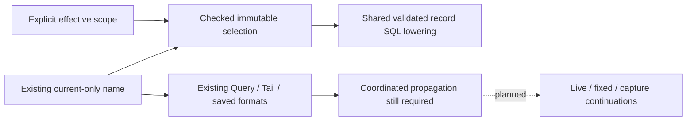

# Record environment propagation — 248 prerequisite

The shipped 247 tool deliberately stops at local inspection. This audit prepares
main-flow adoption; it does not enable missing/empty environment selectors in
Activity, fixed questions, captures or reusable packages.

248 introduces `identity.EnvironmentSelection`, a checked immutable semantic
value. `CurrentEnvironment(name)` retains current-key-only selection;
`EffectiveEnvironment(scope)` uses the 247 presence/fallback contract. Their
matching and equality retain policy: current-only `prod` is not effective `prod`.
Zero values refuse validation, matching, equality and SQL lowering. Accessors
return copies. JSON encoding/decoding is explicitly refused so private fields
cannot silently become `{}` in a saved identity. This is not a new wire schema.
249 adds explicit [versioned DTO metadata and wire fixtures](ENVIRONMENT_SELECTOR_PROTOCOL.md).
Semantic JSON/YAML serialization is refused; the DTO preserves policy explicitly.

The record compiler's source boundary and adoption preview now share one SQL
lowering function. Existing Query validation uses the same checked name constructor.
Inventory, service signal/edge discovery and trace search propagate source errors.
249 passes checked selection directly into the source compiler, which derives
bindings and rejects collisions/stale unused named bindings. Existing callers
explicitly construct current-only selectors; native metric compilers remain
independent. Existing SQL/parameters and saved formats retain their meaning.

## Audited handoffs and remaining work

| Boundary | Current representation / risk | Required coordinated change before exposing effective scope |
|---|---|---|
| `exploration/model.go`, `compiler.go` | Query carries one required current-only name. Compiler lowering is now checked/shared. | Versioned, mutually exclusive legacy-name/effective-scope wire choice; reject missing, ambiguous and invalid choices before source access. Keep old JSON/YAML and canonical bytes stable. |
| `tail.go`, `tail_membership.go`, `result_snapshots.go` | TailSelector copies the name; membership and snapshot identities bind serialized questions/selectors. | Preserve policy in Query conversion, connection/membership identity, cancellation and snapshot resolution; reject cross-policy reuse even when literal names match. |
| `context.go`, `followups.go`, `native_record_context.go` | Log surrounding/trace followups construct fresh queries from strings; native context starts with a current-only definition. | Carry checked selection in every derived query; preserve original fixed bounds and predicates where promised. Refuse unsupported native bridges before reads. |
| `inventory.go`, `service_discovery.go`, `dashboard.go`, `scope.go` | Service/dashboard constructors and transform summaries carry/compare strings. Service identity includes a separate namespace contract. | Preserve selection policy separately from service entity identity; expose explicit unsupported capability for unimplemented dashboard/native paths. Do not invent one environment entity for an unreported population. |
| `exploration/reported_edge.go`, `trace_search.go` post-read checks | Parent-ownership SQL and trace example/membership checks independently encode current-key-only semantics, beyond shared source SQL. | Update both SQL ownership constraints and post-read verification; reject examples/parents from another effective population. |
| `comparison.go`, `explanation.go`, `population.go`, `capture_store.go` | Compatibility and companion checks compare environment strings. | Compare checked policies, not just values; retain exact windows and parent/selection predicates. |
| `capture_comparison.go`, `capture_search.go`, `capture_catalog_index.go` | Comparison removes environment fields to compare question shape; catalog summaries/filtering have named-string contracts. | Separate policy identity from optional comparison dimensions; version summaries/search deliberately. Old exact-ID reopen and catalog rebuild must preserve stored receipt meaning. |
| `exploration/package.go`, `workbench/activity_views.go`, `cmd/goo/activity_views_http.go` | Reusable question and view definitions carry a name; view-baseline compatibility checks names. | Version definitions and copy policy through authoring, saved view, baseline compatibility and refresh; no silent widening of historical definitions. |
| `ui/stream-entry.mjs`, `tail.mjs` | Applied/draft scope, prepare/start, observation-window and Analyze construct name-only objects. | One browser protocol helper for copying/validating/formatting the checked selector; invalidate pending reads and inspector actions on policy change. No overloaded input sentinel. |
| `ui/activity-*.mjs`, `service-browser.mjs`, fixed-question/route owners | Latency, numeric plots, triage, explanations, Saved and service links reconstruct scope or show name-only summaries. | Adopt the same helper; format missing/empty/named visibly; retain policy in hashes, back/return and share links. Disable unsupported actions explicitly. |
| Annotation/retention/native definitions | Domain environment identity and record selection are currently separate string contracts. | Do not equate a missing-label population with a named entity or migrate these stores implicitly. Keep their current-only support explicit until intentionally designed. |

This table groups concrete inspected handoffs; it is not a claim that every
future caller is covered. A new Query field alone does not complete any row.

## Implementation order and acceptance

1. Wire prerequisite delivered 249: freeze existing Query/Tail/package/capture
   bytes/identities (existing route fixtures remain), and pin explicit wire
   fixtures for the new policy. Keep checked semantic values outside stored wire
   types; convert at boundaries with errors.
2. Adopt the wire selector across record Query/Tail and all derived constructors,
   compatibility checks and snapshot/membership owners together. Make unsupported
   bridges fail before any source read or publication.
3. Version capture/package/view summaries and browser protocols where needed,
   preserving old current-only identities and exact retained reopen.

Steps 2–3 are one gated public rollout: internal plumbing may land first, but
Query/Tail HTTP acceptance must not permit effective scopes to reach an old
capture/package/view codec. Either complete those codecs and identities together
or explicitly reject each unsupported continuation server-side before reading or
publishing. Hiding a UI action cannot protect direct API callers.

4. Enable explicit UI adoption only after Activity → observation → fixed question
   → capture/reopen and return retain scope, including delayed responses. Extend
   the real logs/spans presence matrix to both policies, Hegel copy/compatibility
   properties, and a state/trace campaign for live-to-fixed transitions. Exercise
   Bombadil completion and negative controls; do not add a stateless Quint model
   merely for policy equality.

The 248 extraction has no visible UI change. The actual 247 storyboard/screenshots
remain current; no synthetic screenshots were added.

