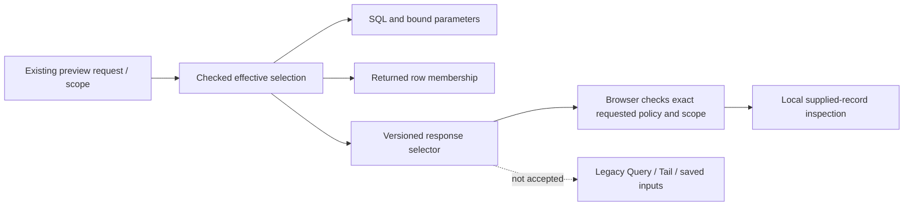

# Record environment selector protocol — 249, API adoption 250

The checked record-selection value now has an explicit wire counterpart:

```json
{
  "version": "goo/environment-selector/v1",
  "policy": "effective",
  "scope": {"mode": "unreported"}
}
```

`identity.EnvironmentSelector` converts to/from checked
`identity.EnvironmentSelection`. The browser's pure `record-environment.mjs`
validates, detaches, compares and matches the same finite shared fixture bank.
The semantic value still refuses JSON and YAML; only the explicit DTO is a wire
representation. DTO JSON/YAML round trips preserve policy and scope. No new
canonical hashing or durable identifier scheme is defined for this DTO.

| Policy | Permitted scope | Meaning |
|---|---|---|
| `current-only` | `named` with a nonempty value | Match only the reported current environment key. This preserves historical Query semantics. |
| `effective` | `named`, `empty`, or `unreported` | Current key wins by presence, then legacy fallback; neither key is unreported. |

Unknown versions/policies/fields, differently cased field aliases, malformed
scope combinations, explicit null values, NUL, invalid UTF-8 and escaped lone
surrogates are refused by the JSON boundary. Valid surrogate pairs, literal
U+FFFD and Unicode names remain supported. Named values are bounded to 128 UTF-8
bytes; empty and unreported have no nonempty value. There is no wildcard and a
name literally equal to `unreported` remains a name. A failed DTO JSON decode
clears the receiver rather than retaining a previous selection. Duplicate JSON
members use last-value semantics, matching `JSON.parse`; repeated objects cannot
merge an earlier scope/name into the final object.

250 now accepts this DTO as `environmentSelector` on the [record Query/Tail APIs](RECORD_SELECTOR_API.md), with mutually exclusive legacy name selection.

## Shipped use and rollout boundary

`POST /api/environment-scopes/records` adds root **response-only** `selector`
metadata. The server derives it from the exact checked selection used for SQL
lowering and returned-row membership checks. It is outside the echoed `question`.
The UI requires effective policy and the exact requested scope before constructing
record rows. Valid metadata for a different policy or scope is still refused.
Metadata is not a source snapshot, membership capability or custody receipt.

The preview still takes `scope`; root `selector` and `environmentScope` are not
Query/Tail input aliases. In 250 only the explicit `environmentSelector` field
is accepted by record APIs. Saved intent and other unsupported families still
refuse the DTO. Browser handoffs remain disabled.

The private record compiler now receives a checked selection directly and derives
its environment parameter bindings from that selection. Conflicting prefilled
bindings and stale unused named bindings are errors. All existing callers
explicitly construct current-only selection from their legacy inputs. Old compiled
plans, serialized Query/Tail/package/capture-question shapes, package YAML and
revision, Activity view ID and exact reopen remain pinned. Full retained capture
byte/ID fixtures remain covered by the existing Go suite.



The [propagation audit](ENVIRONMENT_SCOPE_PROPAGATION.md) still gates coordinated
main-flow adoption. Next, carry the versioned selection through derived queries,
context/parent ownership, snapshot/membership and compatibility checks together
with saved codecs, or explicitly refuse unsupported continuations server-side.
Only then enable the UI handoff. The versioned DTO alone does not complete A0.

## Executable checks

- `identity/environment_selector_test.go` and
  `tests/environment-selector-protocol.test.js` share
  `testdata/protocol/environment-selectors.json`: canonical scopes, matching,
  missing/empty/conflicts, policy distinction, Unicode byte bounds, strict field
  names and raw JSON Unicode controls. This finite bank is not an exhaustive proof
  of all JSON/YAML parser behavior.
- `workbench/environment_wire_compatibility_test.go` freezes old named wires and
  identities against `testdata/protocol/environment-legacy-wires.json`.
- Source tests check metadata, explicit binding construction and collision refusal;
  handler tests reject new selectors on old Query/Tail/capture/view inputs.
- Journey 247 executes real logs/spans SQL and browser inspection. It injects valid
  but wrong-policy and wrong-scope metadata as rejecting controls; then recovers
  with an unmodified response. Existing Bombadil actions/invariants run against
  the guarded preview and require the completion action.

See [validation](../VALIDATION.md) for actual executions and limits.
