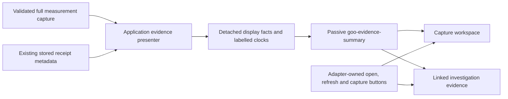

# Shared evidence summaries

Captured measurements and their investigation links use the same passive `goo-evidence-summary` element. It groups the population, scope, fixed window, source-record count, declared grain and binding into labelled facts. The result state and evidence mode are separate. A visible notice preserves source-completeness and independent-read limits; exact identities and clocks stay in a native disclosure.

The application presenter in `ui/evidence-scope.js` interprets typed measurement captures. The custom element in `ui/evidence-summary.js` only renders its supplied display snapshot. It never queries telemetry or metadata, chooses a namespace, infers health, calculates counts, refreshes evidence, navigates, copies or captures. Existing adapter buttons remain outside it.

```js
summary.data = {
  mode: 'frozen',
  state: 'unknown',
  facts: [{label: 'Population', value: 'Native duration histogram'}],
  notice: 'Source completeness remains unverified.',
  details: [
    {label: 'Source read', value: '2026-10-21T00:00:01.123Z'},
    {label: 'Stored custody time', value: '2026-10-21T00:00:02.456Z'},
  ],
};
```

## Display contract

- Supply `.data`, including on detached or pre-definition elements, or an HTML-escaped JSON `data` attribute for server-rendered HTML. Getters and setters detach snapshots.
- Modes are authored, fixed, frozen and live. Result states are supplied explicitly: observed, unknown, unavailable, partial, no_data, invalid, pending, stale, comparable, incompatible or ok. Mode never determines state or connection continuity.
- Accept one to eight visible facts and up to 32 detail rows. Labels are nonempty strings up to 120 characters, values up to 8,192 characters, and the notice up to 2,048. JSON attributes are capped at 512 KiB. Invalid input shows unavailable and clears the old mode/facts; rows are never silently truncated.
- All strings render as text. The component owns its children; place adapter links/buttons beside it. It has no action/event API and starts no subscriptions. Disclosure is the only built-in interaction.
- Native definition lists preserve reading order and wrap full IDs/values without widening the document. Mode/result labels are neutral; no healthy status is inferred. The host is a labelled group, without automatic live announcements.
- A valid data update preserves whether the exact-detail disclosure is open and restores focus to its summary if that summary owned focus. Other invalid/structural updates may remove the disclosure; this is not keyed interactive-child reconciliation.

## Adapter semantics

The shared measurement presenter distinguishes wildcard, missing, present-empty and literal namespaces using the existing service-identity helper. It retains exact counts as strings and exact nanosecond question bounds in details. A pinned complete stream binding is distinguished from independent matching streams; lifecycle bindings retain subject/tenant terminology.

Source read and stored custody are separately labelled from their explicit fields. A missing source-read timestamp stays unavailable and never borrows storage time. Full lifecycle results may additionally supply business evaluation and knowledge-cutoff clocks. Missing receipt-only metadata is left unavailable: the existing metadata endpoint has no evidence basis or full evaluated diagnostics, and the presenter does not fetch another result to fill them in. The full capture and its native attribute viewers remain accessible through adapter-owned buttons.

Linked question evidence retains visible scope-difference guidance, including a matching question's independent-read caveat. Matching windows never imply a shared source snapshot. The same summary also presents a separate native capture card in investigation notes. Non-measurement evidence retains its existing presenters in this milestone.

The capture workspace suppresses its old repeated scope paragraph and the measurement renderer's duplicate count/read paragraph when the shared summary owns those facts. The operational status remains available for refresh, attachment and error feedback. Reusable result rendering elsewhere retains its existing metadata by default.



## Executable storyboard

Journey 82 injects real OTLP histogram exports, creates an immutable measurement capture and links it into a question plus a separate capture card. It opens the full capture, inspects exact read/storage/basis values, follows the saved investigation, verifies receipt-only limitations and matching scope, and opens the same disclosure while preserving an unsaved finding. Mobile checks verify internal wrapping, with no source reads during inspection and no change to the retained capture.

[Full capture summary](journeys/screenshots/82a-capture-evidence-summary.png) · [Linked native evidence](journeys/screenshots/82b-linked-evidence-summary.png) · [Mobile evidence summary](journeys/screenshots/82c-mobile-evidence-summary.png)

Journey 83 covers the clearly synthetic standalone gallery, SSR attributes, pre-definition properties, detached getters, safe text, invalid data, keyboard disclosure, update focus and mobile layout. Pure tests cover bounds, large counts, namespace distinctions, exact timestamps and absent-clock handling. Observed Quint replay checks the actual capture/linked summaries and rejects eight corruptions; the saved-evidence Bombadil actor explores the two real adoption surfaces.

[Standalone synthetic reference](journeys/screenshots/83-synthetic-evidence-summary.png)

Next adoption candidates are service widgets and comparison sides, with their own typed display adapters. They are proposed, not migrated by this feature. See the [whole-product sweep](WHOLE_PRODUCT_COMPONENT_SWEEP.md) for the later selection/detail and complex-composition work.
