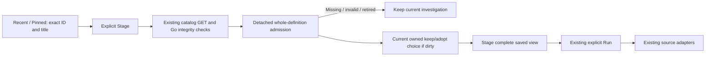

# Exact saved views in Recent / Pinned

427 adds immutable saved-view references to the existing Recent / Pinned picker.
It reuses the saved-view catalog and reader; it does not add another definition
store, Save workflow or query executor.

## Find, pin and stage

Successful saved-view publication and opening add an exact reference to Recent.
Pin the current acknowledged saved view or pin an existing row. Search, unpin,
forget and clear are local journal operations. Persistence remains an explicit
browser choice under the existing bounded Recent / Pinned policy.

A saved-view row identifies a specific definition, not its title's latest revision.
**Stage** resolves that definition through the existing reader. It preserves the
whole query/composition, comparison operands, environment/window policy and any
checked CEL authoring. Staging does not read telemetry or save anything. The
existing **Run** action performs a new source read explicitly.

A modified unsaved view is not pinned as though it were its last saved revision.
Save the new definition first. Ordinary Activity and single-question entries
retain their existing configuration semantics; saved comparisons are not flattened
into the selected query to fit those older entry shapes.

## A small reference, not a copied investigation

The journal stores only `kind: saved-view`, its exact content `id` and a bounded
`title` hint. Identity is the ID. It does not copy queries, CEL source, receipts,
rows, library bindings or private invocation tokens into browser history.
The saved definition and its Go validation remain authoritative.

Stage performs detached metadata resolution and admission before changing the
current investigation. Missing, malformed, incompatible or old-library definitions
refuse while the current scope, draft and held results remain available. A cached
label is never used to infer a replacement query.

## Ownership and recovery

The picker shows a native pending state and can supersede an earlier Stage.
Closing, rerendering, leaving, changing the parent or starting a newer request
retires its invocation. An old success or error cannot become current after an
A → B → A sequence, even when a transport ignores abort.

Unsaved investigations use the existing owned **Keep current draft** / explicit
adoption choice. Keep returns focus to the retained editor or opener. Successful
adoption focuses the staged view heading. A fully acknowledged unchanged saved
view is not a new unsaved draft merely because another definition is selected.
Serialized source is restored under fresh local ownership; no request/stage lease
is replayed from the journal.

See [storyboard](journeys/saved-view-recall.md),
[independent review](reviews/EXACT_VIEW_RECALL_427.md) and
[validation](../VALIDATION.md). Paired evidence capture is the next bounded step;
recalling a definition does not capture fresh evidence or complete that work.
