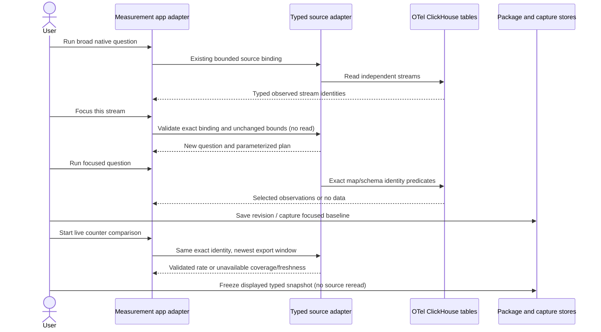

# Pin an observed OTel metric stream

Implemented for native counter, gauge and explicit histogram measurement packages.
Run a measurement, inspect its independent streams, then choose **Focus this
stream**. This previews a new question with the same exact window and a complete
`source.exactStream` binding. Preview reads no telemetry. **Run measurement** is
explicit; save a package revision, share the question, capture evidence or add
it to an investigation using the existing controls.

The binding contains full resource attributes (including instance, namespace
presence and environment), resource schema URL, scope name/version/schema URL,
metric name/unit and all data-point attributes. Missing keys and present-empty
keys differ. Map insertion order does not matter. All outer service, namespace,
environment and attribute constraints still apply; contradictory selectors are
rejected. Metric temporality and counter epochs are evaluated, not identity
filters: a temporality change or reset must reach the native kernel.

```yaml
source:
  services: [search-api]
  scope: otel.http
  version: '1'
  schemaURL: https://opentelemetry.io/schemas/1.30.0
  metric: http.server.requests
  unit: '{request}'
  exactStream:
    resourceSchemaURL: https://opentelemetry.io/schemas/1.30.0
    resource:
      service.name: search-api
      service.instance.id: one
      service.namespace: ''
      deployment.environment.name: production
    scope: otel.http
    version: '1'
    schemaURL: https://opentelemetry.io/schemas/1.30.0
    name: http.server.requests
    unit: '{request}'
    attributes:
      http.request.method: GET
      http.route: ''
```

The Go source adapter compiles exact sorted key/value equality for resource and
point maps plus resource-schema equality. Values are typed SQL parameters; only
bounded selected observations reach evaluation. The reference evaluator also
rejects any off-stream row rather than silently discarding it. The selector is
part of the package revision, question, plan and evidence basis. Existing
unselected definitions retain their original hashes and behavior. Identities are
bounded to 64 resource keys, 64 point keys and 16 KiB encoded identity; existing
source row/payload/window limits still apply.

**Explore all matching streams** previews a question with only the exact binding
removed. It retains the package's other source selectors and fixed bounds. It
neither modifies the selected package/capture nor performs a source read until
Run. New focused packages are immutable revisions; existing broad captures do
not acquire a selector retroactively. Capture a focused baseline explicitly.

Live counter comparisons use that binding for endpoint discovery and the exact
window read. A replacement instance or added dimension is excluded, so it cannot
advance the selected stream's endpoint. If the selected stream stops exporting,
the retained endpoint ages out under maxGapMs; missing/incomplete fixed windows
remain unavailable, never zero or automatically replaced by another instance.
Freeze retains the selected typed snapshot and its original source basis.
Gauges/histograms support fixed selected questions and captures; their live
comparison remains planned. This is an instance-and-dimensions pin, not a stable
logical-service selector or fleet aggregation.



Journey 73 uses real OTLP counters with two baseline instances and seven current
identities, including lookalikes differing only by added/absent/empty keys or
resource schema. It focuses one stream, saves/shares/reopens the binding, verifies
3/s against 5/s despite distractors, freezes/reopens it, checks missing evidence,
and clears focus without mutating prior evidence. The observed ledger is checked
by the Quint phase model with nine rejecting mutations. Hegel generates focus,
clear and off-stream changes over independent inventories. Bombadil executes
Run, Focus and Clear and checks the rendered exact identity and stream count.
