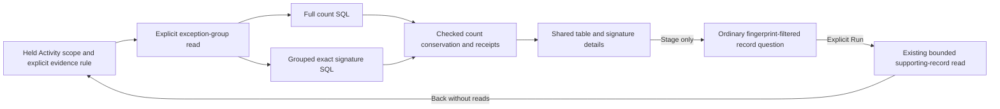

# Exact exception groups

Milestone 416 adds query-only exception grouping inside **Errors & exceptions**.
[Validation](../VALIDATION.md) records actual checks and the independent review.

Open Activity's **Investigate → Errors & exceptions**, choose the evidence rule,
then explicitly **Read exception groups**. The current environment policy,
selectors and fixed observation window are preserved. The signature profile uses
standard reported `exception.type` and `exception.stacktrace`; a custom type-field
choice for the older triage breakdown does not redefine that profile.

The table shows full-population counts, record times in the searched window, and
bounded affected service/version contexts. Inspect reveals the exact signature
inputs. **Stage group records** opens an ordinary fixed record question; **Run**
reads supporting records. Back returns to held Activity and the chosen group.
Opening details, finding, sorting and staging perform no source read.

## Source contract

`exception_fingerprint_v1` is a versioned string dimension over one source record.
Logs use structured log attributes. Spans use attributes from named `exception`
events; type and stack must come from the same event. Every such event must have
the same complete tuple for the span to classify. Duplicate identical tuples
still contribute one span record. Conflicting or incomplete tuples are explicit
unclassified groups. Event-array misalignment refuses the read.

No message, status or `error.type` fallback creates a signature. Missing and
present-empty fields remain distinct. The profile does not trim, rewrite paths,
remove addresses, normalize whitespace or infer a cause. Exact stacks can
fragment when goroutine headers, messages, addresses or build paths change;
these are exact signatures, not portable issue identities.

Classified identity is `ef1:c:<lowercase SHA-256>`. Its UTF-8 preimage is:

```
goo.exception-fingerprint/1\n<byte length of type>:<type><byte length of stack>:<stack>
```

The domain ends with an actual newline. Lengths count bytes, not Unicode code
points. A tuple means the same thing across log/span signals; the signal itself
is not included in the digest. The Go response decoder rechecks the exact inputs
against the returned identity. Unclassified identities are `ef1:u:<reason>`.
Reasons distinguish absent events, both/missing fields, both/empty fields,
conflicting tuples, oversized input and invalid UTF-8.

Limits are 256 bytes for type, 8192 bytes for stack, 32 named exception events and
64 KiB of their type/stack bytes per span. Oversized input is unclassified, never
hashed after truncation. Reads admit at most 1000 complete groups and an 8 MiB
response. Exceeding those aggregate limits refuses the read; no top-N sample is
presented as a full population.

## Counts, clocks and context

The Go `/api/exception-groups` read uses the existing compiler/source family:
exactly one count SQL statement and one grouped SQL statement. Group counts
include unclassified records and must conserve the full count. Changed independent
reads remain diagnostic; drill actions are withheld. Separate receipts and
content bases do not establish a transactional snapshot or complete ingestion.

First/last are matching **record Timestamp** bounds inside the question's fixed
window: log time or span start time. They are neither lifetime first occurrence
nor exception-event timestamps. The UI displays UTC, with exact nanoseconds in
inspectable tooltips.

Affected identities include service name and namespace/version presence plus
literal value. Missing differs from present empty. A deterministic first 32
contexts are returned with an exact distinct total and explicit limited flag.
Counts and first/last use the entire group, independently of that metadata cap.



## Reuse and boundaries

The derived field works in ordinary predicates and grouping, so record questions
can be saved and reused through existing grammar/view paths. A supporting-record
page remains bounded independently of its full query count. A fingerprint that
was not projected in supplied rows displays **Not projected**, not false Missing.

This slice adds no issue lifecycle, resolution/assignment state, new query engine,
manifest requirement, language restriction or durable exception store. Capturing
supporting records remains a separate explicit action; reading the group table
does not publish evidence. Source authority remains in application owners, while
display and local controls reuse the shared components.

See the [storyboard](journeys/exception-groups.md),
[independent review](reviews/EXCEPTION_GROUPS_REVIEW_416.md) and
[OpenAPI contract](../api/openapi.json).
