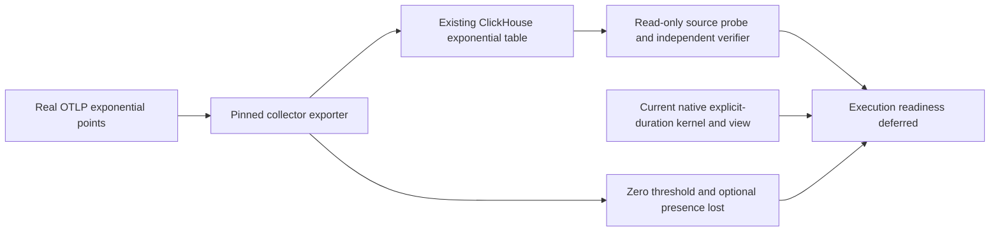

# Exponential histogram readiness — 374

**Decision: defer general exponential-histogram execution.** Real OTLP input
reaches the existing ClickHouse table, but the current source and native
explicit-duration representation do not preserve the required semantics.
No product adapter, kernel, chart kind, collector configuration or schema changed.

## What the real probe establishes

The lab uses Collector Contrib **0.123.0** and
`otel_metrics_exp_histogram`. The pinned exporter source is commit
`bef0a5cfb993608bbcce1eb5859c37295ac8eed2`; exact files and hashes are in the
[source review](reviews/EXPONENTIAL_HISTOGRAM_SOURCE_374.md). The protocol review
pins the official cached OTLP v1.11.0 module separately.

Thirteen valid, uniquely scoped OTLP points were accepted and all 13 stored rows
were independently checked. The fixture derives bucket masses from compressed
rational observations using independent arithmetic. It includes signed buckets,
offsets, zero regions, scale changes, delta/cumulative epochs, a recorded-value
flag and integer mass above JavaScript's safe range.

| Fact | Observed result |
| --- | --- |
| Counts, positive/negative arrays and signed offsets | Exact, including positive mass `9007199254740993` and total `9007199254740998` |
| Start/end timestamps | All nine nanosecond digits retained by `DateTime64(9)` |
| Scale, flags, temporality and qualified string-valued resource/scope identity | Retained in this fixture |
| `zero_threshold` | No stored column; distinct 0.125/0.25 inputs have identical projected payloads |
| Optional Sum/Min/Max presence | Omitted values and reported zero collapse to non-nullable zero |
| Exponential interval evaluation and charting | Not implemented by this probe |

The collisions compare payloads with the identifying probe-series tag excluded.
The exporter stringifies attributes; original OTel value types are a separate
source limitation. Names cannot supply the missing protocol facts. Cumulative growth/reset and scale
changes are verified as captured fields, not as evaluated intervals. The recorded
configuration hash describes the repository bind-mount declaration; it does not
attest the running process's applied configuration. Running image/version,
live table schema and actual ingestion were observed separately.



## Why an explicit-bucket alias is insufficient

Exponential bounds use `2^(index / 2^scale)`. Positive scales can require
irrational endpoints, such as square root of two. The current native kernel uses
finite nonnegative binary64 explicit bounds; its view projects those as exact
rationals. Arbitrary-precision floating point would still be an approximation.

Positive buckets use `(lower, upper]`, negative buckets use `[-upper, -lower)`,
and the zero region is closed `[-threshold, threshold]`. A uniform explicit-bin
closure cannot silently stand for all three. Protocol scale is unrestricted
int32; an implementation limit must be described as unsupported, not malformed
OTLP. See the [representation review](reviews/EXPONENTIAL_HISTOGRAM_REPRESENTATION_374.md).

Reopen implementation after closing source preservation, exact symbolic bounds
or explicit conservative uncertainty, mixed closure, bounded scale/index work,
count overflow, cumulative alignment/reset and zero-threshold changes. Give the
new arm its own source/view contract and independent oracle. Existing query
ownership, explicit Run and immutable capture infrastructure remain reusable.
An exporter upgrade alone does not close the representation boundary.

## Reproduce

```sh
# Offline fixture arithmetic only; no network or container access.
python3 scripts/probe_exponential_histogram_374.py

# Existing lab: read-only inspection, uniquely scoped OTLP ingestion, bounded reads.
NO_PROXY=127.0.0.1,localhost no_proxy=127.0.0.1,localhost \
  python3 scripts/probe_exponential_histogram_374.py --run

# Check retained raw input/schema/rows and seven corrupted-report controls.
node verification/check_exponential_histogram_probe_374.mjs \
  artifacts/exponential-histogram374/report.json
```

The observation report stays unchanged; the verifier produces a separate verdict.
Actual input, table metadata, rows and verification occupy about 84 KiB locally.
No synthetic UI journey or success-model trace is claimed for an unimplemented
execution path. The next roadmap item is the shared narrow-screen grouped row.
