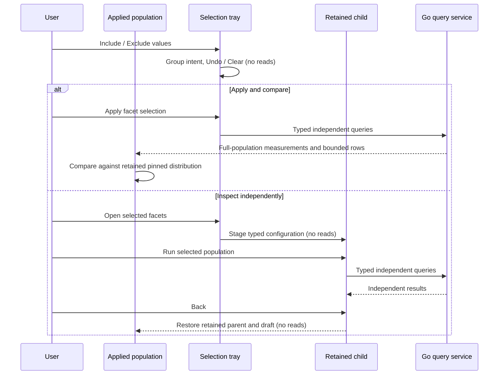
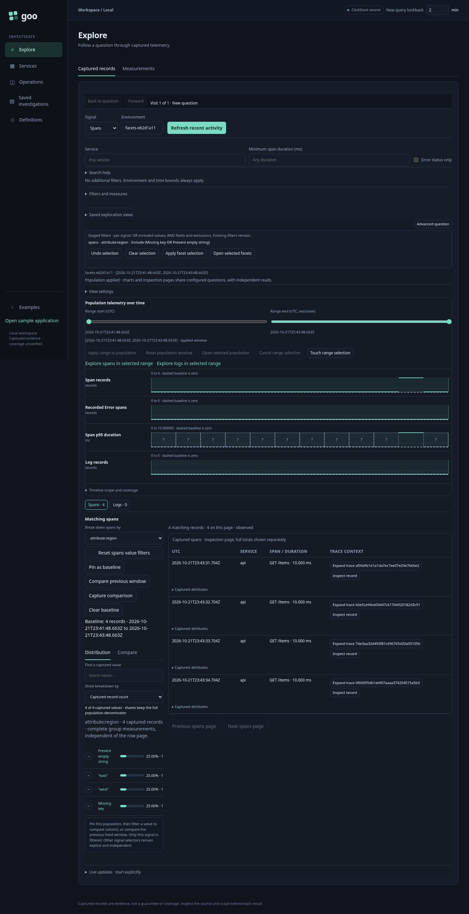
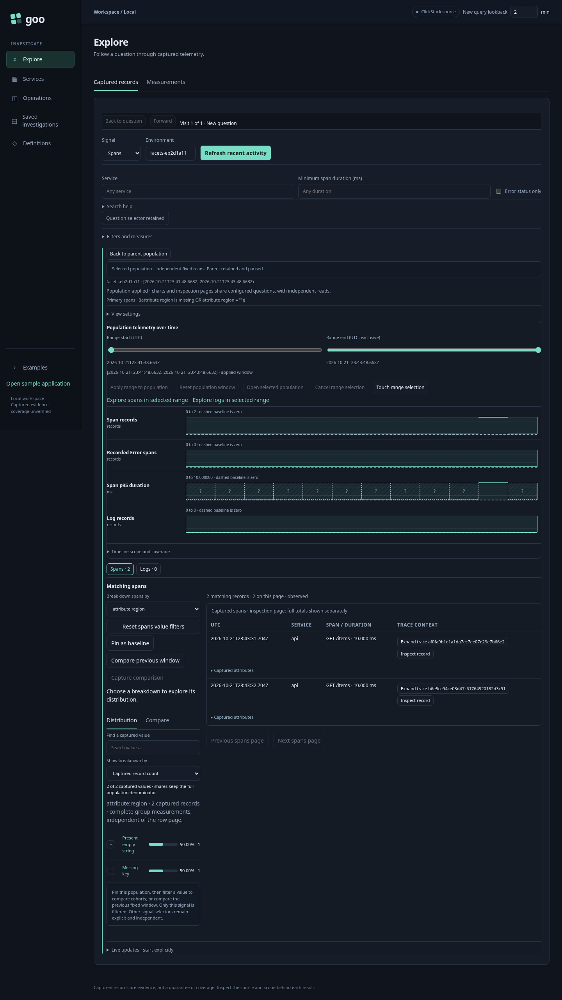
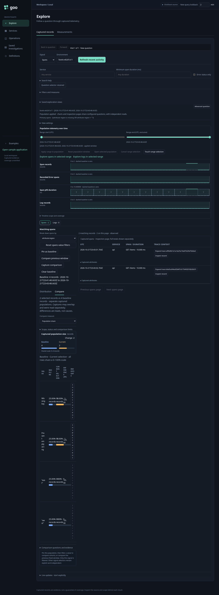
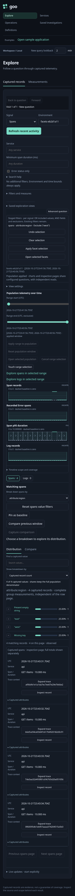

# Staged categorical populations

Recent activity facets support Include (the value button) and Exclude (the minus
button). These gestures pause live updates and stage intent in a compact sticky tray that stays visible while browsing facets;
they do not read telemetry or alter the displayed measurements. Click the same
value/action again to remove it, or use Undo and Clear. Clear preserves one-step
Undo and never removes applied filters.

Within each signal, included values of one field are ORed. Different fields,
exclusions and the complete existing predicate are ANDed. Fields retain their column/resource/
attribute namespace and their signal. Untargeted signal selectors stay
unchanged; selecting values in both signals stages two independent questions,
not a join. Missing keys and present empty strings remain separate choices.

Excluding a present value means `missing OR ne(value)` because Go's `ne` only
matches present fields. Excluding Missing key means `exists`. This is a bounded
categorical operation, not an arbitrary predicate complement or selection versus
all other telemetry. The existing 32-node/four-depth query budget still applies;
over-budget drafts disable Apply/Open and explain how to simplify the selection.
Go validates and compiles applied queries; the UI does not evaluate measurements.

- **Apply facet selection** explicitly reads the configured populations and keeps
  the pinned distribution baseline for the existing Compare view.
- **Open selected facets** stages an independent child without reading. Run
  selected population explicitly reads it. Back restores the original parent
  records, baseline and selection draft without rereading or resuming live updates.
- Save an applied or staged child using the existing exploration-view settings.
  Reopening restores configuration without reading telemetry. The temporary tray
  and its Undo history are not stored; saving is disabled while a draft is pending.
  Apply or Open first to save its predicates. Changing the breakdown explicitly
  reads values for that field while retaining the staged selection, so values
  from multiple fields can be combined.

Journey 96 (`journeys/facet-selection.spec.js`) sends ordinary OTLP spans with
missing, empty, west and east region values, waits for ClickHouse ingestion, then
executes these workflows. Its generated documentation frames are:

Generated Hegel cases check UI query construction against Go compilation and
reference matching. The observed browser depth/read ledger reuses the Quint
retained-population model, with rejecting controls for hidden reads, changed
companion source, missing selection predicates and incorrect return depth.
Bombadil exercises Include, Undo, Exclude, Open and Back with bounds, no-live-tail,
completion and exception invariants. Actual run outcomes are in VALIDATION.md.
