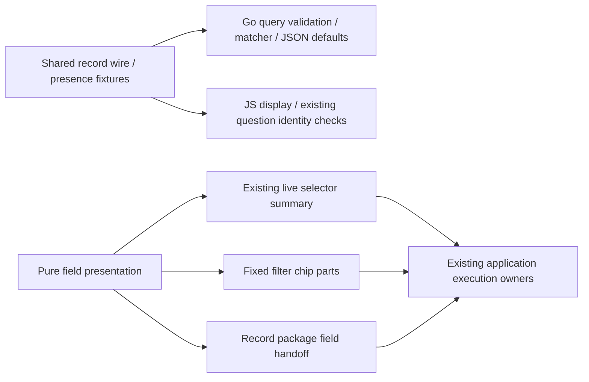
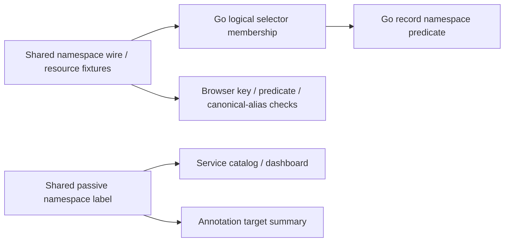

# Record field presentation and wire fixtures

The first B2 slice shares pure record-field display helpers across live selector
summaries, fixed filter chips and record-package instrumentation field handoffs.
`ui/field-presentation.js` owns qualified field labels, operator labels, leaf chip
parts and nested selector text. It never validates a source binding, changes a
predicate, coerces numeric attributes, issues requests or publishes evidence.

| Record predicate | Display distinction |
| --- | --- |
| `missing` | “is missing”, with no value label |
| `exists` | “is present”, including a present empty string |
| `eq` with omitted or empty `value` | `Empty string`; Go's omitted string default is preserved |
| `eq` with literal `Empty string` | `"Empty string"`; literal text is quoted |
| Same key in `resource` and `attribute` | Different qualified fields; neither is a fallback for the other |
| Duration bound | Exact decimal string; no Number conversion |
| `column:timestamp_ns` | Exact UTC with nine fractional digits; original nanosecond string unchanged |

Fixed chips retain qualified `kind:key` labels. Existing live/context selector text
retains its friendly column labels and qualified attribute family labels. Package
handoffs use the same exact qualified key labels. Literal punctuation, case,
Unicode and colons in attribute names are preserved. Native instrument bindings
continue through their own presentation and validation; an omitted native binding
is not reinterpreted as an empty record-filter value.

`testdata/protocol/record-fields.json` freezes ten wire/presence cases. Go validates
the record query, checks its reference matcher against observed field maps and
checks the canonical omitted-default JSON. JavaScript consumes the same fixture,
checks display for both explicit and canonical forms, and verifies that existing
question identity treats omitted and explicit empty strings alike without mutating
the predicate. These are record wire/display fixtures, not new stored identifiers
or a universal validation schema.

Journey 113 stages a fixed question with omitted empty equality, missing resource
key and literal sentinel text, compiles a real record package without a telemetry
read, checks its field handoff, preserves the fixed draft across navigation and
captures a mobile frame. Journey 104 retains the real OTel live-filter/paused-return
path, its observed Quint ledger/rejecting controls and expanded Bombadil selector
text invariant. Hegel live-filter state/swarm checks now call the display helpers
while asserting unchanged draft/applied selectors and empty-default identity.

## B2 scope and request-owner comparison

The [shared-question/native continuation and acceptance audit](QUESTION_PROTOCOL.md)
complete bounded B2. This slice does not introduce a shared request owner.
The inspected fixed exploration owner combines `GooQuestionSession`, abortable
source reads, active-visit checks and retained drafts. The retained catalog owns
metadata generations and cursors; it preserves an older selected snapshot and
rejects stale completions without sharing the source execution lifecycle. Their
begin/invalidate/current/dispose contracts do not establish an interchangeable
owner. A later helper requires two genuinely matching adapters and their lifetime
checks; there is no new global mutable store.

## Service namespace identity — B2 continuation

`testdata/protocol/service-namespaces.json` adds eight Go/JS wire fixtures for
wildcard, missing, omitted/explicit empty and literal named namespace selectors.
Six observed resource maps check each selector's membership, including literal
`missing`, `present empty` and Unicode values. Root Go checks logical identity
matching, the derived record predicate and canonical omitted-default JSON.
JavaScript checks existing browser selection keys, canonical aliases and equivalent
record predicates through the existing question-identity rules. Browser selection
keys remain tab-local tuple keys; they are not server artifact digests.

`GooServiceIdentity.label` now serves both existing catalog/dashboard selectors and
annotation target summaries. Named values are quoted, so `Namespace "missing"`
differs from `Namespace missing`, and `Namespace "present empty"` differs from
`Namespace present empty`. The optional lowercase form is used within annotation
sentences; literal namespace case is preserved. Wildcard descriptions say “all
namespaces”; wildcard service annotation targets remain disallowed by their existing
server validation. Qualified service names, query selectors, keys, native bindings,
links and stored revision digests are unchanged.

Journey 60 now ingests ordinary OTel spans and gauge streams for six namespaces,
including both literal sentinel names. It checks scoped native/record isolation,
separate visible labels, existing declared operation bindings, real observed Quint
traces and an expanded Bombadil label invariant. Journey 98 retains exact service
annotation and saved revision behavior. The [shared-question/native wire continuation](QUESTION_PROTOCOL.md) supplies the
next bounded protocol coverage; no generic request owner is introduced.

The D2 audit adds typed event-time presentation only for `column:timestamp_ns`.
Canonical UInt64 values show exact UTC, including submillisecond predicate edges.
Malformed/out-of-range strings retain their literal representation; an attribute
named timestamp_ns remains an ordinary attribute. Unit tests cover epoch zero,
UInt64 maximum and invalid values; journey 134 checks the real staged selector.
