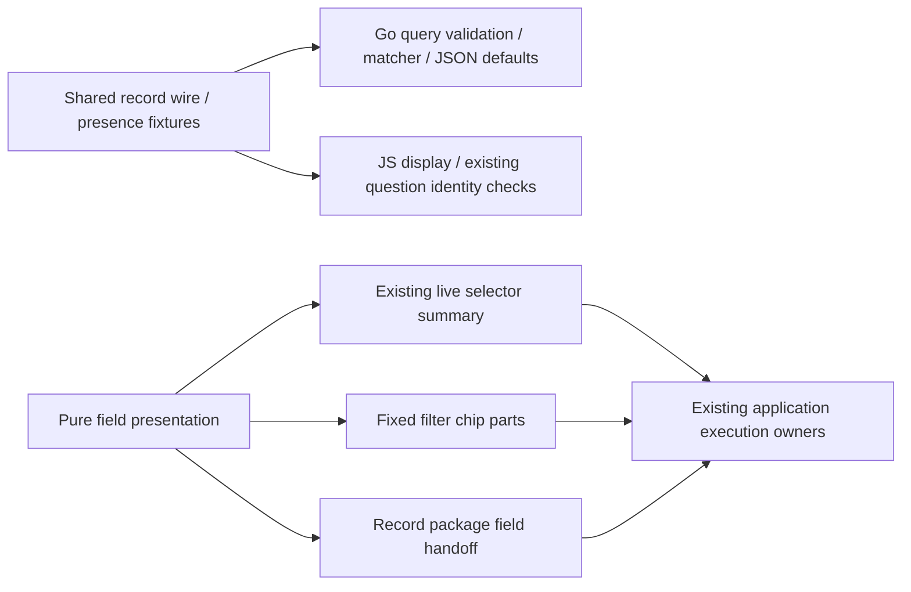

# Record field presentation and wire fixtures

The first B2 slice shares pure record-field display helpers across live selector
summaries, fixed filter chips and record-package instrumentation field handoffs.
`ui/field-presentation.js` owns qualified field labels, operator labels, leaf chip
parts and nested selector text. It never validates a source binding, changes a
predicate, converts numeric strings, issues requests or publishes evidence.

| Record predicate | Display distinction |
| --- | --- |
| `missing` | “is missing”, with no value label |
| `exists` | “is present”, including a present empty string |
| `eq` with omitted or empty `value` | `Empty string`; Go's omitted string default is preserved |
| `eq` with literal `Empty string` | `"Empty string"`; literal text is quoted |
| Same key in `resource` and `attribute` | Different qualified fields; neither is a fallback for the other |
| Duration bound | Exact decimal string; no Number conversion |

Fixed chips retain qualified `kind:key` labels. Existing live/context selector text
retains its friendly column labels and qualified attribute family labels. Package
handoffs use the same exact qualified key labels. Literal punctuation, case,
Unicode and colons in attribute names are preserved. Native instrument bindings
continue through their own presentation and validation; an omitted native binding
is not reinterpreted as an empty record-filter value.

`testdata/protocol/record-fields.json` freezes ten wire/presence cases. Go validates
the record query, checks its reference matcher against observed field maps and
checks the canonical omitted-default JSON. JavaScript consumes the same fixture,
checks display for both explicit and canonical forms, and verifies that existing
question identity treats omitted and explicit empty strings alike without mutating
the predicate. These are record wire/display fixtures, not new stored identifiers
or a universal validation schema.

Journey 113 stages a fixed question with omitted empty equality, missing resource
key and literal sentinel text, compiles a real record package without a telemetry
read, checks its field handoff, preserves the fixed draft across navigation and
captures a mobile frame. Journey 104 retains the real OTel live-filter/paused-return
path, its observed Quint ledger/rejecting controls and expanded Bombadil selector
text invariant. Hegel live-filter state/swarm checks now call the display helpers
while asserting unchanged draft/applied selectors and empty-default identity.

## B2 scope and request-owner comparison

B2 remains active for broader cross-language protocol fixtures and qualified
identity/presence adoption. This slice does not introduce a shared request owner.
The inspected fixed exploration owner combines `GooQuestionSession`, abortable
source reads, active-visit checks and retained drafts. The retained catalog owns
metadata generations and cursors; it preserves an older selected snapshot and
rejects stale completions without sharing the source execution lifecycle. Their
begin/invalidate/current/dispose contracts do not establish an interchangeable
owner. A later helper requires two genuinely matching adapters and their lifetime
checks; there is no new global mutable store.
