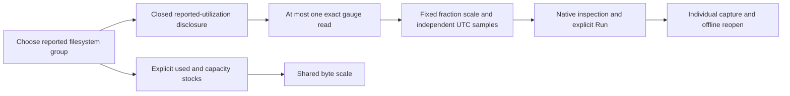

# Reported filesystem utilization

Milestone 215 is implemented and accepted with live OTLP/ClickHouse journeys,
Bombadil, Hegel and independent raw/Quint checks.
[Validation evidence](evidence/filesystem-utilization-215.json).

The pinned OTel 1.37 development convention defines
`system.filesystem.utilization` as Gauge/unit `1`, with a reported filesystem
state. Goo's convenience selection requires `state=used` and the same exact
reported device/mount/mode/type group as the byte view. These are conservative
selection policies; they do not define closed OTel attribute maps or infer a
physical filesystem identity.
[Pinned convention](https://github.com/open-telemetry/semantic-conventions/blob/v1.37.0/docs/system/system-metrics.md#metric-systemfilesystemutilization).

## One additional explicit read

Open a host and expand Filesystem. Used bytes and reported capacity retain their
existing two-read budget; CPU/memory defaults remain unchanged. If utilization
candidates exist in the plan, a closed Reported utilization disclosure appears
inside Filesystem. It inherits the chosen mount and adds at most one unambiguous
gauge read when expanded. There is no second visible mount selector. Duplicate
exact gauge streams require Preview/Run; incomplete discovery suppresses the
convenience read. A group with no compatible gauge is unreported, not zero.
Utilization-only hosts can still use the gauge without byte/capacity exports.

The gauge uses its own owner and fixed 0–1 chart domain, displayed as percentages.
Byte timelines keep their byte scale. Reopening either disclosure is local.
Closing the child cancels its pending work only; parent closure/global withdrawal
also cancels the child. Changing mount clears and closes child evidence immediately,
so a prior mount's fraction cannot appear under the new selection. Refresh remains
explicit and accepted byte evidence is not replaced by a utilization result.

## A reported fraction, not a derived ratio

Source admission checks original identity strings/maps and integer flags. The
original exported decimal must be nonnegative and at most one before Float64
conversion is trusted. An invalid fraction refuses the entire gauge read,
including values just above one that would round to one. It is not clamped or
painted as healthy. A missing-value flag keeps the observation unknown and skips
its numerical payload. The latest unknown does not fall back to an earlier value;
freshness stays tied to the fixed window end.

No used/capacity ratio, state sum, aligned snapshot, threshold, saturation or
health classification is inferred. The live fixture deliberately reports 62.5%,
while division of its independently timed latest byte numbers yields 37.5%.
That division is not an eligible aligned measurement; it demonstrates that the
product renders the reported gauge instead of substituting a calculated ratio.

Inspect stages an exact native gauge question locally. Run and individual capture
remain explicit fresh reads; stored evidence reopens without source POSTs. No new
stock/gauge point record-context API is added. Existing host matching-resource
links retain their broader fixed-window scope.

[Executable storyboard](../journeys/215-filesystem-utilization-storyboard.md).
