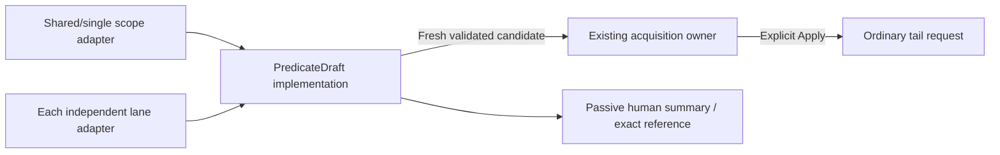

# Consistent Activity filter drafts

Single and paired Activity use the same predicate draft implementation and
condition presentation. They keep separate state instances and source owners.

| Action | Shared scope / single stream | Paired lane |
| --- | --- | --- |
| Edit | Pause the current acquisition; keep the applied selector | Keep reading the applied lane condition |
| Apply | Explicitly read the selected scope | Explicitly replace only that lane's read |
| Discard | Restore the applied predicate and clear CEL drafts; keep Environment/Signal drafts | Restore that lane's applied predicate and clear CEL drafts |
| Save | Require an applied condition with no pending draft | Require both lane conditions applied with no pending draft |

**Discard filter draft** changes predicates only. If Environment or Signal is
still edited, that intent remains pending. The visible Applied badge identifies
the accepted environment and signal, including after a saved view is recalled.
An incompatible retained predicate stays visible and blocks Apply; no branch is
dropped to make it fit the new signal.

A checked CEL expression can be applied and then saved as its ordinary predicate
AST. Its source text and authoring provenance are not saved by rolling Activity
views. Checking an expression is not applying it or acquiring telemetry.

## Readable, exact conditions

Applied conditions and library summaries show fixed span durations in exact
units: `100000000` ns becomes **100 ms**, and `100000001` ns becomes
**100.000001 ms**. The formatter uses integer arithmetic, including values above
2^53, and never rounds a comparison boundary. Raw predicate JSON remains in the
summary tooltip; authoring inputs still label their raw nanosecond unit.

This is presentation only. Query predicates, IDs and saved configuration are not
rewritten. Arbitrary attributes named `duration_ns` do not acquire inferred units.

## Ownership and local work

The private draft owns detached applied/draft ASTs, errors, pending checks and a
revision. Invalid drafts cannot appear clean through null/default normalization;
old tokens cannot commit after edit, reset, discard or retirement. Environment,
Signal, query composition and source acquisition remain in their adapters.
The shared scope adapter additionally retains chip provenance for facet removal.

Closed single-stream Filters no longer clone and render held suggestions on
every tail update. Opening Filters hydrates current held fields locally. This
adds no cache, polling policy or source request.

## Measured result

| Same bounded single-stream exercise | 450 baseline | 451 |
| --- | ---: | ---: |
| Closed suggestion subtree mutations | 6 | 0 |
| Hidden suggestion nodes | 199 | 7 |
| Document nodes | 4,184 | 3,980 |
| New stream connections during measurement | 0 | 0 |

The real stream continued polling in both samples. Their observation intervals
were about six and four seconds; these are DOM/work measurements, not a latency
benchmark or a claim of fewer source polls. Reopening in 451 hydrates all 199
suggestion nodes and observed tenant metadata with zero source reads.

Paired first-row position and visible control count are unchanged at 1440, 390
and 320px. Its measured application source work remains eleven SQL calls for the
same journey plus actor. See [executed storyboard](journeys/filter-consolidation.md)
and [validation](../VALIDATION.md) for actual checks and limits.
