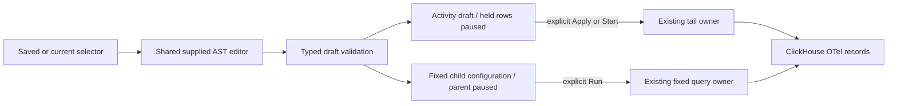

# Shared staged filter editor

Activity's **Filters** disclosure and fixed population **Edit logs/spans filters**
use `GooFilterEditor.mount`. Start with a known field even when no matching record
has appeared. Choose Column, Attribute or Resource, enter its key, choose an
operator and value. Column keys have signal-specific browser suggestions;
attribute/resource keys remain explicit, including OTel convention keys.

- Groups support AND/OR, nested within the existing Go budget of 32 nodes and
  depth four. Removing the last child removes its group. Clear filters removes
  the selector, preserving environment and time ownership.
- Equals with a blank value means **present empty string**. Missing checks absence;
  not-equal does not include missing keys. Add an OR missing condition explicitly
  when that is the intended population.
- String fields support equals/not-equals/contains/presence. Native duration and
  timestamp columns additionally support unsigned decimal ordering; values remain
  strings through transport, preserving uint64 precision. Duration/timestamp
  predicate literals use nanoseconds, explicitly labeled in the editor. This cut
  does not introduce numeric attribute conversion or transforms.
- Editing pauses Activity and preserves its held observations. Apply scope starts
  a new recent read. Invalid drafts block Apply, Resume, Save and fixed analysis.
  Saved Activity configurations restore the complete tree and remain paused until
  explicit Start. Changing environment preserves editor input and validation.
- Fixed editing preserves the configured parent. Open edited population stages a
  child with that signal's selector replaced; companion selectors, grouping,
  measures, environment and UTC bounds remain. Run selected population performs
  the reads. The parent stays paused. Fixed view publication saves configured
  queries; editor drafts belong to their disclosed edit controls until opened.

The helper owns DOM/input state and emits detached normalized predicates or a
validation error. It performs no fetch, navigation, subscription or publication.
Application adapters own execution, drafts and custody. Native Go validation
remains authoritative. Empty `value` is omitted exactly as Go JSON transport does;
its operator retains empty-versus-missing meaning. Existing saved-view hashes and
query API schemas are unchanged. The older single-question builder remains a
separate authoring surface; this adoption covers Activity and fixed population
workspaces, including saved configurations.

Executable storyboard: journey 148 sends three ordinary OTel logs (missing,
empty, canary), verifies ingestion independently in ClickHouse, edits a saved
selector without a source read, checks invalid/keyboard/mobile behavior, applies
it, saves/reopens the exact AST, then edits a fixed continuation before explicit
Run. Bombadil explores staged group changes. Observed Quint replay checks the
source-free staged configuration, including existing rejecting controls. Hegel
checks missing/empty membership through sampled nested JSON round trips.

