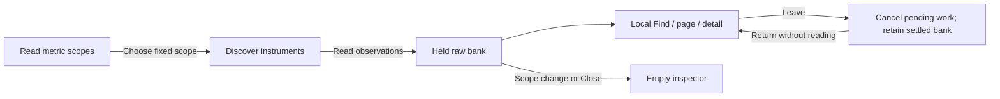

# First-use acquisition and retained inspection

Metric investigation uses three explicit reads: **Read metric scopes** finds
reported services, **Discover instruments** reads metadata for a chosen fixed
scope, and **Read observations** acquires raw gauge rows. Local inspection does
not repeat those reads.

Leaving Metrics cancels pending raw reads while retaining an already acquired
bank in the same mounted workspace. Returning restores its local Find, page,
selected detail and source-read receipt. The fixed observation window does not
advance with wall time. Returning is not a refresh; another **Read observations**
explicitly reads the source again.

Changing discovery scope, starting discovery again or choosing **Close
observations** clears the raw bank. Pending reads from a retired visit cannot
replace held rows or their receipt, even if cancellation is ignored and a
successful response arrives after return. A pending first read leaves no bank
behind; a pending reread retains only the preceding settled bank.

Source schema and access probes remain specific to each explicit request. A
previously compatible table does not prove current access, unchanged schema,
fresh observations or evaluator readiness. This change introduces no persistent
readiness cache or cross-scope reuse. Native evaluation and raw inspection remain
separate source owners.

The bounded 240-point metric-only fixture records six SQL requests for scope
discovery, six for instrument discovery and three for the first raw read.
Missing metric families still have their schema checked; the gauge family has
schema, access and data reads. Local paging, Find, detail and retained return
start no source requests. Rendering is capped at 100 rows per page independently
of the full 240-row held bank. Exact measured response sizes and executed runs
are recorded in the storyboard, rather than embedded as performance guarantees.

The [executable measurement journey](journeys/first-use-acquisition.md) records
per-phase API and source response bytes, returned rows, SQL families, cancellation
and local DOM work over real OTLP data. These are bounded fixture measurements,
not production latency benchmarks or ClickHouse physical scanned-byte estimates.
Actual executed results belong in [validation](../VALIDATION.md).
