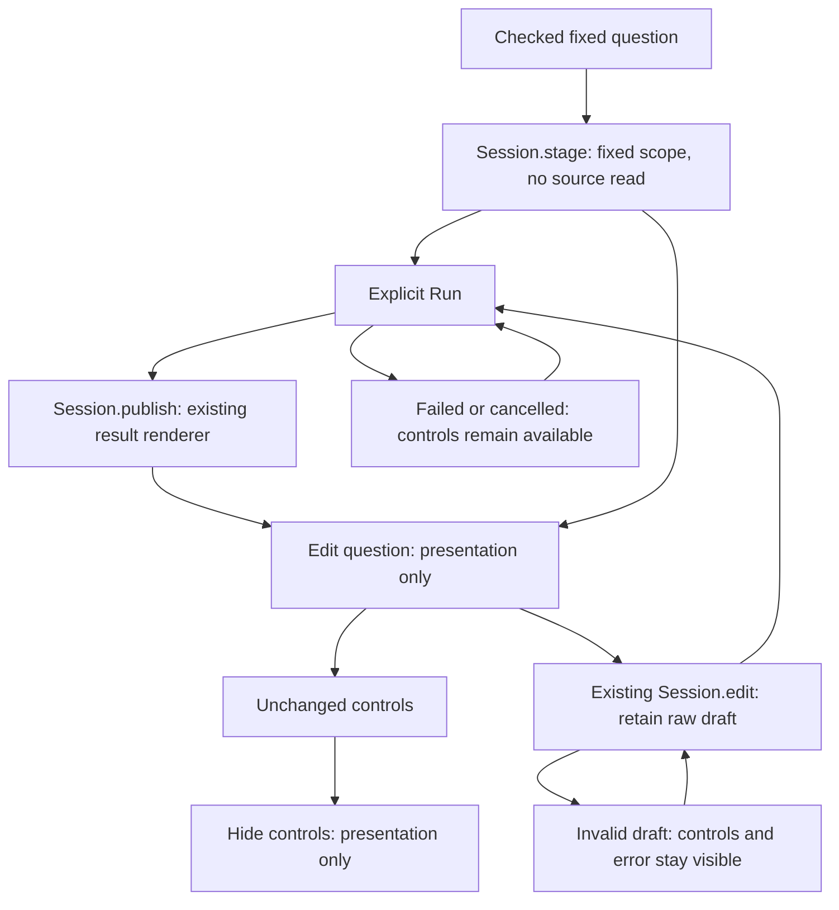

# Read and edit a fixed question

Fixed exploration uses one existing question session. A checked staged question
shows its scope and an explicit Run action; a successful read puts the existing
result before authoring controls. **Edit question** reveals those same controls,
with their raw values and listeners retained. It does not stage, execute, resolve
a new window or replace evidence.

The local presentation helper reads the actual session snapshot. A draft with a
checked `requested` question is an untouched staged question; a draft without it
is an edit. Dirty or invalid drafts cannot collapse. A successful explicit read
returns to reading. Failed and cancelled questions expose their controls, rather
than leaving a collapsed panel without an actionable checked request.

When controls are closed, Run clones the session's checked staged or applied
question. Hidden form values cannot reconstruct or silently change its profile.
When editing, the existing filter/numeric validation and question construction
remain authoritative. Fixed bounds and typed environment policy are preserved;
only an explicit fresh-window action changes the window.

The workbench moves once during construction, after the record panel. It is not
reparented on Edit, and it does not borrow rolling Activity mode. Hidden controls
are inert, their events are stopped, and authoring callbacks check the current
editor owner. Filter and numeric widgets also check `canMutate` before changing
their private draft or refreshing controls: rejecting a notification afterward
cannot undo an already-mutated tree. Programmatic restoration remains available
to the application owner. Closing returns focus only if authoring still owns it. Population
coverage, route retirement and the existing task's return ownership remain
independent. Frozen captures use their separate SavedRecords owner.

Specialized numeric, histogram, grouped-time and reported-edge questions retain
their existing admission and renderers. This change adds no query executor,
result cache, measurement kernel, display kind or saved format.

Acceptance uses genuine matched fresh-document desktop and narrow frames, the
same fixed fixture and saved package bytes, actual chart/record positions and
explicit source-read receipts. Counts of rendered controls are distinguished
from controls intersecting the viewport. Scope/count/status chrome is not used
as a substitute for a substantive result. See [validation](../VALIDATION.md),
[architecture review](reviews/FIXED_QUESTION_ARCHITECTURE_358.md) and
[design review](reviews/FIXED_QUESTION_DESIGN_358.md).
