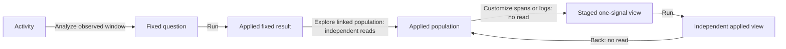

# Customize one signal

After reading a population, choose **Customize spans** or **Customize logs** beside
that signal. The same action works in recent activity, a linked fixed population,
or an applied saved population without a composition. Opening a saved definition
alone stages configuration; Run must finish before customization becomes available.

The child keeps the chosen root query: environment policy, predicates, grouping,
measures and absolute UTC bounds. Its record page starts at offset zero. It does
not substitute a fresh recent window or copy held records into new evidence.

An ordinary single-field grouping starts with the checked aggregate-and-records
composition. An ungrouped or multi-field question keeps its grouping and exposes
existing grouping controls. Histogram and grouped-time profiles retain their
specialized editors. Pending selections, query/display drafts, record paging,
baseline/live configuration and the existing depth limit still guard this action.

## Choose optional span measures

In an ordinary one-query span composition, open the population scope and
**Measures · spans**. **Span duration summary** and **Span status and errors** use
the same terms as fixed analysis. A change stages the query and clears its held
results; Run acquires the requested measures. The fixed window, predicates,
environment and grouping remain unchanged, and delivery starts at page zero.

The captured-count profile excludes status/numeric/specialized queries. To compare
ordinary counts from a planner-enriched span question, explicitly turn off span
status, Run, then capture a matching baseline. Existing status captures retain
their original definition and are not rewritten to fit. Incompatible measure
changes refuse without replacing a declared display or baseline reference.

Customize stages configuration without a telemetry read. Run reads the child
independently. Back restores the paused parent's supplied results and renews its
Customize control; old retained controls remain retired.

See [the responder storyboard](../journeys/294-responder-flow-storyboard.md) and
[ownership review](reviews/FOCUS_ENTRY_ARCHITECTURE_294.md). The linked-population
step reads its planned signals; it does not share a transaction with the fixed result.
