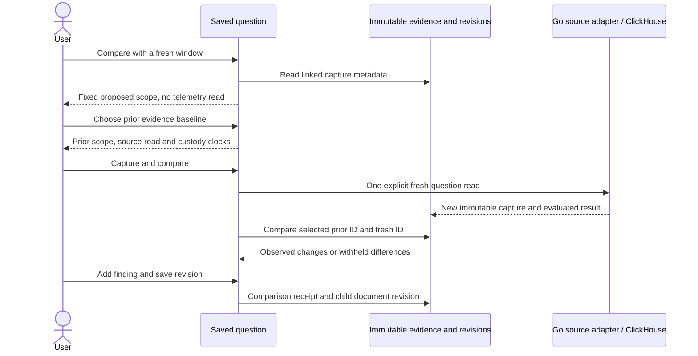

# Compare a saved question with a fresh window

A saved question with linked evidence offers **Compare with a fresh window**.
Opening it focuses the baseline selector and hides the redundant opener. The shared
action group shows **Capture and compare** before capture, then **Compare retained
capture** for source-free retries. **Preview options → Close preview** restores
focus to the opener. Live comparison retains its own explicit execution controls.
Save any draft edits first. Opening the preview performs no telemetry read: it
fixes a proposed window ending at preview time, keeps the saved question's duration
and definition, and loads metadata for linked captures.

Select **Prior evidence baseline** explicitly. The preview distinguishes the
prior question scope, its source-read time, immutable custody time and the proposed
fresh scope. Linked captures with a different signal, definition or environment
are disabled. A different historical window is allowed and remains visible.
The fresh duration comes from the saved question, not from whichever prior capture
was selected; the comparison engine explains different window lengths.

**Capture and compare** performs one new source read for the previewed question.
It never refreshes the baseline. Both capture IDs are then passed to the existing
source-free comparison panel. A failed comparison GET can be retried through
**Compare retained capture** without another source read. Failed capture requests
require an explicit retry; successful captures remain in the capture library even
if the active investigation changes. Late results do not mutate another draft.

Add a finding through **Add comparison to investigation**, then **Save revision**
to share the frozen comparison and finding. The original question card, its fixed
scope and linked evidence remain unchanged. The fresh capture is referenced by the
comparison; it is not silently linked as matching evidence for the old question.
Use **Add comparison question** to make the new scope reusable if desired.

## Scope and evidence semantics

Record selectors, summary choices, environment and native package/source bindings
are unchanged. Only the time scope moves. Millisecond windows keep their exact
millisecond duration. Native exact scopes retain their exact nanosecond duration,
with canonical string bounds and matching enclosing millisecond bounds. The
fresh end is the fixed preview clock in milliseconds, expressed exactly in
nanoseconds when required. There is no inferred SDK phase alignment.

Records and native gauge/counter/explicit histogram questions are supported.
Lifecycle cohort comparisons remain outside this workflow. Full native coverage
is still required: asynchronous boundaries, gaps, resets, missing streams, layout
changes or empty data can withhold numeric differences. The existing **Find
comparable windows** workflow can discover observed support in retained native
captures. A fresh window does not assert ingestion completeness or health.

No new receipt kind or persistence endpoint is introduced. A pure question-step
projection proposes scope; existing capture, comparison receipt and document APIs
retain custody and evidence. Preview freshness does not advance automatically:
open a new preview explicitly to change the proposed end time.

The executable [storyboard 57](journeys/README.md#57--resume-with-fresh-evidence)
uses real HTTP spans and OTel system memory gauges, rejects a changed definition,
retries a failed comparison without recapture and shares findings in a fresh browser.
