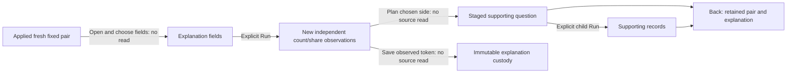

# Explain a fresh fixed comparison

After applying a fresh count or mean-duration comparison, open **Explain population
differences**. Choose one to six qualified fields, then **Run explanation**. Opening
and choosing fields read nothing; Run acquires new count/share observations over
the two complete original questions.

The explanation asks which reported populations differ. For a mean comparison,
it describes population composition; it does not attribute the latency change or
establish causes, significance, complete telemetry or unique requests.

The immediate view keeps the actual operand roles: **Previous window** or **Fixed
baseline window**, and **Selected window**. Both exact policies, filters and UTC
windows remain available with independent source clocks and bases. The original
mean/group/interval profile stays in the request; the existing engine derives
count questions separately. Loaded inspection records and the held comparison's
old counts do not become the new explanation's denominator.

Use an observed field/value's side actions to stage an Include/Exclude condition
or open its supporting question. Planning is pure. The chosen side retains its
whole original profile and predicate, with the exact value condition conjoined;
it does not filter both operands. Missing, present-empty and ordinary strings
remain distinct. Large values may be displayed while their filter action is
unavailable under the existing predicate budget.

Opening a side stages a records child. Run there explicitly reads supporting
records. **Back** restores the held pair and observed explanation without another
source read, including selected fields, local editor text, shown values and
disclosures. Fresh handlers own the returned task; old callbacks and pending
planner/source completions cannot regain authority after departure or replacement.

A field that is partial, refused or inconsistent does not assert comparable rows
or rank a missing observation as zero. Other usable fields retain their own
results. An empty successful population remains distinct from failed acquisition.
Editing fields retires the old result; a new Run is explicit.

**Save observed explanation** promotes the existing server-held result token,
without rerunning telemetry or trusting browser-supplied counts. Reopen reads the
stored observation. Rerun is separate new evidence, and expired-token or unknown
save acknowledgment never causes an automatic read or publication retry. Stored
explanations use neutral Baseline/Selection labels with their complete original
questions; no custody-format label change is introduced.

This entry covers applied fresh fixed-query count and mean pairs. Captured mean
baselines, temporary selected/rest comparisons and automatic field/causal discovery
remain separate tasks. Other explanation entry points retain their existing
navigation behavior.

Implementation, generated semantics, genuine native/ownership/model checks and
actual desktop/narrow frame acceptance pass for 348. See
[validation](../VALIDATION.md) for the passing gates and separately recorded failed
regression attempts, and the
[architecture contract](reviews/FRESH_PAIR_EXPLANATION_ARCHITECTURE_348.md) and
[existing explanation engine](POPULATION_EXPLANATIONS.md).
