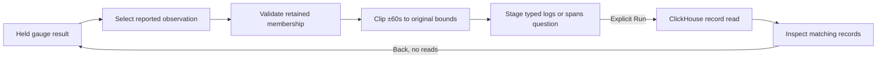

# Records around a gauge observation

Milestone 388. Implemented in ordinary Measurements; see
[validation](../VALIDATION.md) for checked behavior and limits.

The user task is to inspect logs or spans reported near an unusual or unavailable
gauge observation. This is a time association within one reported service
instance, not evidence that a metric caused a record or that the source is complete.

The initial surface is ordinary Measurements. Select an observation on a service
gauge timeline, then choose **Logs around observation** or **Spans around
observation**. The action stages an ordinary record question. **Run** explicitly
reads telemetry; **Back to measurement** restores the held native evidence and
selection without another telemetry or capture-store read.

Nearby-question staging is a separate supplied-evidence capability from native
source actions. After Back, the same unchanged held result can stage another
nearby question without reacquiring the gauge. Editing the definition/window,
applying another display, starting a new measurement or replacing the result
retires the old capability. Hidden owners cannot stage. This capability grants
no native capture, source execution or display-save authority; those actions
retain their existing checks.

## Scope and admission

`exploration.PlanNativeObservationContext` and the pure browser projection select
one uniquely retained stream and one uniquely retained reported sample timestamp
from a gauge result. The Go helper validates the full retained result by replay;
the browser owner binds its successful response to the requested question and
current visit, then checks the selected series/sample. The browser projection is
not a second gauge evaluator or a custody-integrity verifier. The stream must match the measurement's source
identity. A timestamp supplied independently of the retained result cannot grant
navigation. Recorded zero, stale values and unavailable/no-recorded-value samples
remain distinct; a real reported timestamp can supply context without a magnitude.

For observation `at` and original half-open bounds `[lo, hi)`, the record interval
is `[max(lo, at − 60s), min(hi, at + 60s))`. The upper end is excluded. Arithmetic
uses integer nanoseconds, saturates before clipping and never consults the current
clock. The enclosing millisecond source window is rounded outward; timestamp
predicates enforce the exact nanosecond interval. A selected point outside the
original measurement bounds is refused.

The record question preserves:

- Signal, chosen explicitly as logs or spans.
- Reported service name and instance ID.
- Resource namespace, distinguishing missing, present-empty and named values.
- The original environment policy and exact clipped timestamp bounds.

Metric name, unit, point attributes, scope/schema identity and unrelated resource
attributes do not become record filters. The result carries `atNS`, `fromNS`,
`toNS`, `radiusNS: "60000000000"`, and both `grain` and `relation` equal to
`observation-context`. This projection is storage-free and introduces no new HTTP
route. The resulting ordinary question uses existing execution and save paths.

For Go callers holding an evaluated result:

```go
context, err := exploration.PlanNativeObservationContext(result, stream, "logs", sample.AtNS)
if err != nil {
    return err
}
// Present or stage context.Question; execute it only on the user's Run action.
```

## Boundaries



Existing counter/histogram interval planning and reported-exemplar navigation
retain their own admission. A gauge point is not promoted into a native coverage
interval. The first cut excludes stock, resource-bound gauges, Saved and service
dashboard continuation; those surfaces require their own retained-evidence
admission before adopting the projection.

Trace expansion remains a separate, broader read by reported trace ID. Saving or
sharing the child question retains its filters, not a durable citation to the
in-tab native parent. Parent source basis, read time and evaluation window are
preserved independently of a fresh record read.

See the [roadmap](ROADMAP_2026_11_09_CHECKPOINT_387.md), existing
[interval context](NATIVE_RECORD_CONTEXT.md), and [validation](../VALIDATION.md). The
[executable storyboard](../journeys/388-gauge-observation-context-storyboard.md)
shows the actual native-to-record journey, failure/retry and retained return.
