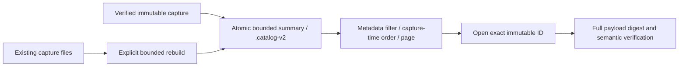

# General investigation captures and stable inspection pages

Implemented locally: Explore span/log questions and observed service inventories
can be named and captured without an application manifest. **Saved investigations**
contains their catalog, immutable receipts and the existing operation-capture path.
The same inspection components render live and saved records; read-only instances
have separate DOM identities and hide the query editor. A saved capture can open
as a live question or produce a reusable package without changing stored evidence.

## What is frozen

The Go server accepts a typed question, not caller-supplied evidence. Saving
rereads that fixed environment, event-time window, predicates and grouping. It
retains the actual source plan/parameters, complete supported counts/groups,
field discovery, warnings/state and a bounded inspection row bank. Therefore a
new capture can differ from the previously displayed live query. The dialog makes
that reread explicit.

For Explore, one row read retains the **first 1,000 ordered records**, with one
extra sentinel to detect more source records. Page size is 100 and saving resets
inspection offset to zero; an inspected live page is not a selection to archive.
Counts and groups still cover the full matching captured population. A capture
with 1,205 matching spans may contain 1,000 stored records and ten stable inspection
pages. Its final stored page does not suggest that the source had only 1,000 spans.
Source byte/time/memory/group budgets still apply; an oversized read fails instead
of silently publishing a partial aggregate. Inventory retains its whole bounded
aggregate, at most 1,000 service/span-name pairs, rather than raw spans.

Aggregate/count/row/field reads remain separate and nontransactional. An original
`changed_between_reads` state is preserved, not repaired by storage. Sampling,
ingestion completeness, clocks and fleet membership remain unverified. Immutable
captures freeze the evidence actually returned, not the underlying database.
Identical duplicate records are preserved; no synthetic event identity or unique
invocation count is inferred.

The record bank's content basis remains constant across its pages. Page position
is presentation metadata; the receipt records the original normalized question.
Opaque local cursors bind an offset to a specific content-addressed receipt and
reject use with another receipt or successor. Stored pages do not query ClickHouse
and cannot shift after a late arrival or retention change. Ordinary live Explore
paging still uses mutable offsets; the stable guarantee applies to saved receipts.

## Reopen, refresh and branch

| Action | Behavior |
| --- | --- |
| Capture investigation / inventory | Server rereads the fixed question, publishes an immutable receipt and opens its first saved page. |
| Open catalog item, ID or `#capture=<id>` link | Read and verify stored evidence, with no telemetry query. A fresh browser starts on the first page. |
| Previous / next saved page | Select records within the existing stored bank, retaining count, groups and basis. |
| Refresh fixed question | Load the predecessor server-side, retain its typed question and bounds, require the same compiled source plan, then capture a successor. Failure leaves the predecessor untouched. |
| Previous revision | Reopen the predecessor by ID; no source read or overwrite. |
| Open as live question | Explicitly run the saved selector and fixed bounds against the current source. Subsequent ordinary Explore runs can resolve a new lookback. |
| Create package | Reuse the captured selector through the existing YAML/preview flow. Package definitions and their fresh previews remain separate from frozen evidence. |

A compiler-plan change blocks refresh with a diagnostic rather than silently
changing the saved question's physical interpretation. The old receipt remains
reopenable. This is conservative exact-plan matching, not SQL equivalence checking.
The single configured workspace source is assumed; production source identities,
backend/evaluator version pinning and renderer archival remain future work.

Trace expansion and linked/surrounding logs opened from a saved row are independent
**fresh reads** of the original bounds. They are not added to the stored receipt.
Pinning a distribution baseline remains browser-local. Explicit **Capture comparison**
now rereads/stores both questions and a pair receipt; expanded inspectors are not
automatically archived. See [comparison contract](ERROR_COMPARISONS.md).

## Storage and API

- `POST /api/captures`: `{title, question: {kind: "explore", explore: Query}}`
  or `{title, question: {kind: "inventory", inventory: InventoryQuestion}}`, or
  `{title, question: {kind: "comparison", comparison: {baseline: Query, selection: Query}}}`.
- Refresh: `POST /api/captures` with `{parent: id}`. A supplied question must match
  the predecessor after presentation normalization. Clients cannot supply evidence.
- `GET /api/captures/{id}?cursor=...`: verified receipt and one stored record page,
  or the bounded saved inventory. Responses include retained-record/truncation
  metadata and previous/next cursors.
- `GET /api/captures?cursor=...`: 20 receipts per page in stable ID order, with an
  exclusive seek cursor. Directory scans are bounded at 10,000 entries. Listing is
  not a snapshot of a growing directory; new IDs before the cursor appear after a
  catalog refresh. Direct IDs remain reopenable if the catalog scan budget is hit.

Python proxies these endpoints; Go owns validation, source execution, custody and
paging. General captures live under `exploration/` in the existing investigations
volume. Publication writes a private temporary file, syncs it, atomically links a
complete immutable file and syncs the directory. Load checks its content digest,
version and receipt shape; the maximum file size is 24 MiB. Catalog entries on a
page are verified before display. Source failure cannot become a saved zero-count
receipt, and corruption is not hidden as no data.

The capture timestamp is server receipt time after reads, distinct from question
event-time bounds and source-read metadata. It is not immutable ingestion custody
or database time travel. A hash and cursor are integrity/position identifiers,
not authentication or authorization tokens. Links reopen this local workspace;
there are no team accounts, cross-workspace sharing, quotas, retention policy,
backups, catalog index, deletion API or general capture export yet.

## Executable evidence and next direction

[Journey 32](journeys/README.md#32-preserve-general-evidence-and-page-a-stored-record-bank)
checks a real collector/ClickHouse fixture, independent source count, late insertion
before old pages, successor lineage, source-free browser reopen, service restart,
span/log/inventory rendering, copied link, explicit live branch, stale open isolation,
read-only controls, unique component IDs and mobile containment. Go HTTP tests
close the source entirely before reopening/paging. Hegel state/swarm explores
arrivals, source changes, captures, branching refreshes and stable record banks.
Quint checks actual browser receipts and rejects changed old counts, changed page
bases, changed refresh scope and accepting a cross-revision cursor. A dedicated
read-only Bombadil actor checks reachability and data-aware paging/receipt invariants.

The [collaboration research](COLLABORATIVE_INVESTIGATIONS_RESEARCH.md) recommends
personal saved questions and ordered investigation cards next, with explicit
frozen-evidence versus live-question references. Shared editing, permissions,
conflict handling, comments and ephemeral presence follow as separate capabilities;
a freeform multiplayer canvas is not implemented by this milestone.

Opt-in [core measures and time charts](CORE_WORKBENCH.md) are retained in new Explore
captures and stay fixed across pages. Older captures without these optional fields
remain reopenable; adding a measure is a new live question, not a mutation of old
evidence. Summary/chart component counts retain independent-read disagreement.

[Investigation notes](WORKBENCH_CONTEXT.md) can now cite an exact general capture or comparison ID. Notes preserve their own ordered revision history; they neither refresh nor rewrite cited evidence. Deployment context in a saved Explore view is an explicit fresh local read, with marker receipts separately pinnable into notes.

Typed `measurement` captures now retain the complete bounded gauge, counter,
histogram or lifecycle input/result rather than an Explore record page. They
share immutable IDs, parent refreshes, deep links and note references. Stored
source plans are evidence: reopening does not require the current compiler to
emit the same SQL; refresh does require an identical current plan. Canonical
source JSON keeps evidence bases stable across browser transport spellings.
See [measurement packages](MEASUREMENT_PACKAGES.md).

## Search by task and recency — 242, bounded summary correction 244

Saved → Browse evidence uses literal title search, receipt capture-time order,
and optional kind/known signal/exact environment filters. Editing stages a search;
**Find captures** applies it. Same-title captures keep separate IDs. Search covers
the admitted catalog before paging; it never rereads telemetry or changes an open
capture. The legacy ID-ordered list API and exact-ID reopen retain their contracts.

`GET /api/captures/search` returns versioned bounded summaries (not receipts/full questions); opening still fully verifies
stored contents. Existing stores need the explicit rebuild command documented in
[the catalog contract](CAPTURE_CATALOG_SEARCH.md). Missing metadata, bad stamps,
corruption and scan limits are errors, distinct from no matches. The shared declared question scope supplies signal/environment, including native
metrics and lifecycle captures; arbitrary service predicates are not inferred.

[Journey242](../journeys/242-capture-search-storyboard.md) exercises save → leave →
find beyond page one → reopen with real OTLP/ClickHouse data and no search/reopen
telemetry reads.

[Journey 244](../journeys/244-capture-summary-storyboard.md) covers a large accepted
question, summary browsing and explicit derived-index migration without payload changes.
