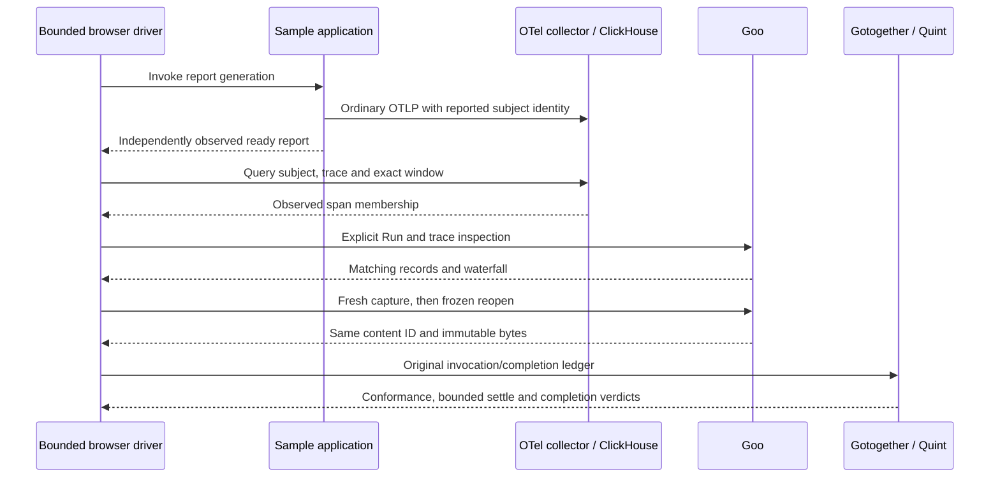

# Gotogether follow-on pilot

This isolated consumer experiment pins core and qhegel to
[`65093ec1c98abd095f6d399fae038e466555c231`](https://github.com/chucklehead-dev/gotogether/tree/65093ec1c98abd095f6d399fae038e466555c231),
remote version `v0.0.0-20261026141556-65093ec1c98a`. It follows the
[initial onboarding and shadow pilot](GOTOGETHER_PILOT.md). Production and existing
verification module dependencies remain unchanged. This is not a migration.
GitHub's CI API returned `Forbidden`; remote CI success was not verified.

## Parser fix

The [consumer regression](evidence/gotogether-followup/parser/parser_test.go.txt)
passes in 0.023s, with no skips. Eight second-object/garbage variants now produce
line-specific errors, including first/second lines and terminated/unterminated
lines. Valid whitespace passes. A genuinely truncated final object still retains
the prefix and returns `*TornTail`, with an explicit loss record at this pin.
The previously reported defect is fixed at this version; the old issue text is
historical and should not be filed as a current defect.

## Real lifecycle preparer and overlay mutant

Six bounded faithful schedules pass against Goo's existing one-subject Quint
model in 13.201s. They execute actual `lifecycle.Policy.Prepare`, covering cutoff
equality, visibility strictly after the cutoff, duplicate delivery,
terminal-before-accept and frozen snapshots. The recording import changes to the
new toolkit in scratch; the lifecycle algorithm is not reimplemented.

A build overlay changes only delivery exclusion `received >= cutoff` to
`received > cutoff`. The application source is untouched. qhegel's
`FindViolation` catches the expected **state mismatch after `advance95`** and
shrinks to `terminal → advance95` in 33.953s: seven Quint checks and seven cache
hits. Both proper one-action subsequences match the independent bounded
projection. This establishes necessity within the duplicate-noise generator,
which varies zero to six duplicate deliveries; it is not a globally minimal
arbitrary lifecycle failure or a broad concurrency campaign.

The useful diagnostic is the equality boundary: a terminal delivered at 95 must
remain invisible at evidence cutoff 95. The overlay exposes it early. The model
reports the failing transition and observed `unknown=true`; TypeScript does not
supply the failing model's full ITF state. These timings are single observations,
not a performance comparison with Goo's existing Hegel suite.

[Receipt](evidence/gotogether-followup/lifecycle/receipt.json),
[test harness](evidence/gotogether-followup/lifecycle/pilot_test.go.txt),
[smallest trace](evidence/gotogether-followup/lifecycle/smallest-mutant-trace.json)
and [exact overlay diff](evidence/gotogether-followup/lifecycle/overlay-diff.json)
retain the experiment. Production `prepare.go` SHA256 remains
`8b85766e87a34d0d324a73fe039930a8f94402c7920641c1c9b38679e344a3ca`.

## One real cross-application journey

The accepted browser run passes in 13.074s: generate a report in the sample app,
observe its subject/trace correlation independently in ClickHouse, inspect the
same fixed-window span in Goo's records and waterfall, capture, then reopen the
frozen capture. The source query, API rows, DOM inspection and waterfall agree
on one span; this is the observed population, not a complete-trace guarantee.
Three explicit Explore POSTs and one fresh-read/custody capture occur. Independent
ClickHouse probes comprise seven subject-correlation polls and two fixed-window
membership reads. Five capture/store GETs and 29 other metadata GETs are separate;
Goo's internal SQL statement count was not measured. Reloading
the saved capture adds no source POST. Ordinary OTLP flows through the existing
collector; no positive source or UI response is mocked and traffic stays running.

The coordinator persists ten dense invocation/completion checkpoints. A click is
recorded before the action, and completion only after the corresponding DOM,
source or stored-byte checks succeed. One actor/run and coordinator sequence
establish ordering; timestamps from different hosts are not used to infer it.
The external adapter maps these original checkpoints to native invocation/call
steps, retaining their original times. It does not pretend that `qobs.Invoke`
ran inside the browser or re-stamp old events as newly executed operations.



The settle marker means **this finite driver finished its calls and response
bodies**. It does not assert global collector drain, ingestion watermarks,
complete telemetry or quiescence of the running application. The model's
`eventually: [done]` requires the reopen checkpoint; checking only conformance of
a finite prefix is insufficient.

| Actual model check | Result |
| --- | --- |
| Accepted browser ledger | Conforms, settles and completes |
| Changed reopened digest | Rejected at reopen |
| Changed displayed membership | Rejected at inspect |
| Conforming prefix without settle | Remains unfinished; eventual completion unjudged |
| Settled run with reopen invoked but never completed | Pending call detected; eventual done violated |

The full validation and four controls pass in 24.498s, with zero skips. A focused
3.296s follow-up strengthens the prefix check to require conformance and completed
prefix calls, while still refusing to call the journey settled. The binding and
[checker source](evidence/gotogether-followup/cross-check/cross_test.go.txt) are
retained with their raw test output. Missing Quint is fatal.

Capture ID: `e3645c0e731fd8c2674dca913ccb6cd27012a98e2309aa353ce693c23b0c225f`.
Stored evidence is 6,080 bytes before and after reopen, SHA256
`d5456ccd5c4a9d3ec09477e90d6afc95191165446fc89e734bf827441bef06cd`.
The independent test-only helper unmarshals the public `SavedCapture`, clears its
ID, marshals it and computes standard SHA256 without calling the production
digest function. Exact stored bytes are checked separately. The model checks
identity continuity; these independent checks establish source membership and
byte integrity rather than deriving them from model acceptance.

The first browser attempt reached the actual capture but failed its scratch JS
content-ID oracle: parse/stringify erased escaped slashes retained inside Go
`json.RawMessage`. That diagnostic remains in scratch. A typed Go helper corrected
the harness without changing the application or weakening the hash assertion;
the complete accepted journey used a new report. Failed attempts are not counted
as passes. Browser trace and diagnostics remain beside the scratch ledger.

Actual frames: [ready report](journeys/screenshots/gotogether-report-ready.png),
[correlated Goo trace](journeys/screenshots/gotogether-correlated-trace.png), and
[immutable reopening](journeys/screenshots/gotogether-immutable-reopened.png).
The [executable browser harness](evidence/gotogether-followup/cross-app/run.js.txt)
and [accepted ledger](evidence/gotogether-followup/cross-app/ledger.json) preserve
the journey. This round exercises a Playwright external driver, not a new Bombadil
adapter or external-driver shrinking. Existing Bombadil coverage is unchanged;
its future adapter should consume the same invocation/outcome boundary.

## Reproduction and boundaries

Scratch root: `/tmp/goo-gotogether-followup`. Compact source, pinned module/sum
files, models, bindings and actual logs are retained under
[the evidence directory](evidence/gotogether-followup/). Source/module/log files
have an added `.txt` suffix in the repository; restore their original names in a
scratch directory before executing. The overlay diff is escaped JSON to preserve
its exact whitespace; apply its one comparison change to a copied `prepare.go`
and point `overlay.json` at that copy. Absolute Goo/tool paths must match the
local checkout. The receipt hashes refer to original file bytes.

Use Go 1.27.2, Quint 0.32.0, a writable XDG cache, and the environment's normal
module/build caches. Both tool modules are remotely resolved with checksum
verification; only Goo has a local replacement. Pinned gotogether-start,
workflow, Hegel and traces skills guide the experiment. Missing Quint fails these
checks rather than skipping them. TypeScript and `Eval:"quint"` are explicit;
Rust, qweave and gosim were not exercised.

Lifecycle commands, run sequentially in the restored scratch module:

```sh
go test -run '^TestFaithfulBounded$' -count=1 -v .
PILOT_MUTANT=1 go test -overlay overlay.json -run '^TestMutantShrinks$' -count=1 -v .
```

Initial setup diagnostics were harness/environment problems: a nonexistent
`hegel.TestCase.Fatalf` was corrected to `Errorf`, and the Hegel cache needed a
writable `XDG_CACHE_HOME`. Restricted proxy access was retried through the
supported escalated command; final remote modules resolved with checksums.
These are not library semantic defects. No performance, filesystem durability,
complete-telemetry or production-readiness claim follows from this pilot.

Cross-app model validation, in the restored `cross-check` scratch module:

```sh
QUINT_BIN=/absolute/path/to/quint \
GOO_GOTOGETHER_LEDGER=/absolute/path/to/accepted/ledger.json \
GOTOGETHER_KEEP=/absolute/path/to/output \
go test -json -count=1 -timeout=150s .
```

All campaigns stop after the stated gates pass. No extra browser exploration or
broad Goo test suite was run for this isolated testing/documentation change.
