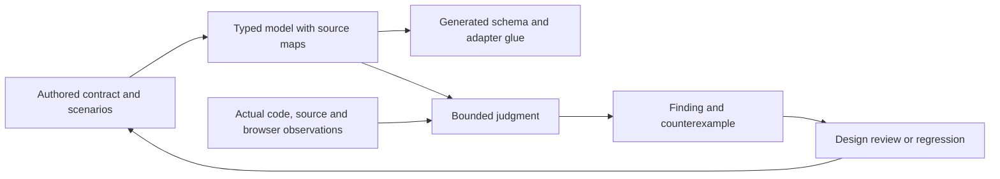

# Ideal scene: behavioral contracts through the whole development lifecycle

Design exercise, 2026-11-14. This is a proposal, not a claim that these features
are implemented or a replacement for Goo's execution roadmap. It draws on Goo's
[acquisition pilot](GOTOGETHER_ACQUISITION_PILOT.md),
[posted adoption feedback](reviews/GOTOGETHER_SHADOW_FEEDBACK.md), independent
architecture/authoring/lifecycle reviews, and upstream gotogether at
[`fc32bcb9`](https://github.com/chucklehead-dev/gotogether/tree/fc32bcb9d4ad5e3c9bf8850aed8c45ca55cb914c).
Goo's pilot remains pinned to `771dcce`; this exercise changes no dependencies.

## The ideal

A developer describes a small behavioral contract, implements ordinary code,
and sees the same contract exercised during design, testing, refactoring and
operation. Product stories, model actions, actual observations and counterexamples
are connected. Mechanical bindings and reports are generated outputs.

Goo supplies domain meaning: source scope, presence, clocks, identity, units,
acquisition authority and custody. Gotogether supplies reusable mechanics for
exploration, simulation, reconstruction, judgment and diagnosis. Neither tool
should force the other to become its application framework.



For Goo, the useful unit is a handful of durable operator contracts rather than
a model for every milestone: see telemetry, isolate a population, follow context,
compare compatible observations, preserve evidence or reuse a question. Raw
metric profiles retain their own temporality/completeness rules underneath those
workflows. Sharing contracts must not produce a universal result or permission
object that erases those differences.

## A feature's ideal lifecycle

### 1. Ideation starts with examples and counterexamples

The retained-investigation story needs three cases before implementation:

- Return shows the same admitted question, window and receipt without reading.
- A retired read can finish successfully but cannot acquire adoption authority.
- A missing log tail leaves completion unjudged.

A living storyboard contains the human explanation, named cases, a small model,
observation schema and expected failure distinctions. The model checks the
proposed design before a browser or service exists. Required states and scenarios
make rare cases explicit; a positive sample is not a proof of universal coverage.
Counterexamples should be readable as product stories, not just variable dumps.

### 2. Keep the authored behavior near its explanation

Support ordinary Quint fenced blocks in Markdown, with stable block IDs and
source maps back to original lines. For small local contracts, permit equivalent
blocks in Go doc comments. Use one authoritative definition per contract; the
other locations link to its stable ID. Cross-service state machines belong in
one readable document rather than fragments scattered over function comments.

Illustrative authoring outline, not an existing gotogether syntax:

```text
Contract: acquisition
Story: retained return
Model actions: begin, reply, cancel, adopt, leave, return, show
Required: read -> visible display -> inspect -> leave -> return
Forbidden: an adoption without a live request lease
Unjudged: terminal evidence lost before settlement
```

The formal part supplies transition rules and obligations. Extract Quint plus
explicitly authored observation-schema and scenario metadata into the normal
model, converters, binding defaults, named test expectations and diagrams. Do not
infer required journey order from transition rules alone; abstract model action
parameters can intentionally differ from recorded wire fields. A compiler or failed transition should open the original
Markdown or Go comment, not an anonymous generated file. Stable semantic IDs
survive a Go symbol rename; digests detect stale generated artifacts.

Upstream already parks L8 literate Markdown models until a second project asks.
Goo provides a concrete second consumer case, with executable storyboards and repeated
prose/model/scenario synchronization work. This is a small useful authoring
improvement even before a complete native Go compiler exists.

### 3. Implement ordinary Go and observe real effects

Generate action argument types, schema converters, driver scaffolding and
annotation checks. An engineer implements adapters using ordinary Go methods and
small pure projections. The default should not require several manually aligned
string dictionaries, template expressions or advanced generic type machinery.
External/non-Go producers still need explicit mapping through the same typed
observation contract.

Use annotations to reference authored actions and expose observations. Check
names, fields, units and optionality against the model at build/load time.
Distinguish an integer instant from a duration, absent from present-empty, and a
reported sum from a derived rate. Unsupported conversions should refuse rather
than truncate values or manufacture defaults.

Entry/exit weaving is useful for invocation and return, but cannot infer a
linearization point. Observe adoption where the owner actually swaps its held
bank; observe a durable commit at the actual commit boundary. A cancelled client
call may have had a server effect. Automatic recording must not equate a nil
return with every possible meaning of success.

For the UI, application adoption and actual visible display remain separate.
A state change can be correct while a hidden or stale DOM is wrong. Browser
observers must read the rendered result and accessibility state independently.
Generate observation plumbing, not a success flag copied from expected state.

Existing business-operation annotations and generated build manifests can link
to these contracts rather than acquire a second naming system. Developer model
annotations and an operator's tags/review labels have different authorship and
meaning; share provenance links without making them the same feature.

### 4. Explore one contract through complementary drivers

| Tool | Best question |
| --- | --- |
| Model-only checks | Is the intended design consistent; can required stories occur? |
| connect / MBT | Do allowed sequences drive the implementation correctly? |
| Hegel / input variation | What happens at boundaries and outside normal guards? |
| qenv / synctest | What do retries, cancellation, reordering and failures expose? |
| Playwright / Bombadil | Does actual interaction produce the intended visible state? |
| Real OTLP / ClickHouse differential checks | Does the physical system preserve the intended data semantics? |

One typed run/observation interface should let these engines cooperate without
making them the same engine. Faults and inputs should shrink together where
possible, preserving the failing property and causal links. Required model
states can guide exploration toward the paths ordinary random actions miss.

Do not reproduce ClickHouse in a simulation to eliminate the real-source test.
Use a double for a declared failure seam and real integration for data semantics.
The same principle applies to browser visibility and independent arithmetic.

### 5. Diagnose and refactor with a minimal disagreement

A failure opens its story, specification line, actual code observation, request,
source receipt and visible state. Explain whether it is a behavioral violation,
incomplete evidence, unsupported checking or an operational tool failure. Show
the first relevant mismatch and a reproducible bounded case.

A refactor runs old and new adapters on the same contract traces and compares
explicit observations. Include inputs outside model guards, using a looser input
model or input variation. Otherwise two implementations can agree on the happy
path and disagree exactly where error handling matters.

A contract revision should report added behaviors, removed obligations and
fields no longer constrained. Use bounded behavior-difference witnesses where
possible; do not claim general equivalence from finite trace comparison.
Observation mutants test whether a model actually consumes the facts it claims
to check. A missing field or changed identity must not disappear into a green run.

Preserve deliberate independence: generating type plumbing from a contract is
helpful; generating expected transitions from current method bodies and then
checking those bodies against that model can certify the same bug twice.

### 6. Operate through the same semantic observations

Deploy a compiled contract with the relevant service release. An asynchronous,
bounded monitor consumes typed events or existing OTel spans. Partition state by
contract and domain identity; bound retained state, lateness and reconstruction.
Production defaults should observe and report, not synchronously halt a service
because its monitoring evidence is incomplete. Fail-fast checking is appropriate
inside tests.

Goo could render a finding as a normal investigation view: the trace waterfall,
expected/observed transition, owner generation, relevant fields and source
receipt. No separate telemetry platform is needed. Model revision, producer
build, observation schema, converter revision and evaluation basis stay attached.

Browser drain, producer settlement and collection completeness are separate
contracts. Cross-host ordering needs causal links or an explicit search over
permitted orders. Do not merge page/server actors merely to satisfy a recorder's
process convention. Actor, location, incarnation and ordered strand need distinct
meanings.

A production finding can become a sanitized regression and storyboard case.
Human adjudication distinguishes an app bug, a bad model and missing telemetry.
Later classifier training can reuse those reviewed labels with provenance;
model conformance alone must not become a label meaning healthy.

Retain historical judgments when a contract changes. A deployed-contract audit
and a new-policy retrospective are different questions. Goo's event, custody and
evaluation clocks, plus bitemporal corrections, are useful here.

## Removing TypeScript and Rust dependencies honestly

1. **Routine replay:** use the already-built compiled Go path, with exact
   artifact freshness and explicit unsupported/no-verdict results. This removes
   Node/Quint from supported checking, as Goo's pilot demonstrated.
2. **Ordinary model development:** complete the admitted Go evaluator and a
   native Go frontend: parsing, imports/instances, resolution, types and effects.
   A Go evaluator reading TypeScript-produced IR does not remove the compiler
   dependency. Upstream Q0 is partly built; Q1 evaluator completion and Q2
   frontend are proposed. Q3 differential corpora should precede frontend work.
3. **Independent qualification:** keep upstream Quint and optional proof tools
   in dedicated maintainer checks. Compare meanings, ill-typed diagnostics,
   reachable bounded states and replayed witnesses; equal random seeds do not
   imply equal generators. This independence is worth keeping outside the normal
   consumer installation.

Hegel's native engine and Bombadil's Rust executable are separate from Quint's
Rust evaluator. Removing a Rust compiler requirement differs from removing a
prebuilt native engine. A pure Go default could use testing.F, synctest and Go
model exploration, with Hegel/Bombadil optional. Reimplementing good engines just
to obtain a pure-Go label is not automatically valuable. Browser automation also
remains a separate dependency from model compilation.

## Missing pieces with the most leverage

- Literate extraction with stable IDs and diagnostics mapped to source.
- Typed values and bindings, avoiding generated Quint-text interpolation.
- Explicit invocation/effect/adoption/display links. Goo currently checks a
  bounded DOM projection; request IDs and owner epochs could close the missing
  causal link, with actual DOM checks retained independently.
- A shared terminal coordinator with explicit participants; no generic idle or
  EOF shortcut. Transport drain and telemetry completeness remain separate.
- Generated annotation/driver/schema glue and effect-boundary linting.
- An external-driver example combining retained return, obsolete success,
  unanswered calls, hidden display and lost-tail completion.
- Composable domain contracts and first-class causal links across observation
  locations. Avoid a universal product state machine.
- One model-guided exploration interface, semantic coverage and causal shrinking.
- Contract-difference review, constrained-field coverage and incident-to-regression
  handoff with privacy-aware projection before export.

Several are already upstream proposals (L8, Q4-Q10). Goo should supply concrete
consumer cases and acceptance criteria rather than duplicate the same roadmap.

## What to simplify or decline

Reduce the public story to contract, run and finding. Advanced engines remain
available behind those concepts. Several valid internal formats need not become
separate onboarding exercises. Prefer a small intent-based CLI and generated
examples over requiring a reader to navigate every package and skill first.

In Goo, consolidate the repeated transport ledger, diagnostic parsing, manifests,
phase/scenario lists and source/compiled control plumbing after parity is shown.
Keep independent domain/source assertions. One runner can start the environment
once, record once and apply several admitted checks; it need not spawn a fresh
Go or Quint process for every check.

Do not introduce a fluent Go DSL merely to avoid a model file, require Grist to
obtain generated schemas, move normal service code into simulation-specific
APIs, or use one observation profile for semantically different data families.
Allow weaving or explicit narrow adapters at meaningful seams.

Keep successful runs cheap: coverage/cost summaries and selected documentation
frames by default. Preserve full relevant detail for failures, regressions,
incidents or explicit exploration. Goo's history shows the cost of accumulating
milestone-specific harnesses and evidence without reducing a current maintenance
burden. A new abstraction should delete repeated work or improve diagnosis.

## A practical sequence

First make acquisition a literate contract: tangle its existing model, generate
its binding/scenario, report a broken invariant at a Markdown line and reject
stale output. Replay the existing real log; keep the native source gate.

Next exercise stateful CEL edits, Apply/Run and retained return through independent
CEL/AST/ClickHouse implementations. Reuse the contract runner and record which
maintenance code actually disappears. This serves Goo's planned consolidation.

In parallel upstream, qualify compiled Go coverage and a differential compiler
corpus. Build the Go frontend once those controls exist. Prototype a production
monitor only after causal, loss and completeness boundaries are explicit.

Success is less maintained glue, faster routine checks, clearer counterexamples
and meaningful operational findings. A larger generated framework is not itself
an improvement.
