# Go runtime observations

Milestone 200 implements the first runtime slice of C2c. Source validation is
complete; live acceptance and screenshots are pending.

## What the measurements mean

Automatic candidates follow the published
[OpenTelemetry v1.37.0 Go runtime conventions](https://github.com/open-telemetry/semantic-conventions/blob/v1.37.0/docs/runtime/go-metrics.md).
The conventions are development status. This is an explicit supported profile,
not an alias table for older SDK names or a claim that metadata proves an
exporter's conformance.

| Instrument | Source shape | Meaning |
| --- | --- | --- |
| `go.memory.used` | Cumulative nonmonotonic sum, `By` | Reported runtime memory usage for one exact stream. Recommended `go.memory.type` values include `other` and `stack`; custom, missing and empty labels remain distinct. |
| `go.memory.gc.goal` | Cumulative nonmonotonic sum, `By` | Reported heap size target for the end of a GC cycle. This is not measured heap usage, memory capacity or GC pause time. |
| `go.goroutine.count` | Cumulative nonmonotonic sum, `{goroutine}` | Reported live goroutines, available through explicit native selection. Counts alone do not diagnose a leak. |

Each uses the existing nonnegative-integer stock domain (strictly below `2^53`,
certified from the raw decimal before float conversion). Decreases remain stock
changes, not monotonic-counter resets. Epoch changes, stale observations,
conflicting values, missing data and invalid values retain the native kernel's
separate states. Raw evidence remains inspectable. No values are summed across
memory types or instances, and no usage/target percentage is calculated.

The pinned convention's `go.schedule.duration` describes scheduler runnable
delay, not GC duration. This slice does not relabel it or invent a GC-pause
instrument. Fractional counters, runtime pressure classification, process health
and cross-instrument calculations require separate contracts.

## Identity and interaction

The existing service dashboard plans from retained instrument metadata and uses
its existing native measurement transport. Runtime observations are independent
of the selected HTTP, RPC, database or messaging span population. They do not
change span counts, infer causality or identify the source of request latency.

Every runtime question pins the complete observed stream: reported resource map
and resource schema, service/namespace/environment, nonempty service instance,
instrumentation scope/version/schema, metric/unit and point attributes. Equal
instance labels do not establish the same operating-system process across
different raw identities. No PID or missing service identity is manufactured.

At most two native measurements load by default across the service dashboard;
additional runtime streams require explicit selection. Each read retains its own
window, source basis, read time and observation epoch. Side-by-side values are
not an atomic snapshot or a value-level join.

Existing role-specific and pool defaults retain precedence. Where space remains,
runtime defaults prefer a memory/heap-goal pair with the same full reported
resource and instrumentation identity, ordered by instance label and canonical
identity. One memory category is chosen in the order `other`, `stack`, custom
labels in lexical order, empty, then unreported; none is renamed heap or total.
Without a complete pair, at most one independent memory stream and one independent
goal stream are selected, with their separate identities displayed. Goroutines
always require explicit selection. Recognized runtime names without a positive
eligible stream preview remain generic explicit options, never automatic broad
runtime reads.

Discovery retains its existing first-25 stream previews. Planning expands only
those retained previews into exact options and bounds the whole native picker at
128 options. `runtimeStreamsOmitted` discloses reported or clipped runtime
previews; `nativeOptionsOmitted` discloses options excluded by the global cap.
These counts describe supplied metadata, not all instruments in the source.
Each derived option carries only its own stream preview rather than duplicating
the entire discovered stream list. Fresh generated names/titles are canonical
for the stream and evaluation policy, so authored display aliases do not multiply
the same option. Dimensionless generated streams canonicalize attributes to `{}`
before hashing; stored evidence and existing service authoring are unchanged.

Existing native inspection, explicit Run, reusable questions and individual
captures preserve these questions. Returning to the retained service view is
source-free. There is no combined runtime capture, new result store or automatic
refresh owner. Unsupported shapes/schemas and bounded discovery omissions remain
explicit rather than healthy zero.

```mermaid
flowchart LR
  O[Ordinary OTLP runtime metrics] --> C[Collector and ClickHouse]
  C --> D[Existing service metric discovery]
  D --> P[Pure pinned convention and exact-stream planning]
  P --> R[At most two independent native reads]
  R --> V[Compact memory and GC heap-target observations]
  P --> S[Explicit native picker]
  S --> R
  V --> I[Existing native inspection and individual capture]
  I --> B[Source-free retained service return]
```

## Validation boundary

The live journey will send ordinary OTLP through the real collector and
ClickHouse, without a Goo manifest. Generated telemetry validates supported
transport and semantics; it does not establish that a particular Go runtime SDK
emits this convention by default. Source tests, browser ownership checks,
independent evidence validation and actual desktop/mobile frames will be linked
here when completed.
