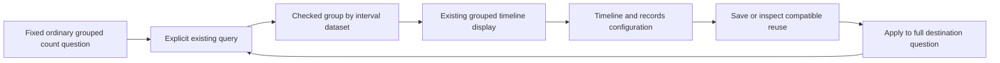

# Reuse a grouped count timeline

Milestone 395 is delivered. The
[active roadmap](ROADMAP_2026_11_10_CHECKPOINT_393.md) supplies the finite scope;
[validation](../VALIDATION.md) records checks actually run.

**Customize grouped timeline** opens the existing workspace directly from an
accepted supported result. Run remains explicit; local View as, Find and Sort
controls use supplied data. A fixed ordinary log/span population can show captured counts over time for one
qualified grouping, then preserve and reuse that display through the existing
timeline-and-records composition. This uses the existing grouped query execution,
shared supplied-data boundary, renderer, population workspace and saved-view owner.
It introduces neither another query engine nor another view store.

## One finite data profile

`Result.groupedTimeDataset` supplies a `grouped-time-series` dataset with nullable
category, interval `fromMs`/`toMs`, and nullable count. A missing category and a
present empty string are distinct group identities. Category text is a label,
not an inferred service, physical event identity or coverage guarantee.

The timeline declaration uses `grouped-count-v1`; its checked guarantee is
`grouped-intervals`. Admission is count-only, one ordinary qualified group and the
existing fixed interval policy. Numeric measures, duration summaries, status
summaries, reported edges, pattern groups and derived duration-bucket groupings
remain outside this arm. Existing specialized displays do not acquire portability
merely because their output resembles a timeline.

Current source bounds remain **eight groups / 1,000 observed cells**. Derived
materialization is separately bounded at **1,920 cells / 240 intervals**. Heatmap
presentation admits at most **32 intervals** and refuses larger inputs rather
than silently changing bucket width or dropping data. These are distinct source
and display bounds, not a claim of complete upstream ingestion.

## Empty bins and uncertain reads

Only categories actually observed in the fixed population participate. For a
coherent complete grouped partition, absent cells for those categories become
known zero captured counts. No all-zero invented category is added. Half-open
intervals retain the exact question anchor and any shorter final interval.

When independent source reads disagree, a missing cell remains unknown with a
null count. It is not painted as zero. Changed evidence cannot acquire interval
selection or drill authority, and display compatibility cannot repair incomplete
accounting. Counted empty intervals establish no application-health conclusion;
known grouped coverage does not prove full ingestion or absence of sampling.

## Existing configuration and action owners

The existing timeline-and-records composition owns declaration editing, layout,
save/reopen and compatible reuse. Configuration contains intent, not retained
source evidence or permission to execute. Inspect/Apply and local presentation
changes do not query telemetry. Apply preserves the destination's full question;
Run explicitly produces a new result under the current population owner.

Canonical category values and exact interval bounds remain action keys. Display
labels, local ordering or a visual selection never broaden the source question.
Selecting a known cell can stage an exact typed group and half-open interval in
an existing nested child. Back restores the held parent without reading telemetry.
Held return remains source-free; stale, hidden, inert or superseded owners cannot
stage an action or revive retired acquisition/publication authority.

Acceptance independently checks raw category×interval membership, exact
counts and zero/unknown distinctions, source and derived limits, short final bins,
missing/empty groups, changed reads and refused profiles. Go/JavaScript/API cases,
actual ordinary OTel journeys, genuine desktop/narrow frames, relevant Bombadil
actions and observed-model rejecting controls are checked together. This
document records the implemented contract; the [executed storyboard](../journeys/395-grouped-timeline-storyboard.md)
and [validation](../VALIDATION.md) record passing runtime gates.

Copied JSON is diagnostic: the existing import boundary strips completeness and
changes inferred zero cells to unknown on its private clone. Positive counts and
typed identities remain displayable; copied data cannot acquire staging authority.

Small multiples and tables support all declared intervals; heatmaps keep a shared
all-group count scale under Find. UTC column labels retain full bounds in accessible
names/tooltips. Literal categories are never uppercased by table styling. Actual
filled count cells passed the browser contrast check at a minimum **5.11:1**.

New timeline `query` and `order` options accept omitted or empty strings, but refuse
explicit null and nonstring values consistently in Go and JavaScript. Local group
order is source or label; grouping and bucket width remain query-owned.
