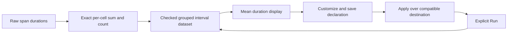

# Reuse grouped mean duration

Milestone 398 extends the existing grouped-count display path to raw-span mean
duration. Execution and acceptance status are recorded in [validation](../VALIDATION.md).
The [active roadmap](ROADMAP_2026_11_10_CHECKPOINT_396.md) keeps percentile reuse
outside this cut.

An ordinary span question with one qualified grouping, fixed intervals and a
span-duration summary can use Small multiples, Table or an eligible Heatmap.
Customize stages the existing population workspace; Run remains explicit.
Save retains a declaration, never a copied dataset or source lease. Applying a
saved display preserves the destination's complete compatible question.

The pinned `grouped-duration-mean-v1` profile selects `duration.mean`. Its supplied
cells retain exact duration sum, contributing count and reduced rational mean in
nanoseconds. Visible durations use human units. A shared scale covers the entire
supplied population; Find and order do not change it. Means are not summed or
averaged across groups. Captured counts remain independent context, not latency.

A cell with spans of recorded zero duration has an observed mean of zero. A known
empty interval has count zero and unavailable duration. An absent cell after
inconsistent reads remains unknown. Neither state is fabricated zero latency.
Support and completeness describe captured query evidence, not complete upstream
telemetry. Missing groups, present-empty values and literal Unicode retain their
own exact identities.

The existing eight-group, 1,000 observed-cell and 1,920 derived-cell limits remain.
Heatmaps retain their 32-interval limit. All bounds are half-open, anchored to the
exact question start, including a shorter final interval. Selecting a known empty
cell can still stage its exact scope; doing so does not claim a duration.

No percentile aggregation, stacked latency total, new source engine or second
workspace is introduced. Count and mean profiles remain distinct checked arms.

The [executable storyboard](../journeys/398-grouped-mean-storyboard.md) follows
actual ordinary OTel data through staging, explicit execution, reuse and held
return. [Verification commands](../verification/README398.md) separate actual
source observations from local generated cases and model rejection controls.
