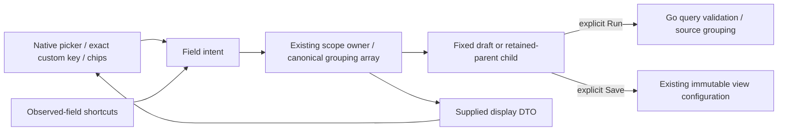
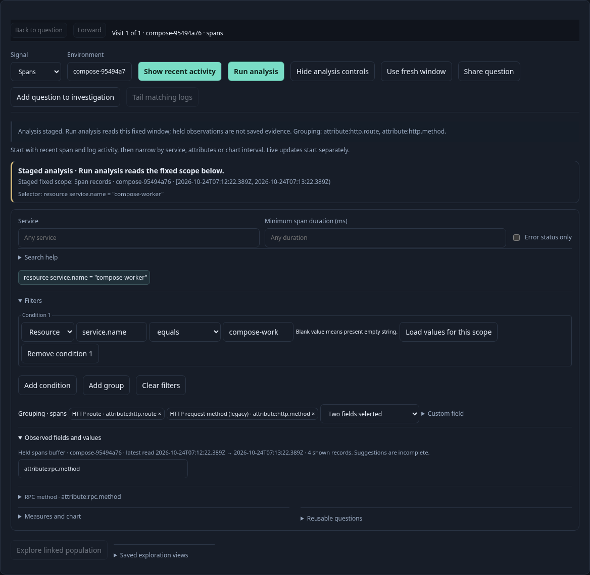
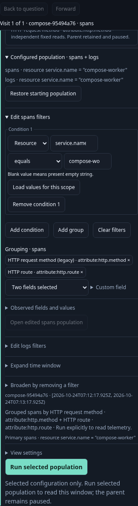
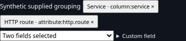

# One grouping control

Grouping now has one picker-and-chip control per authoring scope. The separate
fixed-question **Break down by** selector and the population result dropdowns
have been removed. **Edit grouping · spans/logs** opens the existing scoped editor
and focuses the shared picker. Observed-field shortcuts use that same owner and
selection state.

Choose a supplied field to append it, remove a chip, or choose **No grouping** to
clear the selection. Duplicate fields and additions beyond two are disabled.
**Custom field** accepts an exact qualified key, such as `attribute:tenant:id`,
without requiring it to have appeared in a shown page. The first colon separates
the namespace; remaining colons stay in the key. Native columns are validated for
the current signal; unknown columns are refused without changing the draft.
Manual entry does not assert that a field exists in the source.

All picker actions stage. **Run question**, **Run analysis**, or **Run selected
population** executes the query. An applied population opens a child; further
edits to an unread child stay in place. Filters, fixed bounds and companion
questions retain their existing ownership. Pending facets must be applied or
cleared before grouping; inspection can still stage another facet without a read.
Explicitly labeled **Break down and run** investigation actions keep their
existing read behavior.

## Reusable display element

`<goo-grouping-control>` uses native HTML selection, buttons and a collapsed
custom-field form. It accepts JSON through the `data` HTML attribute or a cloned
`.data` property:

```json
{
  "label": "Grouping · spans",
  "disabled": false,
  "fields": [
    {"field": {"kind": "attribute", "key": "http.route"}, "label": "HTTP route · attribute:http.route"}
  ],
  "grouping": []
}
```

The display DTO allows up to 256 supplied field choices and two distinct grouping
fields. Field namespaces are `column`, `attribute` and `resource`; labels are
literal text. Current grouping entries can exist without being observed choices.
The **No grouping** entry remains usable at the two-field limit.

Native controls emit bubbling `goo:grouping-intent` events with
`{mode, field}`: `add`, `remove`, or `replace` with null for clearing. The event
target is the opener. The element does not change supplied grouping on intent;
the owner publishes the next `.data`. It never validates a query against a source,
fetches, subscribes or saves. The custom-field parser checks qualified identity;
application/Go validation retains signal, query and execution policy.

HTML upgrades, properties assigned before definition, detached updates and cloned
getters/setters are supported. Equal supplied display data keeps the DOM and focus
intact. Changing data retains picker focus and custom-field draft text where
possible. Unsupported display data renders an unavailable state without controls.
Scoped styles live in `ui/grouping-control.css`.

The filter editor adapts its canonical grouping array and scoped field inventory
into this display DTO. Its `grouping()` getter replaces reading state from the old
DOM selector. `setGroupingFields()` supplies known authoring fields; scope edits
withdraw these alongside observations. Static signal-appropriate columns and
explicitly configured keys remain available. `onGroup` still owns transforms and
staging; observed shortcuts and manual selection share that callback.



## Executable storyboards

Journey 168 reuses the real OTel/ClickHouse composition fixture from journey 167,
with manual picker add/remove/clear, invalid-column refusal, exact legacy/custom
entry, preserved compound counts and saved reopen. It proves the legacy selector
is absent and each editor has one control. The existing observed shortcuts remain
covered by 167. Both use the actual Quint read/query replay and independent source
oracle. Bombadil exercises native picker add, chip removal, clear and custom
entry with intermediate-state and no-extra-read invariants. The composition state/swarm properties retain scope and field identity.

`journeys/grouping-control.spec.js` separately exercises supplied SSR/SPA display
behavior, controlled intent, unchanged DOM/focus, detached updates, malformed data,
custom parsing and no API reads. The component gallery demonstrates a synthetic
caller-controlled instance. Existing population comparison and facet journeys now
use staged grouping and the same explicit Run/Apply boundaries.





No API schema, saved format or native executable changes are required. This is a
record grouping control; arbitrary transforms and grouping beyond two fields are
outside its contract.
