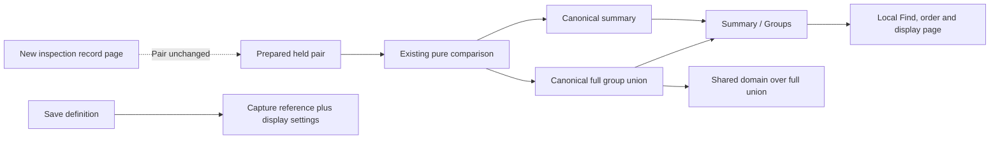

# Count change by group

Switch a prepared captured-count comparison from **Summary** to **Groups** to see
aligned baseline and current counts. The same baseline and held parent population
supply both views. Switching views, finding groups, changing order and paging the
displayed groups make no telemetry, storage or comparison request.

The compact table uses one shared count domain over the full supplied union.
**Count change** orders by exact absolute change; **Group name** orders labels.
Find and the fifty-row display pages change only what is visible, never the data,
domain or totals. The footer reports matching and total group counts. Long values
remain available through their exact-value disclosure. Missing values, empty
strings and literal strings are distinct categories, not interchangeable labels.

## Data semantics

The existing pure comparison response can include a closed
`goo.group-count-comparison/1` envelope. It reuses the exact independent summary
operands from `viewComparison`, including selectors, revisions, source bases and
read clocks, plus the aligned count union. No source completeness witness is
created. Accounting describes supplied observations, not complete upstream data.

| Supplied side | Group membership | Count cell |
| --- | --- | --- |
| Coherent | Present | Its positive captured count |
| Coherent | Absent | Known aligned zero |
| Diagnostic | Present | Unavailable; membership remains present |
| Diagnostic | Not observed | Unknown membership and unavailable count |

Coherent means unique positive supplied groups sum to the captured total. A side
marked changed-between-reads remains diagnostic even if its sums happen to agree.
If either side is diagnostic, all group changes and paired geometry are withheld.
The other side's independently coherent count remains available as a number.
Unavailable is never silently converted into zero.

A real empty operand has zero total and no groups; its aligned counts are known
zeros and its exact differences remain available. Two empty operands have an
empty union and known total difference zero. Null/missing is a category identity;
it is separate from absence of that category in one operand.

Each side admits at most 1,000 groups and the union at most 2,000. Category strings
retain the existing 4,096 UTF-8-byte limit. Keys are `0` for null and `1` plus the
literal string otherwise. Counts remain canonical uint64 strings; differences
use exact signed integers up to ±18446744073709551615. The browser validates Go's
differences rather than computing a replacement display result.

For coherent pairs, group counts account for both totals and row differences sum
to the total difference. Source admission also checks the complete union against
the actual requested cohorts and binds both operands to the simultaneous summary.
This rejects swapped/changed observations even when a forged payload is internally
self-consistent. Existing request byte limits still apply before these group limits.

## Saved presentation and ownership

The existing comparison declaration accepts optional presentation settings:

```json
{"value":"count","view":"groups","order":"change"}
```

Summary is the default view and Count change the default order. Saving preserves
these settings and the immutable baseline reference, not compared evidence.
Reopening remains staged; Run is explicit. Find and the local display page are
held while inspecting another record page, but are not saved query predicates.

Local display controls update only their comparison subtree, preserving pending
record selections. Record paging keeps the pair's original counts and clocks.
Run, a changed baseline or navigation retain the existing pair-retirement guards.
This slice introduces no group drilldown, scope filter, rate, health threshold,
statistical significance or causal attribution.

The framework-neutral `goo-group-count-comparison` element consumes supplied
canonical data through a `comparison` property/JSON attribute and bounded
`display` options (`order`, `title`). It reuses existing comparison geometry and
the scrolling table primitive. It performs no reads, publication or navigation;
invalid input remains unavailable rather than restoring previously valid data.

## Evidence boundary

The new envelope is on the pure cohort-comparison path used by authored views.
Existing stored-evidence comparison algorithms omit this extra presentation
payload, preserving their bounded immutable receipt format. No storage budget or
algorithm version was widened. Existing capture/receipt publication remains
separate from saving a view definition.



See the [proposal history](GROUP_COUNT_COMPARISON_PROPOSAL.md),
[design review](reviews/GROUP_COUNT_DESIGN_291.md),
[architecture review](reviews/GROUP_COUNT_ARCHITECTURE_291.md) and
[actual validation](../VALIDATION.md).
