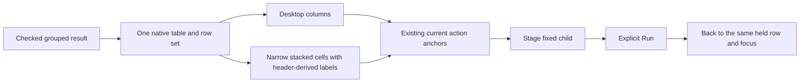

# Read and act on a grouped row — 375

Both grouped-record presenters use the shared stacked `goo-table` layout on narrow
screens. A row keeps its grouping labels, exact captured count and existing
continuations together. Inspect and Compare remain the original links, with
their original questions and action ownership. Desktop keeps table columns. The measured 390 px layouts remove horizontal
panning for ordinary groups and scalar/typed triage, including long values.

The renderer derives mobile cell labels from the same heading array that creates
the native column headers. Numeric and duration cells retain their own labels
and unavailable/not-recorded meanings. A captured count describes matching
records, not the number of displayed rows or a count of unique issues.

Long values wrap. Missing keys, present empty strings and reported exception-type
states retain their existing labels. Literal strings equal to those labels are
quoted for display, so `"Present empty string"` remains distinct from an actual
empty value. Links and group predicates continue to use the original raw value.

The same DOM is used at both widths. There is no duplicate mobile row tree,
second set of links, sort change or extra source read. Reflow cannot grant an
old callback authority. Typed triage Back renews only the existing checked held
group anchors; distribution-range ownership keeps its separate contract.

Native captions, `scope=col` headers and cells stay in the document. Browser
accessibility-tree observations and actual keyboard/geometry checks are recorded
with the [storyboard](../journeys/375-grouped-records-storyboard.md) and
[validation](../VALIDATION.md). They do not establish exhaustive screen-reader
coverage. A very long row can grow vertically; no claim says every group fits
one screen.

The action-bearing fallback opts in directly. Ordinary canonical groups opt in
through ScopedBreakdown and the passive `goo-chart[mobile-layout=stacked]`
attribute, forwarded to its inner native table. Header-derived labels include
existing local selection cells. This attribute does not alter display grammar,
selection proof or source behavior; absent/unrecognized values retain the default.
Unrelated raw/native tables keep their existing presentation. See the [architecture](reviews/GROUP_ROW_ACTIONS_ARCHITECTURE_375.md)
and [design](reviews/GROUP_ROW_ACTIONS_DESIGN_375.md) reviews.
