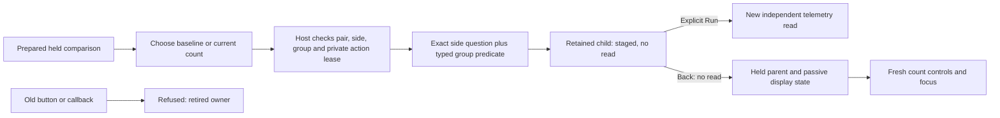

# Explore a group on the baseline or current side

In an application-hosted Groups comparison, select a positive baseline or current
count to stage that side's group question. The count text is a keyboard-accessible
button; its column and accessible name identify the side. Bars remain passive.
An aligned absent zero, unknown count or diagnostic pair offers no action.

The child is an ordinary query workspace, with no inherited comparison reference.
Opening it performs no telemetry, storage or comparison request. **Run** makes a
new independent read. In particular, exploring a baseline question does not open
or filter the original captured rows: late arrival or retention can change its
future result while the original capture remains unchanged.

## Exact question

The chosen side supplies its original checked selector, half-open UTC window,
limit, grouping, bucket width and summary directives. The planner resets offset
to zero and adds one group predicate, retaining the whole original predicate:

```text
all: [originalWhere, selectedGroupPredicate]
```

Missing/null becomes `missing`; a present string, including an empty string,
becomes `eq`. No OR branch is flattened, predicate removed, environment policy
changed or inspection-page offset inherited. If the additional predicate exceeds
existing query limits, staging refuses rather than widening the question.

## Retained parent and action ownership

The parent pauses and retains its comparison, counts, source clocks, Find text,
order and display page. Back returns without a read and focuses a fresh matching
count control. The old button and its callback stay retired. The same rule applies
to hidden/replaced views, redraws, rebaseline, navigation and source refresh.

Staging requires an active connected visible owner with the same admitted pair,
chosen side and group, and no pending read/preparation/page, record selection,
facet/query/source draft or nesting-limit conflict. Temporary draft refusals keep
the draft; returning does not restore an old source-action epoch.

The passive component is static by default. A trusted host may set its
nonserialized `interaction` property with `current()` and `stage(intent, opener)`
callbacks. This enables eligible native count buttons. JSON/HTML data cannot grant
that capability, and there is no generic DOM-event listener that authorizes a query.
The component never fetches, navigates, publishes or runs a query itself.

The closed intent carries only type, side, canonical group key and the chosen
summary's dataset/revision/scope/generation tuple. It carries no arbitrary query,
field, category value or capture permission. Those descriptive fields are not
runtime authorization: the host also checks its private binding and execution
lifecycle, then derives the question from its admitted full pair.

## Semantic planners and identity frames

The pure Go `StageGroupSide(ComparisonRequest, GroupSideIntent)` reconstructs the
existing validated comparison and derives the query. The browser counterpart
uses its admitted canonical comparison. Neither performs IO or creates evidence.
Generic H1 baseline-read-only and summary-refinement rules remain unchanged; this
is a narrow question-staging path, not captured-evidence refinement authority.

Browser admission conservatively assigns local dataset identities. Intents must
be created in their actual frame: a Go wire tuple is not a browser-local tuple,
even when both describe the same question. Same-frame planners produce equivalent
queries; cross-frame and retired-binding requests refuse. This distinction is
intentional and does not require weakening context validation.



See the [reviewed proposal](GROUP_SIDE_STAGING_PROPOSAL.md),
[design review](reviews/GROUP_SIDE_DESIGN_292.md),
[architecture review](reviews/GROUP_SIDE_ARCHITECTURE_292.md) and
[actual validation](../VALIDATION.md).
