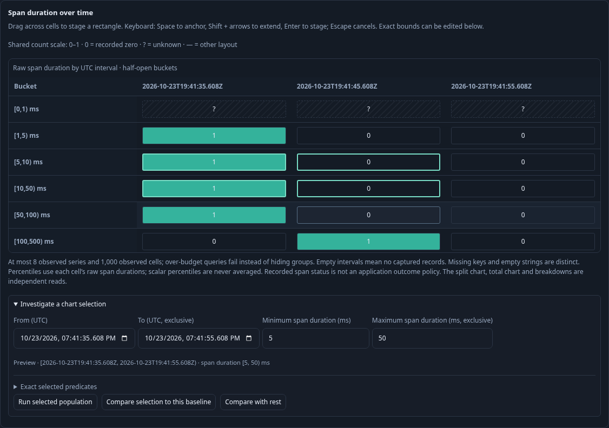

# Raw span heatmap selection

A fixed span question with one `column:duration_bucket` breakdown, split time
series and at most 32 time intervals now shows a compact count heatmap. It uses
supplied complete grouped aggregates, independently of the displayed record page.
The common count scale stays fixed. Missing supplied cells remain unknown.
Other breakdowns retain small multiples; native metric histograms do not imply
span membership and do not offer this operation.

Drag across cells to select complete time and duration buckets. Keyboard users
can press Space to anchor, Shift + arrows to extend and Enter to stage. Escape
cancels the visual draft. The existing selection form also accepts precise UTC
and decimal millisecond bounds. Editing or selecting performs no source read.
The preview shows half-open UTC/duration bounds and exact predicates. The final
time interval can be shorter; the final duration bucket has no upper bound.

Run selected population explicitly reads the intersection with the original
question. Parent predicates, environment and reported-edge scope remain intact;
paging resets to zero. Exclusive upper duration bounds become inclusive integer
nanosecond limits minus one. The ordinary investigation trail retains the parent
paused in this tab. Compare uses the original supplied aggregates as baseline,
not a disjoint rest-of-population complement. A separate [Compare with rest action](REGION_PARTITIONS.md) now stages a disjoint comparison in the full parent window. Existing capture, question-link,
package and saved exploration actions compose with the resulting typed question.
Selection rectangles themselves are not persisted presentation state.

Journey 121 ingests ordinary OTel spans, drags a rectangle, repeats via keyboard,
checks source-free staging, exact execution and full counts with a one-row page,
then captures and reopens evidence. Journey 121b covers passive detached-property
upgrade, reverse selection, cancellation and removal of range behavior.

This bounded D2 cut does not add arbitrary scope widening, a generic predicate
algebra, native bucket-to-trace inference or a new
measurement evaluator. Questions with more than 32 time intervals retain their
existing charts and keyboard-editable selection form.
