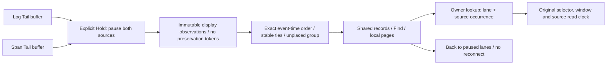

# Held logs and spans in one chronology

In paired Activity, choose **Hold chronology** to pause both streams and order
all their held records by event time. Choose **Back to lanes** to return to the
same paused buffers, Find text and lane layouts. Returning does not reconnect.
Resume or Start remains an explicit source action.

The chronology has its own **Find held records** and local 100-row pages. Lane
Find does not narrow it. Log/Span badges, shared UTC timestamps, service names and
record summaries identify each occurrence. Exact timestamps remain in native
`time` values and tooltips. Equal times use stable lane/occurrence order; temporal
adjacency does not establish causality. Duplicate source observations remain
separate rows. Unavailable or unrenderable timestamps follow in an explicit group.

**Inspect** opens the existing shared record detail. **Analyze observation window**
stages the selected occurrence’s original lane selector and poll window, not the
latest lane window. The selected record’s original source read clock is retained.
A later explicit Run reads data. Returning from analysis retains the held view.
Editing shared scope, applying a lane condition, starting/resuming a source or
resetting retires the held view; stale controls cannot act on replacement work.

## Independent source facts

Each lane retains its own selector, phase, latest completed read clock/window,
gaps and evictions. A buffer can contain records from several polls; the latest
window is not the window of every row. Expanded lane facts and each selected
occurrence preserve that distinction.

An empty unconfigured lane retains a null selector and says **Not configured**;
its scope is never filled from the sibling or pair configuration. A lane with
retained history but no latest completion says **latest read unavailable**. A lane never read is distinct from a completed read returning zero
rows. Counts describe held or locally matching observations, not population totals,
completeness, unique requests or service health. The merged display adds no source
query, polling, retention write or inferred relationship.

## Reusable display contract

`goo-held-chronology` is a passive rich-observation component. It consumes the
bounded `goo.held-activity/1` profile; it does not pretend a multi-poll Tail buffer
is a single `goo.record-page/1` source page or an evaluated aggregate dataset.
The component reuses the common record presentation, UTC, service, severity,
duration and local Find helpers.

```js
import {prepare} from '/held-chronology.mjs';
import '/display.mjs';
const view = document.createElement('goo-held-chronology');
view.data = prepare({logs: heldLogs, spans: heldSpans});
view.addEventListener('goo-chronology-inspect', event => {
  const {signal, key} = event.detail;
  inspectOriginalHeldOccurrence(signal, key, event.target);
});
container.append(view);
```

Include `held-chronology-view.css` and the common component/record styles. Detached
`.data` assignment and an escaped JSON `data` attribute support SPA and server
HTML. `.selectedKey` is the controlled `signal + ':' + sourceKey` occurrence key.
Inspect emits `{signal, key}` from the actual native button, so the owner can
restore focus. The component never opens an inspector or reads/publishes data.

Admission is closed, immutable plain JSON: at most 100 rows per lane, 8 MiB,
250,000 nodes and depth 32. Source membership/preservation tokens are deliberately
excluded. The application retains original items in a private lookup for explicit
inspection actions. Serialized supplied data grants no source or preservation
capability. The current application does not save a chronology as a new Activity
view format, attach baselines or offer merged capture/selection. Existing saved
paired definitions still save their applied lane configuration.



See the [executable storyboard](journeys/held-chronology.md),
[paired Activity](PAIRED_ACTIVITY.md) and [validation](../VALIDATION.md).
