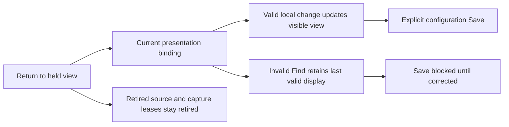
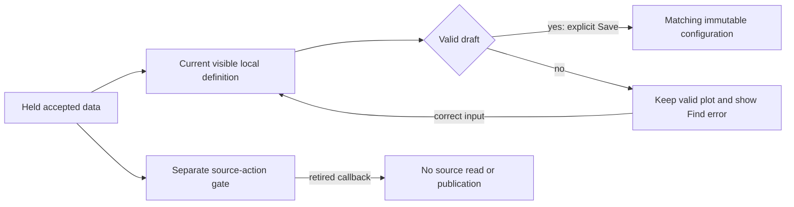

# Presentation ownership after held return

Milestone 396 is delivered;
[validation](../VALIDATION.md) records observed outcomes. This is a finite
consolidation of the existing investigation flow, not a new navigation framework.

Returning to accepted held data should leave its currently displayed configuration
honest and usable. A local display change must describe the visible view, while
retired source capabilities remain retired. The
[active roadmap](ROADMAP_2026_11_10_CHECKPOINT_393.md) bounds this cut to the composed
population/distribution workflows and their actual application adapters.

## Distinct return paths

| Return path | Existing ownership behavior to preserve |
| --- | --- |
| Back from a nested population | The parent renews its current definition bindings while restoring held evidence. |
| Investigation-trail Back or Forward | The trail reuses paused adapters and their accepted evidence; it must not presume that adapters were reconstructed. |

These paths need their own composed checks. A terminal callback test cannot prove
that an earlier application-wrapper gate permits the same operation. The baseline confirmed nested Back was already correct. Trail return could
redraw local settings while saving the previous definition. A fresh current-owner
check separately confirmed that invalid Find could publish the previous valid
value. Both failures now have actual regression coverage.

## Local configuration and source authority

A valid local change to the current definition must affect the displayed view.
An explicit configuration Save must publish that same current definition through
the existing saved-view owner. It is local definition publication, not permission
to reacquire telemetry or perform an old source-bound publication.

Invalid Find text must leave the last valid presentation intact, block Save and
expose a recoverable validation state. Correcting the input must restore the
current owner's permitted local operation. A stale or superseded editor cannot
save another owner's draft merely because its DOM still exists.

Source acquisition, source-free staging capabilities and capture/publication
leases remain governed by their existing owners and retirement rules. Renewing
local presentation binding must not renew any of them. Existing accepted evidence,
its question, source-read basis, custody receipt and captured bytes stay unchanged.
Configuration intent, held evidence and a pending operation remain distinct.

## Finite acceptance

Exercise nested population Back and investigation-trail Back/Forward through the
actual producer and host wrappers. Check repeated returns, current valid edits,
invalid Find and recovery, exact saved configuration, replacement and stale or
hidden/inert adapters. Count source requests separately from explicit definition
publication. Verify unchanged accepted source/custody identity and no source
reads caused by local edits or held return.

Only reproduced repeated orchestration with matching ownership semantics may be
consolidated. A focused regression-only closure is valid if no shared helper is
justified. This cut adds no universal session manager, global generation engine,
compatibility layer or performance claim. Actual results will determine whether a
product correction is necessary; this draft does not assume a failure.

## Delivered ownership boundary

One private current-definition predicate is shared by ranked and timeline
presentation callbacks. It checks the accepted result, current view/data/host and
complete question, visible active owner, and pending replacement state. It does
not borrow the old source-read generation. Source staging retains its existing
generation and action-context checks.

The shared DOM helper guards native event callbacks for visible, enabled,
non-inert controls, including disabled fieldsets. Explicit display setters retain
programmatic and detached/SSR usage. Invalid grouped Find retains raw text and
an accessible inline error, renders the last accepted query, and blocks Save.
Correction clears the owner error and restores publication of the visible view.
Source Customize also refuses the invalid raw draft and recovers after correction.

[The executed storyboard](../journeys/396-held-draft-storyboard.md) covers both
return paths, exact saved intents, invalid recovery and a real failed replacement
with pending/retired callback probes. [Validation](../VALIDATION.md) records the
main journey, independent actor, generated schedules and rejecting model controls.
