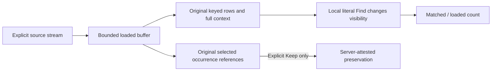

# Find loaded log and span observations

324 adds local Find to the existing Activity tail controls. It searches the bounded
loaded buffer, not the matching telemetry population. The field picker still discovers values
from all loaded rows, including those hidden by Find. Typing, clearing Find and
changing chosen display columns do not query, reconnect, pause or publish data.
An already-running tail continues its existing polling; Find changes neither its
selector nor cadence.

## Search values, not a query language

**Find loaded records** uses a case-insensitive literal substring. Spaces, quotes,
brackets and regular-expression characters remain literal; terms are not joined
across fields. The search covers actual message/span name, service and reported
namespace, severity/status, reported trace/span/parent IDs, valid human-readable
UTC/duration text and values from chosen qualified columns. Full logical text is
searchable even when its display is visually clipped.

Unchosen attributes, action labels, source/retention tokens and the complete JSON
payload are outside Find. Missing, null and empty markers are not synthesized as
search terms; an actual string such as `Missing` remains an ordinary value. Chosen
timestamp/duration columns use their human-readable display, rather than raw
nanoseconds. The input accepts at most 256 well-formed UTF-16 units and 1,024 UTF-8
bytes. It has no regex, wildcard, token or filter syntax.

An empty Find shows all loaded rows. Zero matches means only that no loaded value
matches; it does not establish source absence or health. The UI reports matched
and loaded counts separately from connection observations, evictions and full
query totals. Incoming rows and column changes update local matches.

## Keep the original observations

Find changes row visibility, not the buffer or the original keyed row nodes.
Snapshots, ancestry, investigation context and exact per-occurrence read windows
still use all loaded observations. Inspector/trace/service actions remain bound
to their original records and checked scope; a hidden or retired row action cannot
stage another question.

Selected observations remain selected when Find hides them, and their original
server-issued references remain unchanged. The selection panel reports selected
items not currently shown, including evicted items when applicable. Keep and Clear
selection remain explicit operations. Find does not manufacture membership or
renew an expired preservation capability. Clearing selection restores focus to a
visible original control or the Find input.

Same-scope reconnects retain Find while the existing buffer/selection reset rules
still apply. Explicitly staging a new applied scope or signal, or resetting the
view, clears Find. Returning to the same paused observations preserves it.
Programmatic layout/clamp scroll from filtering must not masquerade as the user's
existing scroll-to-pause gesture.

See [record columns](RECORD_COLUMNS.md),
[kept observations](KEPT_OBSERVATIONS.md),
[journey](journeys/324-held-find.md),
[architecture](reviews/HELD_FIND_ARCHITECTURE_324.md) and
[design](reviews/HELD_FIND_DESIGN_324.md).
