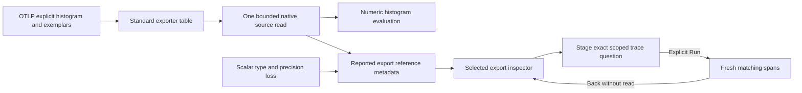
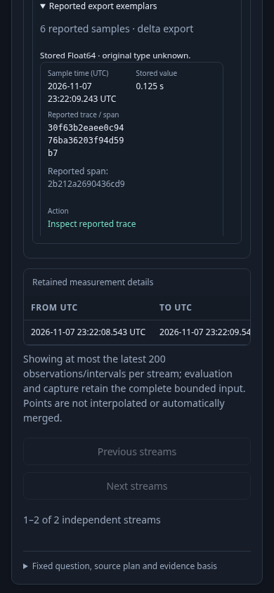
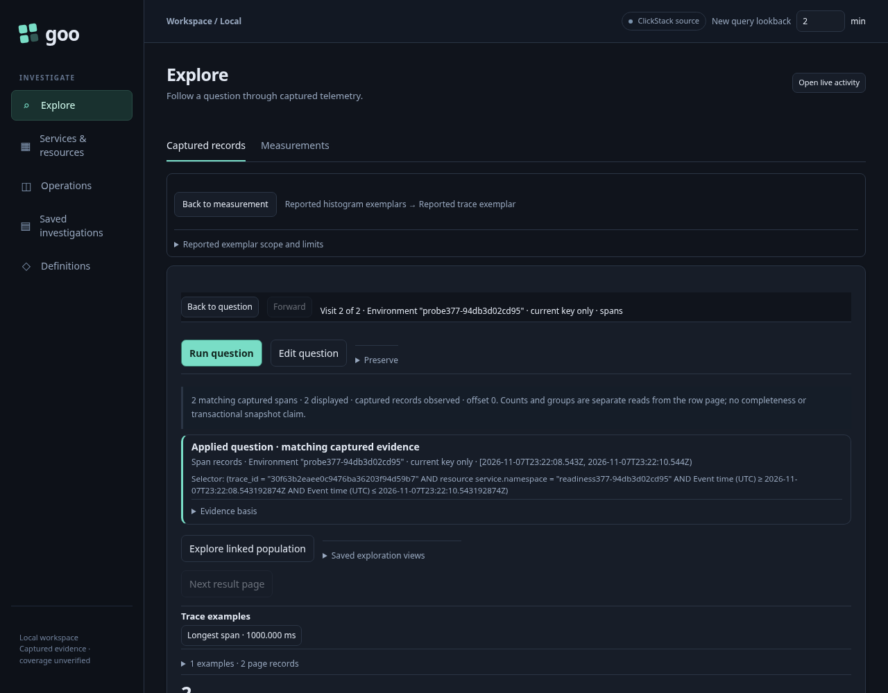

# Reported histogram exemplar references

Status: delivered (377). Source, planner, API and native browser/actor checks
and recorded model replay pass; see [validation](../VALIDATION.md).

The pinned exporter and live probe preserve reported exemplar trace/span IDs,
ordinal, nanosecond timestamp and source export association. They do not preserve
the original scalar type: large integers round to Float64 and integer/double zero
collapse. Filtered attribute types are also flattened. The
[source readiness decision](reviews/EXEMPLAR_SOURCE_READINESS_377.md) and independent
verifier record these limits. This feature follows reported references; it does
not establish bucket contribution, causality, producer conformance or a complete
trace population.

## Read and follow a reported export

Exemplars belong to a source export point, identified by full stream identity,
start/end timestamps, temporality and retained source-row occurrence. A cumulative
export may cover a different time span from its derived numeric interval. The
selected inspector must find exactly one source export for its stream and end
before offering a reference; duplicate or omitted association is unavailable.
Time-bucket aggregates cannot stand in for an individual export.

The inspector uses the existing native table and structured values. A
sample value is labeled as stored Float64 with unknown original type. A reported
trace ID must be canonical and nonzero to act. An absent or invalid span ID does
not invalidate a valid trace reference; it cannot become a focused span or an
extra trace filter. Missing exemplars do not mean no traces contributed.

**Inspect reported trace** stages a question without source I/O. Explicit Run
reads matching spans. The query preserves the original fixed environment policy
and exact time bounds. It keeps the native namespace when specified, otherwise
the selected stream's exact present/empty/missing namespace. It filters by the
reported trace ID, while dropping service, instance and metric attribute filters
so other services in the same checked scope can appear. This is a scoped trace
population, not a complete cross-namespace trace. A sample timestamp outside the
question never silently widens the query.

Back retains the selected export, disclosure, scroll and opener without a
read. Ownership checks reject retired, hidden and changed-source
callbacks. Sharing the record question does not create a durable citation to the
held native result.

## Bounded retained metadata

The standard ClickStack explicit-histogram adapter reads reference essentials in
the same source acquisition. It does not add a schema probe or a separate metadata
query. The pilot omits filtered attributes from product projection because they
are unnecessary for trace-reference authority and can dominate payload size.

The limit is 32 references per export, with exact reported total and
omitted count, plus a 64 KiB typed metadata report with explicit omitted exports.
Absent metadata, malformed arrays and budget omissions are unavailable rather
than known empty arrays. Optional metadata must not corrupt numeric histogram
kernel evaluation. Histogram counts and interval calculations stay independent.

The source reader still refuses more than 10,000 metric rows or an 8 MiB source
payload; it never drops metric rows to fit exemplar presentation. Added reference
columns can make a previously near-limit question exceed the byte budget. The
64 KiB report limit does not bound raw wire cost. Narrowing the question must be
explicit, not a hidden retry.

Navigation is enabled in source-owned live Measurements only when the complete
requested and returned questions match. Saved/service owners remain read-only
where their context contract admits only interval relations. Resource-bound and
time-bucket aggregate trace continuation remain outside this pilot. Returned
links are visibly paused until an explicit measurement Run; stale ordinary and
modified/auxiliary clicks cannot reactivate them.

See the [architecture](reviews/HISTOGRAM_EXEMPLAR_ARCHITECTURE_377.md),
[interaction design](reviews/HISTOGRAM_EXEMPLAR_DESIGN_377.md) and
[executable storyboard](../journeys/377-histogram-exemplars-storyboard.md).

