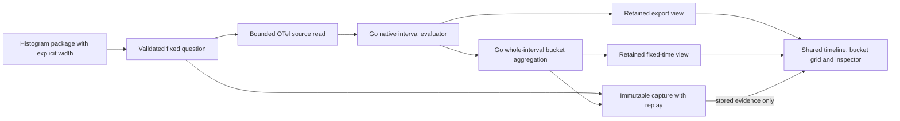

# Explicit native histogram time buckets

Native histogram packages may opt into `histogramBucketMs`. Go derives fixed time buckets from the same bounded, evaluated histogram evidence. This is separate from the retained export-interval view: a column now represents an explicit time window, rather than one exporter interval.

```yaml
# Add to an existing kind: histogram measurement package.
histogramBucketMs: 4000
```

The width is a positive integer in milliseconds, at most 120 minutes. The fixed question may produce at most 200 buckets per exact stream. Preview rejects narrower widths that exceed that budget before reading telemetry. Omitting the field preserves the existing definition and result transport shape. Width changes produce a distinct question/definition revision and evidence basis; they are not a local recoloring setting.

## Aggregation and coverage

`metrics.BucketHistograms` accepts an evaluated native histogram result and an exact nanosecond width. Its windows are half-open, anchored at the question's exact `fromNS`, and cover the entire question. The final bucket ends at `toNS` and may be shorter. No epoch-flooring or browser clock is involved.

For each complete OTel stream identity independently, Go combines whole evaluated intervals only when they exactly cover a bucket and share unit, temporality and native boundaries. It sums checked native bucket counts and recomputes a P95 **bucket range** from the combined population. Cumulative exports are differenced by the existing native evaluator first. Scalar percentiles are never averaged and an export is never divided between time buckets.

| Bucket state | Meaning | Distribution |
| --- | --- | --- |
| `observed` | Complete compatible evaluated interval coverage with observations. | Exact native bucket counts and percentile range. |
| `no_data` | Complete compatible coverage with an observed population of zero. | Count/buckets are zero; P95 has `no_data` state. |
| `unavailable` | Coverage is missing, unknown, overlapping, crossing a bucket boundary, or incompatible; validation or overflow failed. | Withheld entirely, with reason codes. |

A crossing export makes each intersected bucket unavailable. Valid neighboring buckets remain usable even if the whole retained stream is marked unknown. A layout change inside one bucket withholds that bucket; different layouts in different valid buckets remain independently inspectable. Missing source streams do not become zero streams. Unit/shape/count checks use the existing native histogram coverage kernel.

The derived result records `sourceBasis`, its own `basis`, exact bounds, width, complete stream identities and per-bucket reasons. Its basis includes source identity and aggregation policy. The output is detached from the input; sorting retained intervals does not mutate them. Requests exceeding 10,000 retained intervals or 20,000 total output buckets fail as a whole. No visual page limit defines aggregation totals.

## Product journey

1. Open a histogram package in Measurements, add `histogramBucketMs` in its package definition, and preview a fixed window. Preview validates width and scope without reading telemetry.
2. Run explicitly. When derived buckets are present, **Histogram time view** defaults to **Fixed time buckets**. The chart frame shows the width, anchoring policy and possible shorter final bucket. The existing timeline, heatmap and selected-distribution inspector display the supplied Go result.
3. Select an observed, zero or unavailable bucket. Unknown buckets expose reasons and no leftover native bucket table. The layout picker retains disabled other-layout cells; no index alignment invents common boundaries.
4. Switch to **Retained export intervals** to inspect source interval granularity. Both views and their local selection state are retained during switching. Switching, selecting cells and opening disclosures perform no source reads or question mutation.
5. Capture and share the question. Reopening verifies and restores the same width, source/derived basis, exact counts and coverage states. A recipient may switch views using retained evidence without rerunning telemetry.

The display adapter matches complete stream identity, including resource schema, resource attributes and point dimensions. It translates supplied bucket states into the existing passive plot/grid snapshots; it performs no count aggregation, coverage inference, boundary splitting or percentile evaluation. Time-grid columns retain the existing latest-32/64-native-bucket visual budgets; the full Go result retains all bounded time buckets. Exact-time selection remains available for up to 200 windows.



## Executable evidence

Journey 81 injects real OTLP delta exports. It demonstrates two exports merging to seven observations, an unknown bucket, an observed-empty bucket, a changed-layout bucket, and a final three-second bucket under a four-second policy. A separate three-second question proves crossing exports are withheld. The journey saves/reopens the result, validates source-free local interactions and records an observed Quint ledger with nine rejecting mutations. Bombadil explores fixed/raw views, zero and unknown selections on the saved capture.

[Fixed-time distribution and native counts](journeys/screenshots/81a-go-time-bucket-aggregation.png) · [Mobile unavailable-layout bucket](journeys/screenshots/81b-mobile-time-bucket-unknown.png)

Pure Go tests cover boundaries, clipping, layout/coverage/count errors, exact large counts, nonzero origins, determinism and immutability. Hegel properties and a state swarm use an independent whole-export oracle under arrivals, withdrawals, repairs, zeros, layout changes, missing/epoch diagnostics and changing widths. Existing native/capture regressions continue to cover definitions without time aggregation.
