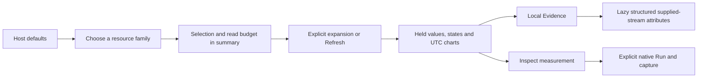

# Host resource controls

Milestone 216 is implemented and accepted with combined live OTLP/ClickHouse,
Bombadil, Hegel and independent raw/Quint checks.
[Validation evidence](evidence/host-controls-216.json).

Host opening still loads its bounded CPU/memory defaults. Network, Disk and
Filesystem keep explicit disclosures; reported utilization remains a nested
one-read disclosure tied to the selected filesystem group. Every family summary
retains its full selection and read budget. Complete metadata with exactly one
group hides the redundant selector; multiple choices and incomplete discovery
keep it. The inherited utilization selector stays hidden. No missing/empty group
identity is collapsed or inferred into a physical host/device/filesystem.

Visible selector labels are simply Interface, Device or Mount. Load names the
family before its first attempt; Reading is disabled while pending; Refresh is
the common explicit action after any attempt, including incomplete discovery,
ambiguity, errors and cancellation. Refresh does not imply a successful prior
read. Closing/reopening remains local, and selection changes retain their existing
explicit auto-load behavior and cancellation ownership.

## Compact values, direct evidence

Host cards keep values, states, observed UTC instants/intervals, unknown reasons,
charts and presentation-cap captions visible. Repeated raw dimension paragraphs
move into Evidence beside Inspect measurement. Expanded Evidence uses the full
card width and directly mounts the shared structured attribute viewer, including
scope/resource/metric attributes, search and copy. It builds once on first open
from a cloned supplied stream, with no telemetry reads or new navigation.
Native metric attributes are labelled Metric attributes instead of Span attributes.

This is an explicit host presentation option in the shared passive renderer.
Its default noncompact behavior and default raw stream inspection remain available
to other callers. Inspect retains the same app-owned question, opener focus and
Back behavior. Opening, searching, closing or reopening Evidence never changes
held values, questions, chart domains, timestamps or capture contents.

No numerical, query, source, wire-format or backend binary change is made.
Network/disk rates, byte stocks and reported fractions retain separate domains,
unknown semantics and existing explicit read budgets. This is a presentation
cleanup, not a new aggregate, ratio, subscription or inferred health signal.

The first live check exposed the previous second Inspect stream step inside
Evidence. That usability gap was fixed by mounting the existing viewer directly;
the revised actual journey passes. It is recorded as a fix, not a first-pass run.

[Executable storyboard](../journeys/216-host-controls-storyboard.md).
