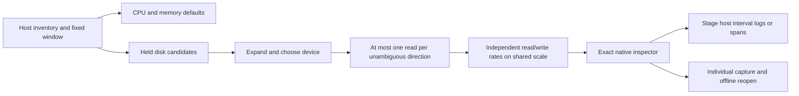

# Host disk throughput

Milestone 213 implements explicit per-device read/write byte rates. Live OTLP/ClickHouse, Bombadil, Hegel and independent raw/Quint acceptance
checks pass; see [evidence](evidence/host-disk-213.json).

The binding is pinned to OTel 1.37 `system.disk.io`, Counter, `By`, with reported
`system.device` and well-known `disk.io.direction` values `read` and `write`.
These attributes are recommended in the development-status convention; the pair
UI requires them rather than guessing them. Custom directions remain metadata.
[Pinned convention](https://github.com/open-telemetry/semantic-conventions/blob/v1.37.0/docs/system/system-metrics.md#metric-systemdiskio).

Open Hosts, find the desired environment, and choose a host. CPU/memory defaults
retain their existing two-read budget. Disk is a separate closed disclosure;
expanding a single reported device loads at most one unambiguous stream per
direction. Several devices require an explicit choice. Duplicate exact streams
for one direction require Preview/Run; an independently unique sibling may load.
Incomplete discovery suppresses paired reads and offers local exact previews.
Reopening held results is local; Load disk explicitly refreshes them.

Network and Disk share the app-owned paired-counter adapter, with distinct
owners. Closing, switching device/host/scope, hiding or leaving the view withdraws
pending work. Late replies cannot publish. Passive web components do not fetch.
There is no background device scan, hidden retry, device alias, partition merge,
or automatic disk value read.

Native source admission certifies whole nonnegative byte counts below 2^53,
cumulative monotonic export, original identity/maps/flags and temporality tokens.
The existing exact decimal/rational interval kernel retains resets, epoch changes,
gaps, missing values and clipped boundaries as unknown. The latest unknown does
not fall back to an older value. Read/write plots share a scale across held valid
intervals, with independent timestamps and a visible presentation-cap caption.
No device sum, IOPS, latency, disk capacity, utilization or saturation is inferred.

Inspect measurement stages an exact native question locally. Run performs a fresh
read. Interval record navigation uses reported host.id and environment plus exact
half-open time bounds, intentionally across SDK maps; disk attributes do not become
log/span filters. This is contextual search, not proof of physical ownership or
causality. Individual capture is a fresh explicit read, with stored offline reopen.

[Executable storyboard](../journeys/213-host-disk-storyboard.md).
