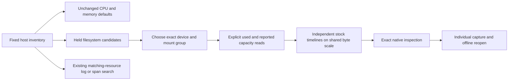

# Filesystem usage and reported capacity

Milestone 214 is implemented and accepted with live OTLP/ClickHouse journeys,
Bombadil, Hegel and independent raw/Quint checks.
[Validation evidence](evidence/host-filesystem-214.json).

The pinned OTel 1.37 development convention defines `system.filesystem.usage`
as UpDownCounter/By and `system.filesystem.limit` as opt-in UpDownCounter/By.
The latter explicitly reports total filesystem storage capacity. Goo binds these
to cumulative nonmonotonic stocks with the existing nonnegative-integer domain,
not rates. Values must be whole bytes below 2^53; original source identity/maps,
flags, cumulative temporality and explicit monotonic false are checked.
[Pinned convention](https://github.com/open-telemetry/semantic-conventions/blob/v1.37.0/docs/system/system-metrics.md#metric-systemfilesystemusage).

## Choose the reported filesystem

Opening a host retains its CPU/memory defaults and two-value-read budget.
Filesystem is a separate closed disclosure. Expanding one compatible group reads
at most one unambiguous used-byte stock and one reported-capacity stock. Multiple
groups require explicit selection. Reopening held results is local; Load filesystem
refreshes explicitly. Incomplete discovery offers exact local previews without
paired reads. Duplicate role variants remain manual Preview/Run choices.

Goo requires reported nonempty `system.device` and
`system.filesystem.mountpoint` for this convenience profile. It groups by their
exact values plus `system.filesystem.mode` and `.type`, preserving missing, empty
and present values. Present mode/type strings are quoted to distinguish literal
values such as "empty" from the missing/empty-state labels. Each stream still
retains all resource/schema/scope/version and extra attributes; grouping is
contextual selection, not a numerical join or proof of physical filesystem identity.
No device alias resolution, bind-mount deduplication or partition merge occurs.

Usage selects `system.filesystem.state=used`. Capacity selects the separately
reported limit without a state attribute. These are conservative Goo selection
policies, not a claim that OTel requires closed attribute maps. Free, reserved,
custom states and differently shaped exports are not summed or coerced into used
or capacity. The usage convention says all states SHOULD sum to capacity; Goo
does not assume an incomplete export proves that sum.

## Compare independent byte observations

The two native timelines share a byte scale across held valid samples. Values,
timestamps, accumulation epochs and freshness remain independent. Stock decreases
are valid. Missing latest values remain unknown and do not fall back to earlier
samples; absent capacity is unreported, while reported zero remains zero. No
aligned snapshot, used/capacity percentage, derived capacity, inode metric,
utilization trend or health classification is added. Presentation caps disclose
omissions while inspection and individual capture retain the full bounded result.

The shared app-owned pair adapter owns reads and cancellation; Network, Disk and
Filesystem retain independent owners. Passive web components render supplied
values only. Closing or switching scope/host/group, hiding or leaving the view
withdraws pending work; late replies cannot publish. Inspect stages a native stock
question; Run and capture are explicit fresh reads. Stored capture reopens without
source POSTs. Existing Matching resource logs/spans links search the fixed host
window using its reported resource attributes; no stock-point context API is added.

[Executable storyboard](../journeys/214-host-filesystem-storyboard.md).
