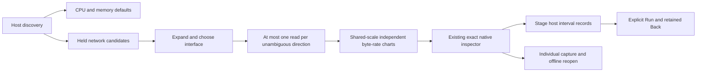

# Host network throughput

Milestone 212 is implemented and source-reviewed; live acceptance is pending.

The pinned OTel v1.37 `system.network.io` Counter has unit `By`, recommended
`network.interface.name`, and well-known `network.io.direction` values `receive`
and `transmit`. [Pinned convention](https://github.com/open-telemetry/semantic-conventions/blob/v1.37.0/docs/system/system-metrics.md#metric-systemnetworkio).
The pair view requires a nonempty bounded interface and one of these directions;
custom/missing labels remain reported metadata, not a guessed receive/transmit
population or proven absence. Full resource/schema/scope/version and attributes
remain exact stream identity.

## Discover once, expand deliberately

Opening a host keeps its existing CPU/memory defaults and at most two native
value reads. Network candidates never enter that automatic default set. Network
has a separate collapsed expansion. With exactly one interface, first expansion
reads at most one unambiguous stream per direction. Multiple interfaces require
an explicit choice; selecting one loads up to two streams. Reopening completed
results is local; Load network explicitly refreshes them.

Incomplete discovery suppresses network defaults. Multiple exact streams for a
direction require explicit native Preview/Run, while an independently unique
sibling can load. No background interface scan, role sum or hidden retry. Closing,
changing host/scope/interface, leaving the view or disposing withdraws pending
work through its own generation owner. CPU/memory evidence is unaffected.

## Bytes, intervals and evidence

The profile opts into existing exact interval arithmetic, with additional raw
byte-domain certification: reported values must be whole, nonnegative integers
below 2^53. This conservative bound avoids claiming exact byte counts after
Float64 export has lost integer precision. Fractional or unsafe counters refuse
that direction's entire read; missing-value flags stay unknown. Source token
identity/maps/flags/temporality are checked before canonicalization, and this
profile requires cumulative monotonic export. Other units/schemas/temporalities
are not silently converted.

Receive/transmit rates use B/s and SI prefixes, on a common display scale derived
from held valid intervals. Stream clocks and points remain independent. Counter
decreases, epoch changes, gaps, missing values and clipped boundaries retain the
existing unknown rules. The latest unknown never falls back to an older value.
Exact decimal delta and rational rate remain available in native inspection.
This adds no interface/host total, bandwidth denominator, saturation or health.

Existing native interval navigation stages reported host.id/environment plus
exact half-open time, intentionally across SDK maps. Interface and metric-only
attributes are not log/span filters; equal IDs do not prove physical ownership
or causality. Run and individual capture remain explicit fresh reads, and stored
native evidence reopens without a source read. Reusable display elements remain
passive; app adapters own loading, selection, cancellation and navigation.

[Journey 212](../journeys/212-host-network-storyboard.md) tracks live acceptance.
