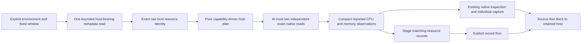

# Host resource observations

Implemented and accepted in [journey 199](../journeys/199-host-storyboard.md).
This is the first host slice of C2c, not a complete runtime, container or Kubernetes
dashboard family. [Compact receipt](evidence/host-resources-199.json).

## Identity and measurement authority

Host observations use an explicit `source.resource: {kind: host, id: ...}` binding
and a mandatory exact stream. Full raw resource maps, resource schema, scope,
version, schema, metric, unit and point attributes remain pinned. `host.id` is
required; `host.name` is only a display label. Equal IDs with different full
resource maps or schemas remain distinct observed resource identities.

The host path never manufactures `service.name` or `service.instance.id`, and
missing service labels remain distinct from present-empty values. ClickHouse
selection uses raw `ResourceAttributes`, not the service column's fallback value.
Original service-source validation, SQL, serialized definitions and saved evidence
remain unchanged when the additive resource binding is omitted.

Explicit host gauge and cumulative nonmonotonic-stock evaluators share the
existing numerical kernels under a separate identity policy. Legacy integer host counters, delta-stock reconstruction, histograms and
lifecycle definitions remain refused. [CPU-time rates](CPU_TIME_RATES.md) adds
an explicit decimal counter authority and pinned cumulative CPU-time profile in
211; its live acceptance is tracked separately.
The service-only native record-context planner also refuses host authority rather
than creating a query for an empty service name. Full raw-result replay and
individual native captures retain their existing consistency/custody checks.

This first slice still requires an explicit `deployment.environment.name` and a
fixed window of at most 120 minutes. Missing-environment discovery is not added.

## Discovery, defaults and effects

In **Services & resources → Hosts**, **Find hosts** makes one admitted source
request: a single bounded union over host-bearing gauge, sum and histogram rows.
More than 10,000 rows refuses the inventory. At most 100 exact resource identities,
16 instrument descriptors per entry and 25 retained stream previews per descriptor
are returned, with explicit omissions. Resource and response byte budgets fail
closed; omitted or unidentified data does not prove absence or health.

Opening an entry plans from retained metadata without telemetry I/O. The dashboard
then reads at most two exact native questions using the existing measurement
transport. Core/mode and memory-state labels identify the selected streams; no
logical-CPU averaging, state summation or whole-host rollup is invented. Other
retained candidates require explicit preview/Run, and unsupported observed
instruments remain explained in a closed prerequisite disclosure.

Automatic bindings follow the pinned
[OTel v1.37.0 system conventions](https://github.com/open-telemetry/semantic-conventions/blob/v1.37.0/docs/system/system-metrics.md):

| Instrument | Supported source shape | Meaning |
| --- | --- | --- |
| `system.cpu.utilization` | Gauge, `1` | Reported fraction per exact logical CPU/mode; prefer reported `user` mode and the lowest canonical logical CPU for the default. |
| `system.memory.usage` | Cumulative nonmonotonic sum, `By` | Independent stock observation per reported memory state; default prefers literal `used` with a certified nonnegative integer byte domain. |
| `system.memory.utilization` | Gauge, `1` | Reported fraction, used as the memory default only if no eligible usage stock is supplied. |

CPU utilization is opt-in in this convention. Cumulative fractional CPU-time
seconds are discoverable metadata, but are not coerced into the integer counter
kernel or silently substituted for utilization. A gauge named memory usage is
not treated as the convention's UpDownCounter. Different schemas remain explicit;
metadata eligibility is not verified semantic conformance of every export.

Reported utilization is formatted as a percentage only within `[0,1]`; no
capacity-derived percentage is calculated from byte usage. Out-of-domain values
are invalid in the host presenter and unpainted in its plot, while original raw
values remain available through native inspection. Unknown/stale/missing/conflicting
latest observations never fall back to a healthier older value.

## Investigation and preservation

Existing native Preview/Run, YAML sharing, draft recovery and individual captures
preserve the host binding. An omitted, null or empty services list means no
service selector for host authority; comparison normalization does not rewrite
stored definition bytes or digests. Legacy service questions retain their stricter
requirements. Host-native inspection cannot clear its required exact stream.

**Matching resource logs/spans** stages a question over all selected reported
resource attributes and the original fixed window. Only explicit Run reads records.
These are matching-attribute contextual searches, not exact resource-map/schema
joins, proof of a causal service or a claim to retrieve every record from a host.
Other SDKs may report different attributes. Oversized predicates refuse staging
rather than silently dropping disambiguators. Back restores the retained host view
without source reads; leaving, changing environment/lookback or canceling withdraws
pending work, and late replies cannot publish into a different scope.

Runtime/GC, additional host instruments, derived capacity ratios, resource
aggregation, missing-environment discovery and Kubernetes ownership remain
separate contracts. A catalog entry or missing metric is not an operational
health conclusion.

## Authoring and accepted evidence

Fresh **host YAML package input** canonicalizes omitted/null services to `[]` and
omitted/null exact-stream attributes to `{}` before package hashing. This keeps
YAML serialization, immutable publication, duplicate publication and catalog
reopening on one revision. The rule is confined to host authoring: direct JSON
questions, evaluated results and stored capture bytes keep their original shapes;
old service package wire remains unchanged. UI comparison/recovery accepts the
corresponding host-only empty aliases without mutating authored payloads.

The ordinary generated OTLP acceptance uses no service name or instance on host
metrics. Main passes in 11.9s, ownership in 4.5s, and the bounded eight-phase
Bombadil campaign in 30.6s (400 snapshots). Independent raw-source and custody
checks pass in 0.225s and reject ten main plus three owner mutations. The fixture
has sixteen observed metric rows across eight exact resource identities; this is
not an OS-scraper deployment or a count of unique physical hosts. Matching app
logs/spans preserve their real service identity.

The default path makes one inventory read and at most two native reads. Staging
is source-free; explicit log and span reads, native Run and individual fresh
capture bring the main journey to seven logical source operations. Frozen reopen
and retained Back add none. The complete individual capture stays 5,618 bytes,
SHA256 `cea836acf2036872bb751cda541614c22b58faa0307a2bfeab0cf1d2a10fd668`.

The final compact display replay uses a separate fresh ordinary fixture and three
real source calls, no capture, and passes in 6.5s. Host plots are 90px through the
reusable timeline CSS variable; other consumers keep their existing defaults.
Exact labels, UTC/ns tooltips and visible desktop/mobile content pass geometry
and actual image review. The authoring fix is checked separately by service/stream
empty-shape publication and recovery matrices; its deployment smoke uses metadata
and the original pure plan, with zero telemetry/custody/browser operations.

[Desktop](journeys/screenshots/199a-host-observations.png) ·
[Mobile](journeys/screenshots/199b-mobile-host-observations.png) ·
[Whole viewport](journeys/screenshots/199c-hosts-in-context.png).
