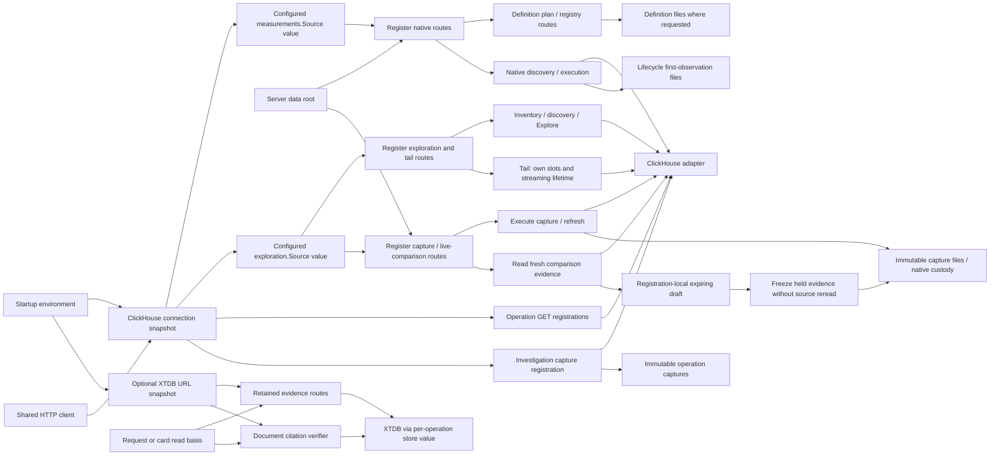
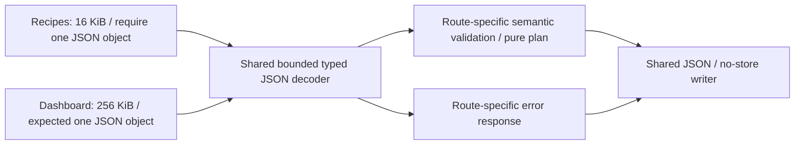

# HTTP effects and dependency boundaries — C2 active

This inventory describes the current Go server routes, not a new API. Browser
`/api` proxy mapping remains in Python. `serve-http` loads binding/inventory and
operation packages at startup, expands plans, builds one 15-second HTTP client,
registers route families and wraps the mux in `newQueryBudget(..., 4)`. Server
header timeout is five seconds; write timeout is 90 seconds. Pure planning, source
execution, filesystem publication and XTDB transactions retain different owners.

## Endpoint effects

Limits below are request JSON byte ceilings, not result or measurement limits.
Validation may reject smaller requests. Route-specific codes/messages and source
family limits remain authoritative in code/tests; this table groups related routes.

| Routes / owner | Effect | Request ceiling / execution lifetime |
| --- | --- | --- |
| GET `/http-package`, `/operations`, `/counter-rates`, `/histograms` in `serve_http.go` | Execute ClickHouse reads; operation views can issue multiple reads | Query parameters; shared client 15s per HTTP request, incoming context |
| GET `/operation-packages` | Return startup declarations; no telemetry | Query validation, no body |
| GET `/measurement-packages`, `/investigation-workflows` | Read definition/workflow files; no telemetry | Catalog/file bounds, no body |
| POST `/measurement-packages/plan` | Validate/compile native definition; no source or publication | 64 KiB |
| POST `/measurement-packages` | Publish canonical YAML; preserve existing duplicate policy | 64 KiB; filesystem |
| POST `/metric-discovery` | Query native instrument inventory | 64 KiB; 15s context |
| POST `/measurements` | Execute native measurement; lifecycle may create first-observation custody files | 64 KiB; 15s context |
| POST `/inventory`, `/discovery`, `/explore` | Query ClickHouse; Explore also freezes a bounded process-local result-page capability when possible | 16 KiB; 15s / 30s / 55s contexts |
| POST `/compare` | Compare supplied summaries; no telemetry query | 1 MiB |
| POST `/tail` | SSE polling reads; own four-slot budget, bounded stream lifetime and write deadlines | 16 KiB; 60s context, 2s polling, 5s per-write deadline |
| GET `/investigations/{id}` | Reopen immutable operation capture; no telemetry | File bounds |
| POST `/investigations` | Read operation/rate/histogram evidence and publish a capture; refresh checks parent question/package revision | 16 KiB; incoming context and shared HTTP client |
| GET `/captures`, `/captures/{id}` and suffixes `followups`, `compare`, `windows`, `receipt` | Read/page/recompute from saved evidence; no telemetry reread | File/catalog/cursor bounds |
| POST `/captures` | Execute source family and publish immutable evidence; refresh retains original question | 16 KiB; 55s context |
| POST `/captures/live` | Read fresh evidence against a saved baseline and hold expiring drafts, or freeze a held draft into immutable capture files without a reread | 16 KiB; read branch 55s context; draft budget separate |
| GET `/recipes`, POST `/recipes` | Return templates / plan supplied question; no telemetry | POST 16 KiB |
| POST `/dashboards/plan` | Plan from supplied inventory/declarations; no telemetry | 256 KiB |
| POST `/telemetry-packages/draft`, `/numeric-plan`, `/plan` | Build/validate/compile reusable definitions; no telemetry | 64 KiB |
| POST `/telemetry-packages`; GET collection or `/{revision}` | Publish or read reusable definition files | POST 64 KiB; store bounds |
| POST `/population/plan` | Plan typed population transformation; no telemetry | 128 KiB workbench decoder |
| GET/POST `/annotations`, `/exploration-views`, `/deployments`, `/documents`, plus GET `/{id}` | Read/publish authored context; document creation checks references and can verify pinned XTDB review citations | POST 128 KiB; citation checks 30s each |
| POST `/captures/comparisons`; GET `/captures/comparisons/{id}/receipt` | Recompute/save comparison context from saved captures; no telemetry reread | POST 128 KiB |
| GET `/retained-evidence/status` | Report optional XTDB configuration; no database probe | No body |
| GET retained collection, manifest, annotations/history or pinned revision | Read XTDB metadata/custody; await-token lower bounds remain separate | 30s contexts |
| POST `/retained-evidence` and `/{id}/annotations` | Freeze selected saved/server-held rows or correct review metadata in XTDB; request recovery may precede publication; no ClickHouse reread | 16 KiB; 30s contexts |
| POST `/queries/{id}/cancel` in budget wrapper | Cancel/mark a query capability; no source publication | Wrapper validates UUID and capability budgets |

The global query budget currently controls only POST metric discovery, native
measurements, inventory, discovery, Explore, captures and live comparisons. It
adds a 60-second outer context and handles optional query IDs. GET executions,
operation investigations, tailing and retention are not all covered by that
wrapper; tailing retains its own slots. This extraction does not broaden budgets.
A GET method therefore does not establish source-free behavior, and a source read
does not establish absence of filesystem custody effects.

## Decoder, response and stream policies

Most JSON route families disallow unknown fields, cap the body and refuse a second
JSON value. Trailing-value messages differ (`one JSON object required`, `expected
one JSON object`, `require one JSON object`); helpers must retain these choices.
Malformed/body-limit errors normally return 400 rather than universally using 413.
Live snapshot size limits can return 413; capacity can return 429. Saved-reference,
refresh, backend and optional-store failures retain per-route 404/409/410/502/503
policies. The current native success/failure and YAML duplicate response fixtures
are in `testdata/storage` and the native route tests.

JSON/no-store is common, not universal: early tail errors currently set JSON but
not no-store; successful SSE sets `text/event-stream`, no-store and
`X-Accel-Buffering: no`. Some inline GET handlers use `http.Error`, whose content
type/body differ from JSON encoder failures. Default mux 404/405 responses retain
Go's behavior. SSE emits reset/stream events and must preserve flush, cancellation,
continuity caveats and disconnect handling. Do not route streaming through a
buffered JSON responder or silently standardize these policies in a refactor.

## Startup dependencies: native and exploration/tail adoption

`clickHouseConnectionFromEnvironment` now resolves endpoint, credentials and the
shared HTTP client once at startup for every Go HTTP ClickHouse route. Empty
endpoint retains `http://localhost:8123`. `measurementSource()` and
`explorationSource()` produce existing family adapters; they do not compile or
execute queries. This replaces the earlier separate native/record environment
builders without introducing a common semantic evaluator or transport.

`registerMeasurements` still derives custody under the supplied data root.
`registerExploration` shares the configured record source with tail registration;
`registerCaptures` shares it with live comparison. Query timeouts, tail slots and
streaming lifetime, capture roots and expiring draft maps retain their owners.
The extracted `registerOperationReads` receives startup plans, HTTP expansion,
instrumentation binding and connection value. `registerInvestigations` receives
plans, connection and storage root. No Go HTTP handler rereads ClickHouse process
configuration. Environment mutation is not a reload API. Source strings are copied;
the HTTP client remains shared.

Operation GET readers and investigations now also use the startup snapshot.
Optional retention and document citation checks share an injected XTDB URL snapshot
from `retentionConnectionFromEnvironment`. Read basis is supplied separately to
`connection.store(readBasis)` for each operation. Definitions/workflow paths still depend on working
directory; result snapshots remain process-global and live comparison drafts remain
registration-local. These are explicit remaining boundaries, not unified services.

## Checks and next cuts

Existing native registry/preview/YAML fixtures pass before and after injection.
Two injected backends return different gauge values with distinct credentials;
an ambient trap source receives zero requests. Tests prove injected client use,
source-free planning, native/discovery routing, invalid-input rejection before reads,
request cancellation and absence of gauge/discovery lifecycle files. Startup tests
pin default endpoint and configuration snapshot behavior. Record dependency tests
keep two routers/backends registered simultaneously, proving inventory, discovery,
Explore and tail use their own endpoint, credentials and client. Caller source
mutation does not redirect a registration; an ambient trap receives no reads.
Invalid and cancelled record queries avoid backend reads. Actual SSE reset/batch
frames, no-store/no-buffering headers and disconnect are exercised with injected
sources. Capture dependency tests likewise hold two routers/backends at once and
check distinct captured/live totals, auth/readonly/client wiring, no ambient reads
and pre-source refresh/cancellation rejection. After both backends close, own draft
freezes are source-free/idempotent, foreign tokens are refused, persisted captures
reopen in a new registration, and old draft tokens do not survive that registration.
The full HTTP race suite
retains budget, SSE, capture and optional-store tests.

C2 remains active. Pure planning JSON and the first native transport adoption are
delivered. Next freeze the record adapter contract before sharing matching source
HTTP mechanics. Transport adoption proceeds one family at a time, preserving parameter escaping,
read limits, basis/identity and non-2xx/oversize/cancellation behavior. Python proxy
removal, changing custody/duplicate policy and universal endpoint budgets are not
part of these cuts.

## Pure planning JSON adoption

Recipes and dashboard planning now use `internal/httpjson.Decode` and `Write`.
The decoder takes an explicit byte limit and trailing-input message. It retains
`encoding/json` typed decoding and unknown-field refusal without imposing content
media-type checks, null rejection or duplicate-key rules. The route validates the
decoded domain object after successful decoding; targets can be partly populated
on error and must not be executed/published in that state. Writer behavior is the
existing JSON content type, no-store header and newline-terminated JSON encoder;
encoding/write errors remain ignored as in the original routes. It is not SSE or
a universal error/status mapper.

`testdata/http/planning.json` pins 32 selected wire cases across the two POST
routes and mux method refusal. It includes valid plans, empty/null/array/truncated
input, unknown top-level/nested fields, second values, malformed tails, trailing
whitespace, exact and over-limit bodies, ignored request content type, empty
objects and 405 behavior. Large bodies are reconstructed from compact fill/padding
fields. Status, exact response bytes and selected headers are compared.

Both fixture sets passed on the old handlers before extraction. Recipes retain
“require one JSON object”; dashboards retain “expected one JSON object”. Exceeding
the body budget during the first value retains the body-too-large error; doing so
while checking trailing whitespace retains the caller's trailing-input message.
Both continue to use 400. Null still reaches domain validation rather than a new
generic “must be object” guard. Default mux text/Allow headers remain outside the
JSON writer.

The Hegel campaign generates Unicode/escaped labels, exact typed int64 values above
JS safe range, whitespace and exact/insufficient byte budgets. It checks roundtrip,
unknown fields, second values and the JSON/no-store response. Existing HTTP race
checks retain pure planning/registry declaration behavior and unrelated native,
SSE, budget, retention and capture contracts. No source or persistence dependency
was added to these planning routes. Other JSON route families are not yet adopted.

## Capture and live comparison dependency ownership

`serveHTTP` constructs one configured record source for exploration/tail and
capture/live registration. Source values are copied into each owner; their HTTP
client remains shared. Environment mutation is not hot reconfiguration. Storage
roots, lineage validation, 55-second source-read context, live draft budgets and
expiry/replacement rules retain their existing owners. Freeze checks the held
server-side draft before any source branch; repeated freeze uses its published
receipt. Backend unavailability does not turn a held snapshot into a new read.

A new registration can reopen persisted capture evidence without its source, but
its draft map starts empty. Source injection does not make capabilities global,
make drafts durable, remove expiry, infer complete source data or change native
measurement semantics. Existing capture bank/page/receipt/comparison tests, exact
live freeze/admission/replacement checks and source-free native-window tests are
retained with explicit source wiring. No transport or UI protocol changed.

## Operation GET and investigation adoption

`registerOperationReads` holds the existing `/http-package`, `/operation-packages`,
`/operations`, `/counter-rates` and `/histograms` handlers outside startup loading.
Parameter validation, defaults, source bindings, current-window versus explicit-window
semantics and response/error styles are unchanged. Eleven validation cases and the
declaration response were checked after moving the unchanged handlers and before
changing their connection wiring. In particular, `http.Error` validation failures
retain JSON-looking text, text/plain content type, no-store and nosniff headers.
Source failures remain 502 JSON, not zero-valued successful evidence.

Two simultaneously registered operation/investigation routers use distinct injected
backends/credentials/clients with an ambient trap receiving no reads. All four
source-reading GET routes execute through the assigned client; `/operation-packages`
is source-free. Already-cancelled GET requests avoid backend reads. Investigations
keep revision/parent checks before reads and reopen exact stored receipts from a
fresh registration even after backend closure and with no loaded plan registry.
The existing optional-rate/histogram-error and failed-refresh receipt tests remain.
These GET routes keep incoming request contexts and the shared client timeout;
this refactor does not enroll them in the global POST query budget.

All Go HTTP ClickHouse and optional XTDB configuration is now resolved at startup.
Definition files/result snapshots still have the documented working-directory/
process-global boundaries. C2 remains active; the first native transport mechanics adoption below is delivered.

## Optional retention and document citation startup wiring

`retentionConnectionFromEnvironment` supplies the optional URL once at server
startup. The same immutable configuration value goes to workbench registration,
its retained-evidence routes and document citation verification. An empty URL
remains an unavailable optional capability; status reports configuration, not
database health. A configured but unavailable store retains existing failure and
recovery behavior rather than pretending a request never committed.

The connection configuration contains no await token. Each read/correction uses a
fresh `retention.Store` value with the request's explicit basis, and document
creation verifies each retained card with its own `ReadBasis`. Thirty-second
contexts, exact manifest/review references, retry keys and native recovery rules
are unchanged. No mutable server-wide basis, connection pool or generic reference
resolver was added. Stored documents reopen from local files without probing XTDB.

Unit/HTTP tests cover empty versus configured-unavailable instances, status/no-store
headers and availability-before-validation ordering independent of later ambient
environment changes. The gated real-instance test
`TestXTDBHTTPInjectedCitationBasisAndOfflineDocument` publishes selected ordinary
record fixtures and a correction, creates a document with old/current exact review
citations, concurrently checks valid/invalid bases, and reopens the file document
with optional retention disabled. It requires `GOO_XTDB_TEST_URL`; root runs without
that variable explicitly skip this live check. This cut ran it against the local
XTDB instance as well as the complete HTTP race suite with that variable enabled.
The fixture uses decimal-string timestamps matching the retained-record adapter.

ClickHouse and XTDB environment mutation after startup is not a reload mechanism.
C2's native transport cut below is delivered. The next record-adapter adoption
must preserve query compilation, parameter escaping, body/row limits, basis and
error contracts. No database schema, bitemporal policy or public UI workflow changed here.

## Native source HTTP mechanics — first transport adoption

`measurements.Source.read` now uses `internal/sourcehttp.Post` for context-bound
POST construction, explicit Basic Auth and the supplied client, and `ReadBounded`
for limit-plus-one body reading. The adapter still closes the body and owns its
15-second fallback client, endpoint/query parameters, escaping, readonly/resource
settings, exact status/limit errors, native scanner and 10,000-row guard. Query
compilation, evaluation, native stream identity, reset/temporality, coverage, basis
and custody have not moved. `Post` requires a non-nil caller-supplied client; it
does not retry or change transport configuration. `ReadBounded` returns no partial
payload on overflow/read error, with the family deciding the resulting error.

Native status checking remains after bounded body reading, so a body-read error
still precedes a non-200 status error. Other adapters may check status first; these
two primitives permit that order rather than imposing native policy. In particular,
record source escaping, status ordering, row validation/limits and SSE ownership
were not adopted or normalized in the first cut; the record continuation below
now adopts only matching mechanics. This is a buffering helper, not an SSE
reader, universal ClickHouse evaluator or query optimizer.

```mermaid
flowchart LR
  Plan[Native compiler: SQL and typed parameters] --> Native[Native source adapter]
  Native --> Policy[Native URL / escaping / query settings / client fallback]
  Policy --> Post[Shared POST / auth / context primitive]
  Post --> CH[ClickHouse]
  CH --> Body[Response owned and closed by native adapter]
  Body --> Read[Shared bounded read: limit plus one]
  Read --> Guard[Native status / 8 MiB / scanner / 10000-row guards]
  Guard --> Evaluate[Native evaluation / evidence basis / custody]
```

Before extraction, native contracts pin exact request body/auth/query flags,
escaping (without mutating parameter maps), response closure, empty/raw-line
behavior, exact/overflow byte and row boundaries, scanner-size failure, 201/503,
transport/cancellation errors and read-error-before-status precedence. The same
contracts pass after extraction. The Hegel campaign generates byte budgets and
partial-read failures, proving exact in-budget bytes, at-most-limit-plus-one
consumption and no partial success on error/overflow.

The gated real test `TestClickHouseNativeSourceTransportIntegration` requires
`GOO_CLICKHOUSE_TEST_URL` and optional `GOO_CLICKHOUSE_TEST_USER` /
`GOO_CLICKHOUSE_TEST_PASSWORD`. It uses readonly queries against the local lab:
complex escaped parameters roundtrip through `numbers(3)`, a native gauge query
passes evaluation/result identity validation, and native instrument discovery
succeeds. No telemetry is inserted; the gauge/discovery scope may have no data.
Root runs without the variable explicitly skip this live check. No running app
image was rebuilt for this code-only transport cut.

## Record source transport adoption

`exploration.Source.read` now uses the same `Post` and `ReadBounded` primitives.
The source still owns its URL policy, 15-second fallback client, response closing,
parameter escaping, error mapping and JSON-object validation. Fetch, discovery,
capture and tail callers keep their existing query and evidence semantics.

| Contract | Native measurements | Record exploration |
| --- | --- | --- |
| Status ordering | Read body before status check | Reject non-200 before any body read |
| Parameter controls | Named escapes for selected controls | Hex escapes for all ASCII controls and DEL |
| Accepted rows | Raw lines, evaluated downstream | Trimmed non-null JSON objects; blank lines skipped |
| Row budget | 10,000 | 1,001; server setting 1,002 |
| Body budget | 8 MiB | 8 MiB |
| Scanner failure | Nil rows with error | Accumulated slice with scanner error (existing contract) |

```mermaid
flowchart LR
  Query[Record compiler: SQL and typed parameters] --> Policy[Record URL / escaping / readonly budgets]
  Policy --> Post[Shared POST / auth / context]
  Post --> CH[ClickHouse]
  CH --> Status[Record status check before body read]
  Status --> Read[Shared bounded read: limit plus one]
  Read --> Rows[Record object validation / scanner / 1001-row guard]
  Rows --> Evidence[Family counts / basis / capture or tail owner]
```

The adapter owns and closes every received response body, including rejected
statuses. Pre-extraction contracts pin request bytes/auth/settings, input immutability,
status-before-read precedence, read-error identity, exact/overflow byte and row
limits, scanner failure, raw numeric spellings, invalid objects and cancellation.
The same tests pass after adoption. `TestClickHouseRecordSourceTransportIntegration`
uses the same gated lab variables as the native test and readonly `numbers(3)`
queries to roundtrip backslashes, all ASCII controls, DEL, Unicode and punctuation.
It inserts no telemetry. Hegel's shared bounded-read properties apply to both adapters.

Other transports and strict-JSON route adoption still need an acceptance audit;
C2 remains active. No UI, SSE protocol or Quint transition changed, so existing
screenshots/storyboards remain applicable. No running app image was rebuilt.
