# HTTP effects and dependency boundaries

Current runtime: one Go process with embedded assets and in-process browser API
routing (238). Dated sections below preserve earlier extraction/acceptance history;
any Python/proxy descriptions there are historical, superseded by
[SINGLE_GO_RUNTIME.md](SINGLE_GO_RUNTIME.md) and [API.md](API.md).

This inventory describes the current Go server routes, not a new API. Browser
`/api` paths dispatch in-process to the same Go handler graph; there is no proxy. `serve-http` loads binding/inventory and
operation packages at startup, expands plans, builds one 15-second HTTP client,
registers route families and wraps the mux in `queryhttp.NewBudget` through the
application's `newQueryBudget(..., 4)` composition function. Server
header timeout is five seconds; write timeout is 90 seconds. Pure planning, source
execution, filesystem publication and XTDB transactions retain different owners.

## Browser ownership for legacy reads (217)

The four admitted source GETs now use `ui/queries.mjs` → `getJSON(url, signal)`.
It shares POST transport mechanics: a fresh optional query ID, cancellation owned
through JSON consumption, late-result abort rejection, and an independent
best-effort cancel control. GETs carry no body or Content-Type. Pure declaration
reads keep their existing configuration transport. Browser and native paths share
the same Go admission/cancellation owner, with no response buffering or duplicate
upload policy. See [runtime consolidation](SINGLE_GO_RUNTIME.md).

Operations owns one controller for its sequential operation/rate/histogram read;
Definitions owns a separate controller for the prepared HTTP preview. Leaving the
owner, changing its package/lookback, hiding the document or pagehide cancels
pending source work and invalidates stale responses. Every follow-on phase checks
its owner. Returning, visibility restoration and staged scope edits do not read
without an explicit action. Completed evidence stays held. Saved publication and
SSE are not tied to these controllers. See [journey 217](../journeys/217-legacy-query-ownership-storyboard.md).

```mermaid
sequenceDiagram
    participant UI as Visible legacy owner
    participant Read as getJSON
    participant Go as Go source admission
    UI->>Read: source GET + owner signal
    Read->>Go: /api GET + X-Goo-Query-ID
    UI->>Read: leave / scope change / hidden: abort
    Read->>Go: independent /api cancellation POST
    Read-->>UI: abort; late body rejected
    Note over UI,Go: No hidden rate/histogram follow-on; explicit retry uses fresh IDs
```

## Legacy operation source admission (2026-10-28)

`internal/operationhttp.PolicyFor` declares the four source GETs: `/http-package`,
`/operations`, `/counter-rates` and `/histograms`. Their implicit HEAD handlers
execute the same work and use the same policy. They now share the four-slot
`queryhttp` budget, 60-second enclosing context and optional `X-Goo-Query-ID`
cancellation capability with modern source families. Each handler starts its
55-second source context after existing query/package validation. The configured
HTTP client's 15-second per-request bound is unchanged; compound reads also have
the overall source deadline. Policies classify exact methods/paths only.

`/operation-packages` is a pure declaration GET/HEAD and does not reserve source
capacity. Unsupported methods/subpaths are still left to the mux. Admission runs
before validation/runtime capability checks: saturation returns 429 with
`Retry-After: 1`; invalid IDs return 400 and reused/cancelled IDs return 409.
Unsaturated validation, successful payloads, unavailable-capability responses and
source error mapping retain their previous behavior. Cancellation after starting
a source request follows the existing 502 source-error path. GETs still have no
JSON body decoder. API source owners remain in `cmd/goo/operation_reads_http.go`;
this cut centralizes their policy without moving semantic execution.

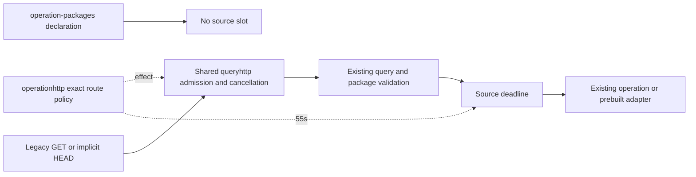

Publication/mixed retention endpoints and SSE retain their separate lifetime
owners. This does not put every route behind a universal read budget.

## Executable shutdown (2026-10-28)

`goo serve-http` owns SIGINT/SIGTERM handling. On a signal it closes listeners
and allows active handlers five seconds to finish, using a fresh shutdown context.
If they do not finish, it cancels the server request root and closes remaining
connections; source reads and SSE inherit this cancellation. A drain timeout is
returned as an error. Normal drained shutdown returns success; listen failures
remain errors. Configuration-only construction still does not listen or probe.

A publication whose response was interrupted may already have committed. Shutdown
does not roll back files or XTDB transactions, create a retry receipt, or change
existing refresh/promotion/freeze retry contracts. Request cancellation is
cooperative; arbitrary handler goroutines are not forcibly joined. SIGKILL and
process crashes cannot drain or flush.

The two Go sample executables own their SDK providers. They stop serving first,
then invoke provider Shutdown (which flushes), each with an independent fresh
five-second context. Checkout shuts down metrics then traces; reports shuts down
traces. Cleanup also runs on a listen error or later initialization failure.
Provider errors are logged. Intentional demo metric suppression remains in effect.
Compose grants both checkout instances and reports 20 seconds before forced kill,
covering the checkout's five-second drain plus two five-second provider budgets.
These small executable-local helpers do not add SDK lifecycle ownership to goo's
instrumentation library or to query adapters. Python processes are unchanged.

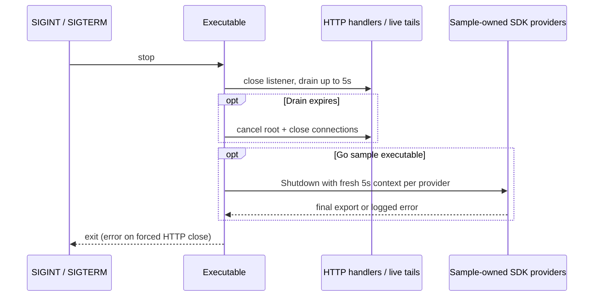

## Record-family policy and handler extraction (2026-10-28)

Implemented: `internal/recordhttp` owns `/inventory`, `/discovery`, `/explore`,
`/explore/counted-values`, `/record-aggregates`, `/trace-search` and pure `/compare`.
`PolicyFor(method, path)` returns a value copy of the family's effect, JSON ceiling
and source deadline. Registration uses those declarations for decoding/deadlines;
application admission uses the same declarations to distinguish the six source
reads from pure comparison. Limits remain 16 KiB/15–55 seconds for record reads,
64 KiB/55 seconds for trace search and 1 MiB for pure comparison. Deadline setup
still follows typed decoding and semantic validation.

The inferred `queryhttp.ReadHandler` shares the typed decode/validate/read/write boundary;
validators and source methods keep their concrete types and existing 400/502
mapping. Source/compiler behavior remains in `exploration`. Registration accepts
the configured source and existing snapshot bank; only `/explore` holds an
expiring result token. Snapshot exhaustion still adds a warning to a successful
read. The configured server creates one bank and supplies it explicitly to
capture/retention owners too; its lifetime is described below.

`internal/queryhttp` owns shared admission, the cancellation registry, tombstones,
60-second enclosing deadline and cleanup after the handler/body completes. The
command composes record, native, explanation, capture and operation family lookups, without
a duplicated controlled-path list. Publication, SSE and Python proxy
policies retain their separate owners.
No endpoint, wire response, source query, status policy or storage format changed.
API source indexing now recognizes the family's explicit `registerRead` calls;
build/check tools share that index. Published source-owner metadata points to the
extracted files, while contract tests compare policy body/admission boundaries to
OpenAPI. Existing source/JSON/deadline fixtures still run through command composition.

Focused checks are `go test ./internal/queryhttp ./internal/recordhttp ./cmd/goo`,
`go test -race ./internal/queryhttp ./internal/recordhttp`, and
`python scripts/check_openapi.py` in the documented API development environment.

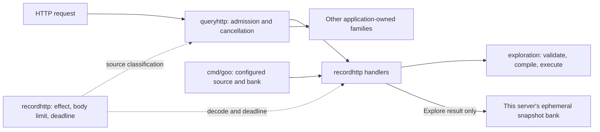

## Native measurement/discovery policy extraction (2026-10-28)

`internal/nativehttp` owns `/metric-discovery`, `/measurements`, `/host-discovery`,
`/pod-discovery`, `/pod-metric-discovery`, `/host-dashboard/plan` and
`/pod-dashboard/plan`. Its family table supplies effect, byte ceiling, timeout and
trailing-JSON error text to registration and admission. `queryhttp.Policy` is a
shared internal value; method/path lookup remains with each family. No global
route registry or user-facing generic parameters are required.

The five source routes retain 15- or 30-second contexts after decoding and
validation. Native byte limits remain 16/64 KiB; the pod planner still accepts
8 MiB plus 1 KiB. Host/pod planners retain their two-second contexts beginning
before decoding, with pre/post-computation deadline checks. They remain available
when source admission is full and do not issue reads. `queryhttp.ReadHandler`
and `PlanHandler` share typed HTTP mechanics without reflection; concrete source,
validation and pure planning functions stay in their domain packages. The unbounded
pure `/compare` route keeps its existing separate handling.

`/measurements` is explicitly a read **with optional lifecycle custody**. Its
configured `measurements.Source.CustodyDir` is preserved; discovery does not write
custody. The record adapter still owns the physical pod-inventory read, passed
separately to `RegisterPodDiscovery`. Definition catalogs/publication, container
planners, capture/recovery and SSE retain their existing owners. Invalid input,
source failure, strict JSON behavior and wire responses are unchanged. OpenAPI
regeneration changes only the seven source-owner metadata entries.

Deterministic `testing/synctest` checks cover deadline phase ordering and the parent
context ceiling. Integration checks cover configured custody, no discovery writes,
immutable first-observation bytes and pure/source admission. Shared policy tests
compare both families' byte/admission declarations with OpenAPI.

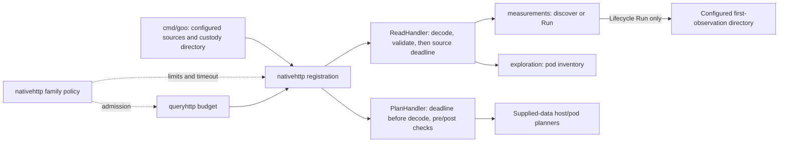

## Server-owned snapshot capabilities (2026-10-28)

`configuredHTTPServer` creates a fresh `ResultSnapshots` bank for each server and
passes it explicitly through Explore, population explanations, capture promotion
and workbench/retention registration. No package-wide result bank remains.
Registration fixtures use local banks rather than resetting production globals.

| State | Owner and sharing |
| --- | --- |
| Live record pages and observed explanations | One bank per configured server; producers and load/promotion consumers share that exact instance. Existing TTL, entry, per-result and byte bounds apply per bank. |
| Tail membership proofs | One bank created at server startup and explicitly shared by the tail and retention routes. A nil bank in a fixture explicitly means membership proof is unavailable. |
| Live-comparison drafts | Already owned by the `registerLiveComparison` closure inside each server's capture registration. |
| Published captures and optional XTDB records | Configured durable stores, independently of the ephemeral banks; servers using the same storage can reopen those saved records. |

A different server or fresh replacement cannot load/promote another server's live
result token, even inside the same process with the same capture directory. Such
requests retain their existing unavailable-token responses. Native retention still
attempts durable request recovery when a page is unavailable; a lost bank must not
turn an ambiguous commit into a false failure or trigger an implicit source reread.
Same-server explanation promotion remains idempotent. Server-local capability
ownership is not an authentication boundary or a new partition of shared storage.
Multi-instance clients still need affinity for live capabilities or an explicit
new observation; saved captures follow their configured storage.

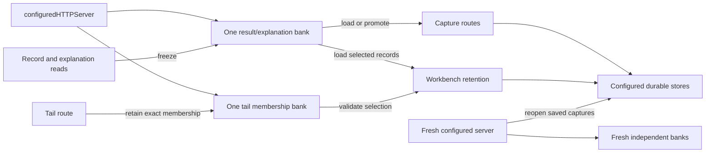

Acceptance uses separately configured servers against a real HTTP source fixture:
foreign record/explanation tokens are refused, the owning server can promote,
retention keeps its retry/recovery ordering, a replacement forgets live tokens,
and shared saved captures still reopen without telemetry reads. The full command
race suite also runs with independent registration fixtures. Live XTDB publication
is separate from these configuration/error-path checks.

## Explanation and capture family policies (2026-10-28)

`internal/explanationhttp` owns the explanation read and its pure plan/filter
routes. All retain 64 KiB strict JSON bodies; the read keeps its 55-second context
after validation. It holds the observed result in the supplied server bank and
preserves `X-Goo-Save-Status: unavailable` if holding fails. Pure plans retain their
existing unbounded computation path and remain outside source admission.

`internal/capturehttp` owns saved-capture GET routes, POST `/captures`, and POST
`/captures/live`. The POST policies retain 16 KiB strict JSON bodies and explicit
mixed effects:

| Route | Source branch | Held branch |
| --- | --- | --- |
| `/captures` | Validate/refresh the fixed question, read and publish immutable evidence | Promote the exact observed explanation with the supplied result bank; no source reread |
| `/captures/live` | Read a fresh record/native-counter comparison into an expiring registration-local draft | Freeze the displayed draft once; retries return its existing immutable receipt |

Only source branches start the 55-second source context. Both branches retain the
existing outer admission/cancellation ceiling, including held publication during
source saturation. The classifier does not decode bodies or perform effects.
Missing/expired tokens still refuse; they never cause an implicit fresh read.
Status mapping, immutable publication, fixed-question refresh and acknowledgment
retry semantics stay in these custom family handlers. `queryhttp.ReadHandler`
rejects mixed publication policies rather than imposing generic source error or
retry behavior on them. Captures' bodyless GET routes keep their existing exact
query/ID/file validation and do not enter POST source admission.

The command now composes all four adopted families' policy lookups. This covers
the previously controlled routes; it does not silently extend the budget to legacy
operation GETs, retention or SSE. Source indexing and OpenAPI point to extracted
owners; request/response schemas and statuses are unchanged. Tests cover the four
families' published byte/admission boundaries and pure/held/source separation.

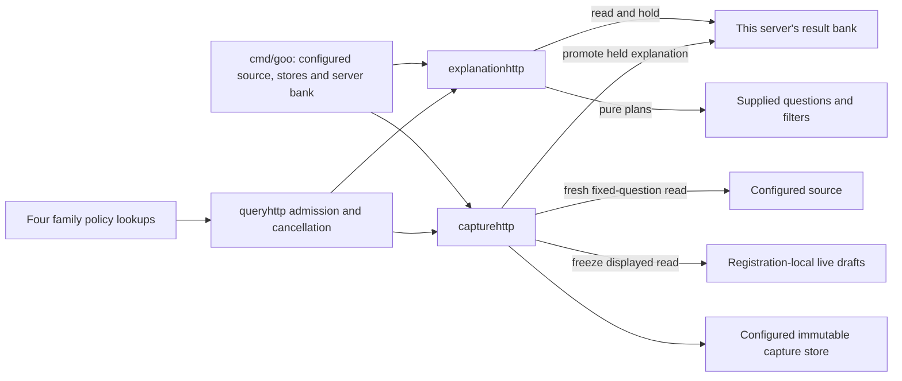

## Endpoint effects

Limits below are request JSON byte ceilings, not result or measurement limits.
Validation may reject smaller requests. Route-specific codes/messages and source
family limits remain authoritative in code/tests; this table groups related routes.

| Routes / owner | Effect | Request ceiling / execution lifetime |
| --- | --- | --- |
| GET `/http-package`, `/operations`, `/counter-rates`, `/histograms` in `serve_http.go` | Execute ClickHouse reads; operation views can issue multiple reads | Query parameters; shared client 15s per HTTP request, incoming context |
| GET `/operation-packages` | Return startup declarations; no telemetry | Query validation, no body |
| GET `/measurement-packages`, `/investigation-workflows` | Read definition/workflow files; no telemetry | Catalog/file bounds, no body |
| POST `/measurement-packages/plan` | Validate/compile native definition; no source or publication | 64 KiB |
| POST `/measurement-packages` | Publish canonical YAML; preserve existing duplicate policy | 64 KiB; filesystem |
| POST `/metric-discovery` | Query native instrument inventory | 64 KiB; 15s context |
| POST `/pod-discovery` | One grouped source read across logs, spans and three metric tables; reported resource variants only | 16 KiB; 30s enclosing context, shared source admission/cancellation; 1,000 source-family groups before whole refusal, 100 retained variants, 8 MiB reply |
| POST `/pod-metric-discovery` | Exact raw pod-resource metric metadata lookup | 64 KiB; 30s enclosing context; shared source admission/cancellation |
| POST `/pod-dashboard/plan` | Pure bounded pod-memory planning over supplied discovery | 8 MiB + 1 KiB; two-second pre/post deadline; no source admission or custody |
| POST `/measurements` | Execute native measurement; lifecycle may create first-observation custody files | 64 KiB; 15s context |
| POST `/inventory`, `/discovery`, `/explore` | Query ClickHouse; Explore also freezes a bounded process-local result-page capability when possible | 16 KiB; 15s / 30s / 55s contexts |
| POST `/compare` | Compare supplied summaries; no telemetry query | 1 MiB |
| POST `/tail` | SSE polling reads; own four-slot budget, bounded stream lifetime and write deadlines | 16 KiB; 60s context, 2s polling, 5s per-write deadline |
| GET `/investigations/{id}` | Reopen immutable operation capture; no telemetry | File bounds |
| POST `/investigations` | Read operation/rate/histogram evidence and publish a capture; refresh checks parent question/package revision | 16 KiB; incoming context and shared HTTP client |
| GET `/captures/search` | Derived metadata search; no payload body or telemetry reads; full contents verified on reopen | Entry/aggregate metadata budgets, stamps, query/catalog-bound cursors; missing index 503 |
| GET `/captures`, `/captures/{id}` and suffixes `followups`, `compare`, `windows`, `receipt` | Read/page/recompute from saved evidence; no telemetry reread | File/catalog/cursor bounds |
| POST `/captures` | Execute source family and publish immutable evidence; refresh retains original question | 16 KiB; 55s context |
| POST `/captures/live` | Read fresh evidence against a saved baseline and hold expiring drafts, or freeze a held draft into immutable capture files without a reread | 16 KiB; read branch 55s context; draft budget separate |
| GET `/recipes`, POST `/recipes` | Return templates / plan supplied question; no telemetry | POST 16 KiB |
| POST `/dashboards/plan` | Plan from supplied inventory/declarations; no telemetry | 256 KiB |
| POST `/telemetry-packages/draft`, `/numeric-plan`, `/plan` | Build/validate/compile reusable definitions; no telemetry | 64 KiB |
| POST `/telemetry-packages`; GET collection or `/{revision}` | Publish or read reusable definition files | POST 64 KiB; store bounds |
| POST `/population/plan` | Plan typed population transformation; no telemetry | 128 KiB workbench decoder |
| GET/POST `/annotations`, `/exploration-views`, `/deployments`, `/documents`, plus GET `/{id}` | Read/publish authored context; document creation checks references and can verify pinned XTDB review citations | POST 128 KiB; citation checks 30s each |
| POST `/captures/comparisons`; GET `/captures/comparisons/{id}/receipt` | Recompute/save comparison context from saved captures; no telemetry reread | POST 128 KiB |
| GET `/retained-evidence/status` | Report optional XTDB configuration; no database probe | No body |
| GET retained collection, manifest, annotations/history or pinned revision | Read XTDB metadata/custody; await-token lower bounds remain separate | 30s contexts |
| POST `/retained-evidence` and `/{id}/annotations` | Freeze selected saved/server-held rows or correct review metadata in XTDB; request recovery may precede publication; no ClickHouse reread | 16 KiB; 30s contexts |
| POST `/queries/{id}/cancel` in budget wrapper | Cancel/mark a query capability; no source publication | Wrapper validates UUID and capability budgets |

The global query budget currently controls only POST metric discovery, native
measurements, inventory, discovery, Explore, captures and live comparisons. It
adds a 60-second outer context and handles optional query IDs. GET executions,
operation investigations, tailing and retention are not all covered by that
wrapper; tailing retains its own slots. This extraction does not broaden budgets.
A GET method therefore does not establish source-free behavior, and a source read
does not establish absence of filesystem custody effects.

## Decoder, response and stream policies

Most JSON route families disallow unknown fields, cap the body and refuse a second
JSON value. Trailing-value messages differ (`one JSON object required`, `expected
one JSON object`, `require one JSON object`); helpers must retain these choices.
Malformed/body-limit errors normally return 400 rather than universally using 413.
Live snapshot size limits can return 413; capacity can return 429. Saved-reference,
refresh, backend and optional-store failures retain per-route 404/409/410/502/503
policies. The current native success/failure and YAML duplicate response fixtures
are in `testdata/storage` and the native route tests.

JSON/no-store is common, not universal: early tail errors currently set JSON but
not no-store; successful SSE sets `text/event-stream`, no-store and
`X-Accel-Buffering: no`. Some inline GET handlers use `http.Error`, whose content
type/body differ from JSON encoder failures. Default mux 404/405 responses retain
Go's behavior. SSE emits reset/stream events and must preserve flush, cancellation,
continuity caveats and disconnect handling. Do not route streaming through a
buffered JSON responder or silently standardize these policies in a refactor.

## Startup dependencies: native and exploration/tail adoption

`clickHouseConnectionFromEnvironment` now resolves endpoint, credentials and the
shared HTTP client once at startup for every Go HTTP ClickHouse route. Empty
endpoint retains `http://localhost:8123`. `measurementSource()` and
`explorationSource()` produce existing family adapters; they do not compile or
execute queries. This replaces the earlier separate native/record environment
builders without introducing a common semantic evaluator or transport.

`registerMeasurements` still derives custody under the supplied data root.
`registerExploration` shares the configured record source with tail registration;
`registerCaptures` shares it with live comparison. Query timeouts, tail slots and
streaming lifetime, capture roots and expiring draft maps retain their owners.
The extracted `registerOperationReads` receives startup plans, HTTP expansion,
instrumentation binding and connection value. `registerInvestigations` receives
plans, connection and storage root. No Go HTTP handler rereads ClickHouse process
configuration. Environment mutation is not a reload API. Source strings are copied;
the HTTP client remains shared.

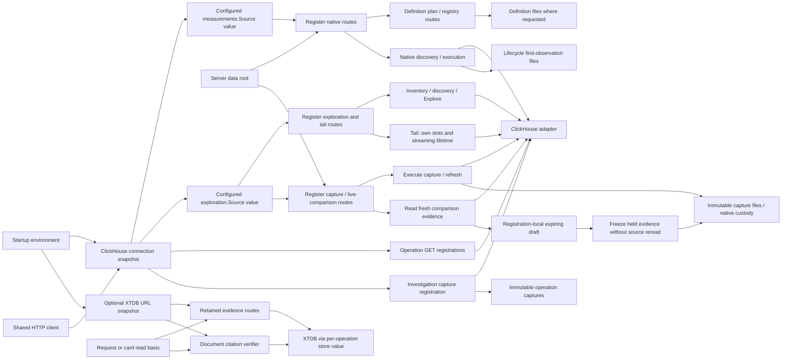

Operation GET readers and investigations now also use the startup snapshot.
Optional retention and document citation checks share an injected XTDB URL snapshot
from `retentionConnectionFromEnvironment`. Read basis is supplied separately to
`connection.store(readBasis)` for each operation. Definitions/workflow paths still depend on working
directory; result snapshots remain process-global and live comparison drafts remain
registration-local. These are explicit remaining boundaries, not unified services.

## Checks and next cuts

Existing native registry/preview/YAML fixtures pass before and after injection.
Two injected backends return different gauge values with distinct credentials;
an ambient trap source receives zero requests. Tests prove injected client use,
source-free planning, native/discovery routing, invalid-input rejection before reads,
request cancellation and absence of gauge/discovery lifecycle files. Startup tests
pin default endpoint and configuration snapshot behavior. Record dependency tests
keep two routers/backends registered simultaneously, proving inventory, discovery,
Explore and tail use their own endpoint, credentials and client. Caller source
mutation does not redirect a registration; an ambient trap receives no reads.
Invalid and cancelled record queries avoid backend reads. Actual SSE reset/batch
frames, no-store/no-buffering headers and disconnect are exercised with injected
sources. Capture dependency tests likewise hold two routers/backends at once and
check distinct captured/live totals, auth/readonly/client wiring, no ambient reads
and pre-source refresh/cancellation rejection. After both backends close, own draft
freezes are source-free/idempotent, foreign tokens are refused, persisted captures
reopen in a new registration, and old draft tokens do not survive that registration.
The full HTTP race suite
retains budget, SSE, capture and optional-store tests.

C2 remains active. Pure planning JSON and native/record transport adoption are
delivered. The acceptance audit below records the remaining adoption sequence; prebuilt transport is
now delivered along with operation spans, counters and histograms; telemetry package JSON is now adopted below. Transport adoption proceeds one family at a time, preserving parameter escaping,
read limits, basis/identity and non-2xx/oversize/cancellation behavior. Python proxy
removal, changing custody/duplicate policy and universal endpoint budgets are not
part of these cuts.

## Pure planning JSON adoption

Recipes and dashboard planning now use `internal/httpjson.Decode` and `Write`.
The decoder takes an explicit byte limit and trailing-input message. It retains
`encoding/json` typed decoding and unknown-field refusal without imposing content
media-type checks, null rejection or duplicate-key rules. The route validates the
decoded domain object after successful decoding; targets can be partly populated
on error and must not be executed/published in that state. Writer behavior is the
existing JSON content type, no-store header and newline-terminated JSON encoder;
encoding/write errors remain ignored as in the original routes. It is not SSE or
a universal error/status mapper.

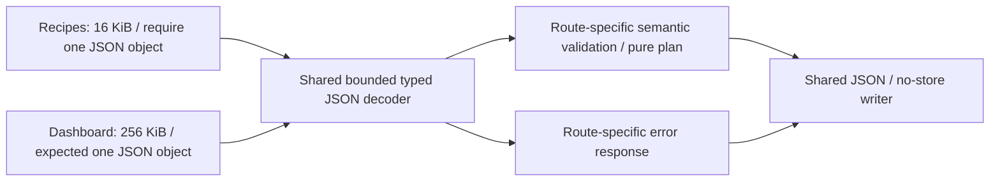

`testdata/http/planning.json` pins 32 selected wire cases across the two POST
routes and mux method refusal. It includes valid plans, empty/null/array/truncated
input, unknown top-level/nested fields, second values, malformed tails, trailing
whitespace, exact and over-limit bodies, ignored request content type, empty
objects and 405 behavior. Large bodies are reconstructed from compact fill/padding
fields. Status, exact response bytes and selected headers are compared.

Both fixture sets passed on the old handlers before extraction. Recipes retain
“require one JSON object”; dashboards retain “expected one JSON object”. Exceeding
the body budget during the first value retains the body-too-large error; doing so
while checking trailing whitespace retains the caller's trailing-input message.
Both continue to use 400. Null still reaches domain validation rather than a new
generic “must be object” guard. Default mux text/Allow headers remain outside the
JSON writer.

The Hegel campaign generates Unicode/escaped labels, exact typed int64 values above
JS safe range, whitespace and exact/insufficient byte budgets. It checks roundtrip,
unknown fields, second values and the JSON/no-store response. Existing HTTP race
checks retain pure planning/registry declaration behavior and unrelated native,
SSE, budget, retention and capture contracts. No source or persistence dependency
was added to these planning routes. Other JSON route families are not yet adopted.

## Capture and live comparison dependency ownership

`serveHTTP` constructs one configured record source for exploration/tail and
capture/live registration. Source values are copied into each owner; their HTTP
client remains shared. Environment mutation is not hot reconfiguration. Storage
roots, lineage validation, 55-second source-read context, live draft budgets and
expiry/replacement rules retain their existing owners. Freeze checks the held
server-side draft before any source branch; repeated freeze uses its published
receipt. Backend unavailability does not turn a held snapshot into a new read.

A new registration can reopen persisted capture evidence without its source, but
its draft map starts empty. Source injection does not make capabilities global,
make drafts durable, remove expiry, infer complete source data or change native
measurement semantics. Existing capture bank/page/receipt/comparison tests, exact
live freeze/admission/replacement checks and source-free native-window tests are
retained with explicit source wiring. No transport or UI protocol changed.

## Operation GET and investigation adoption

`registerOperationReads` holds the existing `/http-package`, `/operation-packages`,
`/operations`, `/counter-rates` and `/histograms` handlers outside startup loading.
Parameter validation, defaults, source bindings, current-window versus explicit-window
semantics and response/error styles are unchanged. Eleven validation cases and the
declaration response were checked after moving the unchanged handlers and before
changing their connection wiring. In particular, `http.Error` validation failures
retain JSON-looking text, text/plain content type, no-store and nosniff headers.
Source failures remain 502 JSON, not zero-valued successful evidence.

Two simultaneously registered operation/investigation routers use distinct injected
backends/credentials/clients with an ambient trap receiving no reads. All four
source-reading GET routes execute through the assigned client; `/operation-packages`
is source-free. Already-cancelled GET requests avoid backend reads. Investigations
keep revision/parent checks before reads and reopen exact stored receipts from a
fresh registration even after backend closure and with no loaded plan registry.
The existing optional-rate/histogram-error and failed-refresh receipt tests remain.
These GET routes keep incoming request contexts and the shared client timeout;
this refactor does not enroll them in the global POST query budget.

All Go HTTP ClickHouse and optional XTDB configuration is now resolved at startup.
Definition files/result snapshots still have the documented working-directory/
process-global boundaries. C2 remains active; native/record transport mechanics below are delivered.

## Optional retention and document citation startup wiring

`retentionConnectionFromEnvironment` supplies the optional URL once at server
startup. The same immutable configuration value goes to workbench registration,
its retained-evidence routes and document citation verification. An empty URL
remains an unavailable optional capability; status reports configuration, not
database health. A configured but unavailable store retains existing failure and
recovery behavior rather than pretending a request never committed.

The connection configuration contains no await token. Each read/correction uses a
fresh `retention.Store` value with the request's explicit basis, and document
creation verifies each retained card with its own `ReadBasis`. Thirty-second
contexts, exact manifest/review references, retry keys and native recovery rules
are unchanged. No mutable server-wide basis, connection pool or generic reference
resolver was added. Stored documents reopen from local files without probing XTDB.

Unit/HTTP tests cover empty versus configured-unavailable instances, status/no-store
headers and availability-before-validation ordering independent of later ambient
environment changes. The gated real-instance test
`TestXTDBHTTPInjectedCitationBasisAndOfflineDocument` publishes selected ordinary
record fixtures and a correction, creates a document with old/current exact review
citations, concurrently checks valid/invalid bases, and reopens the file document
with optional retention disabled. It requires `GOO_XTDB_TEST_URL`; root runs without
that variable explicitly skip this live check. This cut ran it against the local
XTDB instance as well as the complete HTTP race suite with that variable enabled.
The fixture uses decimal-string timestamps matching the retained-record adapter.

ClickHouse and XTDB environment mutation after startup is not a reload mechanism.
C2's native and record transport cuts below are delivered. Remaining adoptions
must preserve query compilation, parameter escaping, body/row limits, basis and
error contracts. No database schema, bitemporal policy or public UI workflow changed here.

## Native source HTTP mechanics — first transport adoption

`measurements.Source.read` now uses `internal/sourcehttp.Post` for context-bound
POST construction, explicit Basic Auth and the supplied client, and `ReadBounded`
for limit-plus-one body reading. The adapter still closes the body and owns its
15-second fallback client, endpoint/query parameters, escaping, readonly/resource
settings, exact status/limit errors, native scanner and 10,000-row guard. Query
compilation, evaluation, native stream identity, reset/temporality, coverage, basis
and custody have not moved. `Post` requires a non-nil caller-supplied client; it
does not retry or change transport configuration. `ReadBounded` returns no partial
payload on overflow/read error, with the family deciding the resulting error.

Native status checking remains after bounded body reading, so a body-read error
still precedes a non-200 status error. Other adapters may check status first; these
two primitives permit that order rather than imposing native policy. In particular,
record source escaping, status ordering, row validation/limits and SSE ownership
were not adopted or normalized in the first cut; the record continuation below
now adopts only matching mechanics. This is a buffering helper, not an SSE
reader, universal ClickHouse evaluator or query optimizer.

```mermaid
flowchart LR
  Plan[Native compiler: SQL and typed parameters] --> Native[Native source adapter]
  Native --> Policy[Native URL / escaping / query settings / client fallback]
  Policy --> Post[Shared POST / auth / context primitive]
  Post --> CH[ClickHouse]
  CH --> Body[Response owned and closed by native adapter]
  Body --> Read[Shared bounded read: limit plus one]
  Read --> Guard[Native status / 8 MiB / scanner / 10000-row guards]
  Guard --> Evaluate[Native evaluation / evidence basis / custody]
```

Before extraction, native contracts pin exact request body/auth/query flags,
escaping (without mutating parameter maps), response closure, empty/raw-line
behavior, exact/overflow byte and row boundaries, scanner-size failure, 201/503,
transport/cancellation errors and read-error-before-status precedence. The same
contracts pass after extraction. The Hegel campaign generates byte budgets and
partial-read failures, proving exact in-budget bytes, at-most-limit-plus-one
consumption and no partial success on error/overflow.

The gated real test `TestClickHouseNativeSourceTransportIntegration` requires
`GOO_CLICKHOUSE_TEST_URL` and optional `GOO_CLICKHOUSE_TEST_USER` /
`GOO_CLICKHOUSE_TEST_PASSWORD`. It uses readonly queries against the local lab:
complex escaped parameters roundtrip through `numbers(3)`, a native gauge query
passes evaluation/result identity validation, and native instrument discovery
succeeds. No telemetry is inserted; the gauge/discovery scope may have no data.
Root runs without the variable explicitly skip this live check. No running app
image was rebuilt for this code-only transport cut.


## Record source transport adoption

`exploration.Source.read` now uses the same `Post` and `ReadBounded` primitives.
The source still owns its URL policy, 15-second fallback client, response closing,
parameter escaping, error mapping and JSON-object validation. Fetch, discovery,
capture and tail callers keep their existing query and evidence semantics.

| Contract | Native measurements | Record exploration |
| --- | --- | --- |
| Status ordering | Read body before status check | Reject non-200 before any body read |
| Parameter controls | Named escapes for selected controls | Hex escapes for all ASCII controls and DEL |
| Accepted rows | Raw lines, evaluated downstream | Trimmed non-null JSON objects; blank lines skipped |
| Row budget | 10,000 | 1,001; server setting 1,002 |
| Body budget | 8 MiB | 8 MiB |
| Scanner failure | Nil rows with error | Accumulated slice with scanner error (existing contract) |

```mermaid
flowchart LR
  Query[Record compiler: SQL and typed parameters] --> Policy[Record URL / escaping / readonly budgets]
  Policy --> Post[Shared POST / auth / context]
  Post --> CH[ClickHouse]
  CH --> Status[Record status check before body read]
  Status --> Read[Shared bounded read: limit plus one]
  Read --> Rows[Record object validation / scanner / 1001-row guard]
  Rows --> Evidence[Family counts / basis / capture or tail owner]
```

The adapter owns and closes every received response body, including rejected
statuses. Pre-extraction contracts pin request bytes/auth/settings, input immutability,
status-before-read precedence, read-error identity, exact/overflow byte and row
limits, scanner failure, raw numeric spellings, invalid objects and cancellation.
The same tests pass after adoption. `TestClickHouseRecordSourceTransportIntegration`
uses the same gated lab variables as the native test and readonly `numbers(3)`
queries to roundtrip backslashes, all ASCII controls, DEL, Unicode and punctuation.
It inserts no telemetry. Hegel's shared bounded-read properties apply to both adapters.

Other transports and strict-JSON route adoption still need an acceptance audit;
C2 remains active. No UI, SSE protocol or Quint transition changed, so existing
screenshots/storyboards remain applicable. No running app image was rebuilt.

## C2 acceptance audit — 2026-10-22

This is a source/test inventory after record adoption, not evidence that the
remaining adapters have passed extraction contracts. C2 stays active. Startup
configuration injection is complete for the Go HTTP server; transport and JSON
consolidation are partial.

| Acceptance area | Evidence / current state | Remaining work |
| --- | --- | --- |
| Endpoint effects and startup dependencies | Inventory above; native, exploration/tail, capture/live, operation/investigation and optional-retention dependency tests | Preserve these boundaries in subsequent cuts; no new dependency layer needed |
| Shared bounded source mechanics | Native and record before/after wire contracts, Hegel bounded-read properties, gated readonly ClickHouse tests | Four readers below still duplicate POST/body mechanics |
| Strict JSON / response mechanics | Recipes/dashboard use shared helpers; 32 frozen wire cases | Other route families still decode locally; freeze each family's wire contract before adoption |
| Family semantics and source-free reopen | Existing evaluation, capture, live-freeze, citation and dependency tests | Re-run affected tests after each adoption; helper tests alone do not prove evaluator/basis parity |
| SSE and query budgets | Tail owns slots/deadlines/flushing; injected-source tests cover frames/disconnect | Keep early error headers and independent lifetime; no buffered response adoption |
| Real-source/browser acceptance | Native/record readonly transport checks ran in prior cuts | Remaining adapters need their own live checks; latest backend commits have not been deployed to the lab UI, so current screenshots do not validate them |

### Remaining ClickHouse transports

| Reader | Current policy that extraction must preserve | Existing evidence and gap |
| --- | --- | --- |
| `prebuilt.FetchHTTP` | Status before body; deferred close; 8 MiB; raw parameter values URL-encoded without record/native escaping; typed JSON decoder; 1,000-span refusal in evaluation; explicit-window checks and duplicate identity | `TestLiveSourceUsesParametersAndRejectsOutOfWindow` and `TestSourceDuplicatesConflictBoundsAndMissingOutcome` cover semantic slices, not full byte/status/read-error contracts |
| `annotations.FetchOperations` | Status before body; deferred close; 8 MiB; raw parameter values; typed rows; 1,000 raw spans; conformance/dedup and exact integer strings | `TestLiveOperationSource` covers bound query and conformance; transport boundary matrix still needed |
| `OperationPlan.fetchInstanceRates` | Body read and immediate close before status; read error precedes status, status precedes oversize; 8 MiB; 3,000 points per contract; baseline and per-instance/fleet semantics | Rate/ratio/fleet tests exist; status/body/error precedence and byte boundaries are not frozen transport contracts |
| `OperationPlan.fetchInstanceHistograms` | Body read and immediate close before status; same precedence as rates; 8 MiB; 1,000 points per contract; bucket layouts, temporality and reset semantics stay local | Histogram/fleet tests exist; full transport contracts still needed |

All four take an explicit client; preserve that caller contract rather than adding
a fallback during extraction. `Post` and `ReadBounded` can support each without
moving URL settings, raw parameter handling, typed decoding or evaluation. Do not
standardize escaping as incidental cleanup: record/native escape policies differ
from these older readers. Any correctness change needs its own contract and cut.

### Remaining JSON owners

Record, native, explanation and capture owners now use shared typed JSON
mechanics while retaining their family policies. Catalog/publication wrappers and
remaining local decoders live in command files such as `measurements_http.go`,
`telemetry_packages_http.go`, `tail_http.go`, `investigations_http.go`,
`workbench_http.go` and `retention_http.go`. They mix pure planning, execution and
publication. Further adoption must preserve effect ordering.
Retain each route's body ceiling and exact trailing-input message (including
retention's `expected one request`), malformed/unknown/null/second-value behavior,
headers, method refusal, error mapping and availability-before-validation checks.
Query-string target decoders and file/YAML readers are separate boundaries.

The OTLP exporter in `instrumentation/example_logs.go`, XTDB's PostgreSQL client,
CLI/file decoders and Python proxy are outside this bounded ClickHouse HTTP
extraction. Their presence is not a reason to build a universal transport owner.

### Ordered completion proposal

1. **Next: prebuilt HTTP transport.** Freeze exact SQL/auth/query settings and
   unmodified parameters; pin status-before-body, close/error identity,
   exact/overflow bytes, malformed rows, cancellation and existing evaluator
   refusals. Run before extraction, adopt only the two shared primitives, then
   run affected race tests and a gated readonly lab query through `FetchHTTP`.
   Keep sampling/schema/window/dedup warnings and evidence identity unchanged.
2. Freeze/adopt operation spans; then counters and histograms separately, including
   their different error precedence and per-contract/fleet behavior. Reuse test
   machinery only where it preserves independently named family expectations.
3. Adopt pure telemetry planning JSON first, with exact wire fixtures. Then group
   remaining decoder work by owner/effect; exercise rejection-before-source/write,
   source-free freeze/reopen, optional-store ordering and SSE headers as applicable.
4. Before closing C2, run affected root/race/property checks and real-source
   acceptance for adopted readers. Rebuild the lab and execute relevant existing
   browser journeys against the completed server; refresh frames only if rendered
   behavior changes. Record skips explicitly. A transport unit pass does not close
   this final integration gate.

D1 comparison presentation remains queued after bounded C2 acceptance. This audit
does not introduce a new evaluator, broaden query budgets or change public UI flow.


## Prebuilt HTTP transport adoption

The first remaining-reader cut from the audit is delivered. `prebuilt.FetchHTTP`
now uses `sourcehttp.Post` and `ReadBounded`. It retains the explicit client contract,
raw URL-encoded parameter values, readonly/query settings, status-before-body
ordering, deferred response closure and exact byte/status errors. Typed JSON
stream decoding, explicit-window validation, duplicate/conflict detection, the
1,000-span evaluation bound, result identity and declared-schema/sampling warnings
remain in the prebuilt adapter/evaluator. No record/native escaping was imported.

```mermaid
flowchart LR
  Binding[HTTP expansion and explicit scope binding] --> Query[Prebuilt query / raw typed parameters]
  Query --> Post[Shared POST / auth / context]
  Post --> CH[ClickHouse]
  CH --> Status[Prebuilt status check before body read]
  Status --> Read[Shared bounded read: 8 MiB plus one]
  Read --> Decode[Prebuilt typed JSON / window checks]
  Decode --> Evaluate[1000 raw spans / identity / dedup / evaluation]
  Evaluate --> Receipt[Existing results / basis / warnings]
```

`TestPrebuiltTransportContract` passed before and after extraction. It pins verbatim
SQL, exact URL settings/auth, unmodified complex parameter values, empty/valid/
duplicate reads, exact/overflow byte and row limits, malformed JSON, unread 201/503
bodies, close-once behavior and read-error identity. Transport errors and cancelled
contexts are checked separately; existing semantic tests retain conflict, missing
outcome and exclusive upper-window refusal.

`TestClickHousePrebuiltTransportIntegration` uses the existing gated ClickHouse
variables and executes `FetchHTTP` against the real lab table with a deliberately
absent scope and fixed window. It validates the query/decoder/empty evaluation path
without inserting data or claiming positive-population coverage. The affected
HTTP suite also keeps injected positive fixtures. Hegel bounded-read properties
pass for the shared primitive. No public UI/SSE/Quint protocol or running image
changed; screenshots remain applicable. The final deployed-journey gate remains
open. At the prebuilt cut three readers remained; operation spans are now adopted below,
leaving counters and histograms;
local JSON-owner adoption remains queued as described in the audit.


## Operation-span transport adoption

`annotations.FetchOperations` now uses shared `sourcehttp.Post` and `ReadBounded`.
The explicit client, raw URL-encoded parameters, readonly/query flags,
status-before-body check, deferred closure and exact errors remain adapter-owned.
Typed row decoding still refuses more than 1,000 raw spans before conformance;
window checks, conflicting identities, duplicate handling, subject events,
manifest/schema declarations, integer strings and evidence basis are unchanged.

```mermaid
flowchart LR
  Manifest[Manifest and explicit operation source] --> Query[Operation SQL / raw typed parameters]
  Query --> Post[Shared POST / auth / context]
  Post --> CH[ClickHouse]
  CH --> Status[Operation status check before body read]
  Status --> Read[Shared bounded read: 8 MiB plus one]
  Read --> Decode[Typed operation rows / 1000-span guard]
  Decode --> Observe[Conformance / dedup / subject events / basis]
  Observe --> Receipt[Existing operation receipt and exact span strings]
```

Before/after transport contracts pin SQL/auth/exact query settings, unchanged
complex parameter values, empty/valid/duplicate reads, exact and overflow byte/row
boundaries, malformed JSON, unread 201/503 bodies, close-once behavior, read-error
identity, transport errors and cancellation. Valid spans retain duration strings
above JavaScript's safe integer range. Existing source tests retain out-of-window,
negative duration, kind/scope/parent identity and conflicting-copy refusals.

`TestClickHouseOperationTransportIntegration` uses the existing gated ClickHouse
variables to execute the actual operation query, decoder and conformance path on
a deliberately absent service in a fixed window. It inserts nothing and proves
empty-path integration, not positive live-population coverage. Positive fixtures
remain in source and injected HTTP/investigation tests. Shared Hegel byte/read-error
properties pass. No UI/SSE/Quint protocol or running image changed; screenshots
remain applicable and the final deployed-journey gate remains open.

At the operation-span cut two readers remained. Counter adoption below is now
delivered; histogram transport remains next. Its body-read-before-status and
immediate-close policies must be frozen independently. Local JSON owners stay queued.


## Counter transport adoption

`OperationPlan.fetchInstanceRates` now uses shared `sourcehttp.Post` and
`ReadBounded`. It still reads and immediately closes each received body before
checking errors: read error precedes status; status precedes payload overflow.
Each rate contract keeps its own query, baseline, 3,000-point guard and evaluation.
The supplied client, raw URL-encoded parameters, readonly settings, exact errors,
plan validation, counter temporality/reset/precision rules, basis, ratios and fleet
peer isolation remain in their existing owners. No partial rates escape if a later
contract fails.

```mermaid
flowchart LR
  Plan[Validated operation plan] --> Contract[Each rate contract / baseline / raw parameters]
  Contract --> Post[Shared POST / auth / context]
  Post --> CH[ClickHouse]
  CH --> Read[Shared bounded read: 8 MiB plus one]
  Read --> Close[Counter closes response immediately]
  Close --> Errors[Read error then status then overflow]
  Errors --> Decode[Typed rows / 3000-point guard]
  Decode --> Evaluate[Counter evaluation / basis / ratios]
  Evaluate --> Fleet[Existing selected-instance and peer isolation]
```

Contracts pass before and after extraction. They pin complete SQL/auth/query
settings, baseline parameters, unmodified complex values, empty/positive payloads,
exact/overflow bytes and rows, malformed JSON, close-before-next-contract behavior,
read/status/overflow precedence, transport/cancellation errors and later-contract
failure without partial success. Positive fixtures retain a cumulative delta of
three; existing semantic tests cover precision, flags, reset/temporality and fleet
failure isolation.

`TestClickHouseCounterTransportIntegration` uses the existing gated ClickHouse
variables and executes both rate contracts against the real sum table for an
absent service and fixed window. It exercises query/decoder/empty evaluation,
without inserts or positive live-population claims. Hegel's shared bounded-read
campaign also passes. No UI/SSE/Quint protocol or running image changed; screenshots
remain applicable and the final deployed-journey gate stays open.

At the counter cut histogram transport remained. Its adoption below now completes
the audited ClickHouse reader list. Local JSON-owner adoption remains queued.


## Histogram transport adoption

`OperationPlan.FetchHistograms` now uses shared `sourcehttp.Post` and
`ReadBounded`, completing the audited Go ClickHouse reader adoptions. It retains
its explicit client, raw URL-encoded parameters, baseline/query settings, typed
decoding and 1,000-point guard. Each response is read and immediately closed;
read error precedes status and status precedes overflow. Plan validation,
per-contract evaluation, bucket layout/count precision, temporality/reset handling,
P95 ranges, evidence basis and warnings remain family-owned. Later-contract
failure still returns no partial result.

```mermaid
flowchart LR
  Plan[Validated operation plan] --> Contract[Histogram contract / baseline / raw parameters]
  Contract --> Post[Shared POST / auth / context]
  Post --> CH[ClickHouse]
  CH --> Read[Shared bounded read: 8 MiB plus one]
  Read --> Close[Histogram closes response immediately]
  Close --> Errors[Read error then status then overflow]
  Errors --> Decode[Typed rows / 1000-point guard]
  Decode --> Evaluate[Exact buckets / layout / reset / temporality / basis]
  Evaluate --> Result[Existing histogram populations and P95 ranges]
```

Before/after contracts pin complete SQL/auth/settings, baselines and raw complex
parameters, empty/positive reads, exact/overflow bytes and rows, malformed JSON,
read/status/overflow precedence, closure before the next contract, cancellation,
transport/read error identity and refusal of partial later-contract success. A
fixture with two independently named histogram contracts checks multi-read lifetime;
cumulative bucket counts above 2^53 retain an exact interval count of one. Existing
histogram semantic tests retain unit/layout and inconsistent-population refusals.

`TestClickHouseHistogramTransportIntegration` executes both fixture contracts via
the actual histogram table/query/decoder/evaluator with an absent service and fixed
window. It uses the existing gated ClickHouse variables, inserts nothing and
establishes empty-path integration, not positive live-population coverage. Shared
Hegel bounded-read properties also pass. No UI/SSE/Quint protocol or running image
changed; screenshots remain applicable and the final deployed-journey gate stays open.

All six audited readers now share only POST/auth/context and bounded-body mechanics:
native measurements, record exploration, prebuilt HTTP, operation spans, counters
and histograms. Their status ordering, parameter policy, decoding and semantics
remain distinct. Telemetry package JSON adoption below is now delivered.
Other JSON owners and final deployed
acceptance remain within C2; this transport completion does not close the milestone.


## Telemetry package JSON adoption

`registerTelemetryPackages` now uses `httpjson.Decode` with its existing 64 KiB
ceiling and `require one JSON object` trailing-input message, plus `httpjson.Write`
for its existing JSON/no-store response envelope. The owner shares these mechanics
between draft, numeric-plan, package-plan and publication; all four POST routes
were frozen before adoption. GET responses also use the same writer. Domain
validation, YAML parsing, default planning clock, annotation handoff, canonical
revision/storage and publication/registry status mapping stay local.

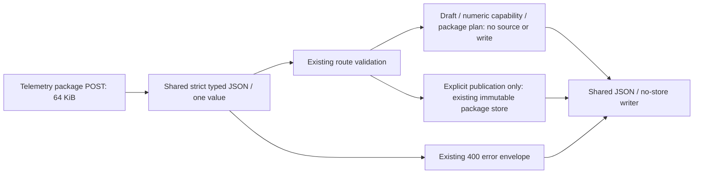

`testdata/http/telemetry.json` freezes 68 cases across the four POST routes:
valid results, empty/null/array/truncated input, unknown/nested-invalid fields,
second values, malformed tails, whitespace, exact/over-limit bodies, overflow
inside the first value, ignored content type, empty objects, invalid numeric types
and method refusal. Compact fill/padding reconstructs large requests. Tests compare
status, exact response bytes and content-type/cache/mux headers. Each request gets
an empty temporary registry: plans and rejected requests leave it empty; successful
publication creates exactly one file. Existing authoring/generated-Go, numeric
capability and storage identity/duplicate/reopen tests remain in the affected suite.

The 68 cases passed before and after extraction. A null value still reaches domain
validation; unknown fields and a second value still fail with existing errors.
The successful cases use explicit windows so their frozen bytes do not depend on
the default planning clock, whose implementation is unchanged. Publication remains
an explicit effect; no source dependency or generic endpoint policy was added.
Hegel shared-JSON byte/Unicode/integer properties pass. No UI/SSE/Quint protocol or
running image changed; existing frames remain applicable. Final deployed-journey
acceptance stays open. Native measurement/registry adoption below is now delivered behind its own
wire contracts. Fixed exploration adoption below is now delivered; other route owners remain queued.


## Native measurement and registry JSON adoption

`registerMeasurements` now uses `httpjson.Decode` with its existing 65,536-byte
limit and `one JSON object required` trailing-input message, plus `httpjson.Write`
for JSON/no-store responses. This covers native planning, YAML publication,
metric discovery and measurement execution; registry/workflow GET responses share
the writer. Validation, default planning time, file-only publication policy,
15-second execution contexts, source errors, lifecycle custody and status mapping
remain in the route/source owners. The catalog's file reader still uses `io.EOF`;
it is separate from request decoding.

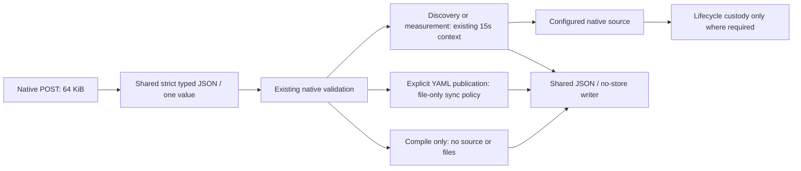

`testdata/http/native-json.json` pins 68 cases across the four POST routes before
and after adoption. Exact statuses, body bytes and JSON/cache/mux headers cover
valid admission, malformed/null/array/unknown/nested-invalid input, second values,
malformed tails, exact/overflow bodies, whitespace, ignored content type, empty
objects, numeric type refusal and method refusal. Tests assert zero source reads
for planning/publication/rejection, one injected failing read for valid execution,
and no files except successful explicit publication. Source errors remain 502;
no partial healthy result or custody file is substituted. The source fixture uses
a deterministic 503 response so frozen bytes do not depend on receipt clocks.
Positive execution, real custody clock/identity, registry/duplicate/reopen and
workflow behavior remain covered by existing affected suites, not by that fixture.

Explicit-window plan fixtures preserve exact output bytes without changing the
default planning clock. Hegel shared-JSON properties pass. No UI/SSE/Quint protocol
or running image changed; screenshots remain applicable. Final deployed-journey
acceptance remains open. Fixed exploration adoption below is now delivered.
Tail request decoding is next; do not buffer its SSE responses.


## Fixed exploration JSON adoption

`registerExploration` now uses shared strict typed decoding and JSON/no-store
writing for `/compare`, `/inventory`, `/discovery` and `/explore`. Comparison keeps
its 1 MiB request budget; the source-reading routes keep 16 KiB. All retain
`expected one JSON object`, existing validation and 400/502 mappings. Inventory,
service discovery and Explore still own their 15/30/55-second contexts. Comparison
still operates only on supplied summaries. Explore still freezes a process-local
result-page capability only after a successful source result; no snapshot or query
owner moved into the helper. Recipes and tail remain separate registrations.

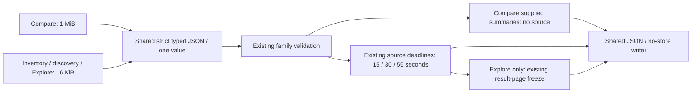

`testdata/http/exploration-json.json` freezes 68 before/after cases across these
four routes. It pins status, exact response bytes and selected headers for valid
comparison (including counts above 2^53), source admission/failure, malformed/null/
array/unknown/nested-invalid input, second values, malformed tails, whitespace,
exact/overflow budgets, ignored content type, empty objects, numeric type refusal
and method refusal. Injected transport counters prove comparison and rejected
requests make no source calls, and admitted source failures make one call with the
correct deadline. A deterministic 503 becomes the existing 502 response.

Positive source execution, result snapshots, late/changed reads, dependency
isolation and SSE behavior remain covered by existing affected tests. The frozen
source-failure fixtures do not claim positive live-data or snapshot coverage.
Hegel shared-JSON properties pass. No UI/SSE/Quint protocol or running image changed;
existing frames remain applicable and final deployed-journey acceptance stays open.
Next freeze/adopt tail request decoding only, preserving early-error headers,
slots, streaming headers, flush/deadline/disconnect and independent lifetime.
Capture/live/investigation/workbench/retention JSON owners remain queued.


## OpenAPI contract adoption

The user-approved [OpenAPI 3.1 contract and usage guide](API.md) is now the shared
HTTP reference, complementing this ownership/effect inventory. It covers all 58
Go operations, five Python-only /api operations and Python /health, with reflected
Go wire shapes, authored endpoint policy, request byte limits, schema-linked SSE
events and explicit browser/direct-Go differences. JSON Schema checks do not
replace semantic kernels or behavior tests.

CI regenerates the checked-in schemas/spec, refuses drift, checks operation coverage,
validates all 236 existing JSON wire cases (222 operation responses and 14 mux
refusals), and validates 56 admitted requests with negative controls. Actual tail
reset/gap bytes have a Go wire fixture plus event-schema checks. The separate
[API docs journey](journeys/API_DOCS.md) exercises the real Python docs/download
routes, filtering and desktop/mobile behavior without touching the running lab.

This direction pauses the queued tail/remaining-owner mechanical JSON adoptions.
Next broaden executed request/response coverage for saved/capture/retention owners
and add browser-proxy fixtures for the recorded limit/header/serialization gaps.
The spec records existing behavior rather than normalizing it. Final deployed
source/browser acceptance remains open; the lab image was not rebuilt in this cut.


## Observed and deployed API continuation

[API acceptance](API_ACCEPTANCE.md) adds actual capture/live-freeze/document and
optional native XTDB observations, schema-validates real proxy HTTP responses,
and records readonly/deployed browser checks. These complement frozen byte fixtures
and do not replace semantic/effect assertions. The document request envelope and
browser cancellation body are corrected in the spec. Non-JSON upstream HTTP errors
now return JSON 502 through GET/POST/pre-stream tail handling; valid JSON status/
body behavior and existing limit/header differences stay unchanged.

Query/packages are rebuilt with the source-bound CGO-disabled Go stage, optional
build-only CA trust and smaller toolchain image. The deployed docs/spec match the
checkout. The initial capture journey exposed a stale hidden-control gesture;
it now changes lookback through Explore and returns to Saved, preserving frozen
evidence. See VALIDATION.md for actual rerun outcomes and scope. Remaining C2
endpoint/branch coverage and policy decisions remain open, rather than assuming
that schema presence establishes full API acceptance.
